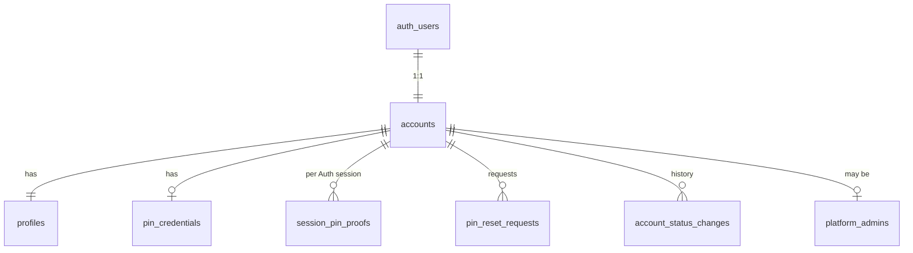
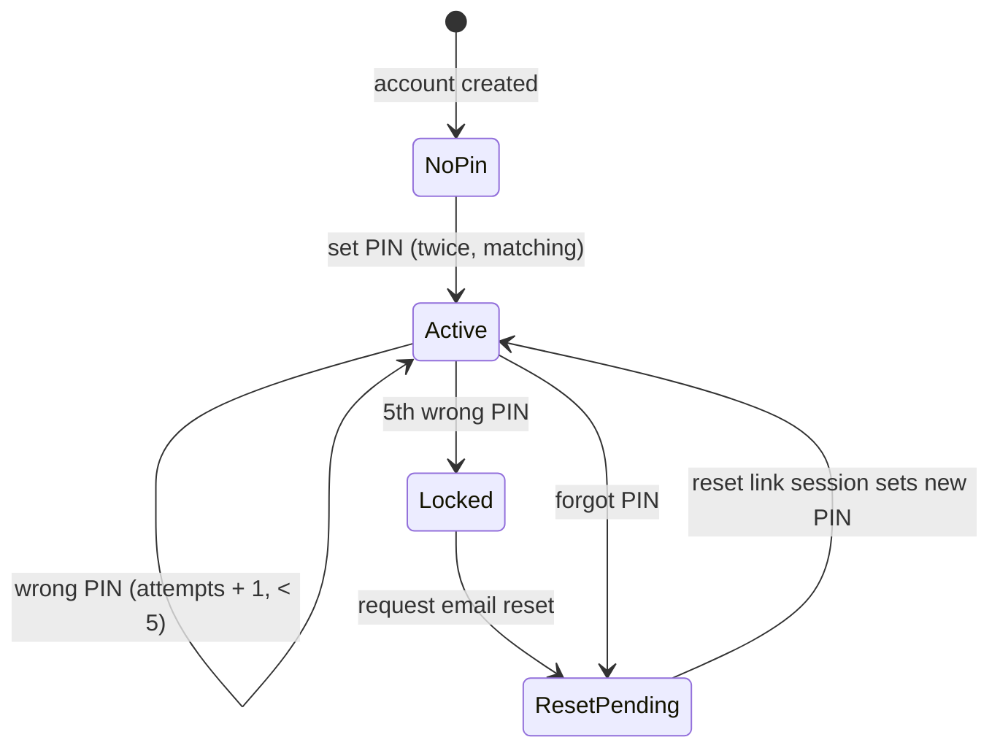

# Blueprint 01 — Accounts, sign-in and PIN

Status: **approved by owner 2026-10-08** (Q1: 15-minute inactivity PIN re-entry plus PIN for sensitive actions; Q2: 8 characters, Supabase's recommended minimum; Q3: first admin is the owner-named email, created by a one-time operation, never stored in Git). Contract: W-01, W-22, A-01, A-05, D-01, D-02, T-01, T-03.

Part A is for the owner: what this slice does, in plain language. Part B is the exact build spec that migrations, functions and tests are written from.

---

## Part A — What this slice does

### What's in it
1. **An account for everyone who signs up.** When someone creates a login, the system gives them an account and a permanent member code (UID) like `EW-48213`. The UID never changes.
2. **Sign-in = password, then PIN, every time.** After the password, the app asks for the 4-digit PIN. Until the PIN is entered, the person can't see or do anything except enter the PIN (or set one up, if they're new).
3. **Setting the PIN.** New users choose a 4-digit PIN and type it twice.
4. **The PIN unlocks sensitive actions for 5 minutes.** Entering the PIN opens a 5-minute window on that device only. Sensitive actions (bank account changes, access changes, adjustments…) work inside that window; after 5 minutes they ask for the PIN again. Retrying doesn't extend the window.
5. **Locking.** 5 wrong PINs in a row lock it. There is no automatic unlock: the person must use the email reset.
6. **Email reset.** "Forgot PIN" sends a single-use link to the account email. The link signs them in for the reset only; they set a new PIN. Every open 5-minute window on all their devices is closed.
7. **Devices.** People can see their signed-in devices and sign out one or all others. Signing out a device closes its PIN window too.
8. **Account status (platform admins only).** Elivate admins can set an account to active, restricted, suspended or deactivated, always with a reason, after entering their own PIN. Each change is recorded.
9. **Codes for everything.** The shared code generator is built now (`WDR-7K3M-9QP2`, `INV-…`, `WRQ-…`), so later slices just use it.

### Not in it (later slices or still open)
- Teams/offices, invitations and the onboarding wizard → Blueprint 02 (invitations, `INV` codes).
- NIN identity check: the provider is still undecided (U-02).
- Branded email templates. Supabase Auth emails already send through Cloudflare SMTP on the development project (switched 2026-10-08); external delivery is not yet confirmed by a real sign-up.
- The platform-admin app screens.

### Decisions I need from you
| # | Question | My recommendation |
|---|---|---|
| Q1 | How long can someone stay signed in before they need password + PIN again? Today a Supabase session can last indefinitely, so "PIN every sign-in" may rarely trigger. | **Ask for the PIN again after 15 minutes of inactivity** (password stays signed in for up to 7 days). Money app norm; the PIN is quick to type. |
| Q2 | Minimum password length (the contract doesn't say). | **8 characters**, plus Supabase's check that blocks known leaked passwords. |
| Q3 | How the first Elivate platform admin is created (there is no admin yet to create one). | **I run a one-time command against the database when you ask**, naming the email you choose. After that, admins add other admins in the app, with a reason. |

---

## Part B — Build spec

### B1. Layout
- Schemas: `identity` (accounts, profiles, PIN, sessions, admins, status), `audit` (security events), `refs` (public references), `api` (the only functions Edge Functions call; executable by `service_role` only). `identity`, `audit` and `refs` are never exposed through the Data API. `api` is listed in `config.toml` `[api] schemas` because the Edge Functions call it with `service.schema("api").rpc(...)`; every `api.*` function is revoked from `anon`/`authenticated`, so clients still never call Postgres directly.
- Edge Function `security` (one function, several routes) is the only transport. It verifies the JWT, takes `user_id` and `session_id` from the verified token (never from the body), computes the PIN HMAC with the secret `PIN_HMAC_SECRET`, and calls one `api.*` command.
- Every `api.*` function is `SECURITY DEFINER` with `search_path = ''`, revoked from `public/anon/authenticated`, granted to `service_role` only.

### B2. Data

| Table | Key columns | Rules |
|---|---|---|
| `identity.accounts` | `user_id` PK → `auth.users`, `uid` unique, `status` (`active`/`restricted`/`suspended`/`deactivated`), `created_at` | Created by trigger on `auth.users` insert. `uid` is immutable (trigger). Status is changed only by the status command. |
| `identity.profiles` | `user_id` PK, `display_name`, `first_name`, `last_name`, `phone`, `timezone`, `rank` | Self-editable later via a command; no identity fields here. |
| `identity.pin_credentials` | `user_id` PK, `pin_hash` (bcrypt over HMAC hex), `key_version`, `failed_attempts` 0–5, `locked_at`, `set_at` | No row = PIN not set. `failed_attempts` resets on success. `locked_at` set at 5; cleared only by reset. |
| `identity.session_pin_proofs` | `session_id` PK → `auth.sessions` (on delete cascade), `user_id`, `verified_at`, `last_activity_at` | One row per Auth session. Deleted on reset, sign-out, status change to suspended/deactivated. |
| `identity.pin_reset_requests` | `id`, `user_id`, `requested_at`, `expires_at` (+15 min), `consumed_at` | Pending request needed before a reset session may set a PIN. |
| `identity.platform_admins` | `user_id` PK, `granted_by`, `granted_at`, `grant_reason`, `revoked_at`, `revoked_by`, `revoke_reason` | Reasons mandatory. All admins have full access (U-09). |
| `identity.account_status_changes` | `id`, `user_id`, `from_status`, `to_status`, `reason`, `actor_user_id`, `idempotency_key`, `at` | Append-only. |
| `audit.security_events` | `id`, `actor_user_id`, `action`, `target_user_id`, `session_id`, `reason`, `safe_before`, `safe_after`, `request_id`, `at` | Append-only (trigger blocks update/delete). Never stores PIN, hash, token or email body. |
| `refs.issued` | `type` (3-letter), `code` unique per type, `issued_at` | Every issued code is kept, so nothing is reused. |

**UID:** `EW-` + random digits; 5 digits (10000–99999) until 70% of that space is issued, then 6, and so on. Collisions are retried. Existing UIDs never change.
**Operation reference:** `refs.issue(type)` → `<TYPE>-XXXX-XXXX`, 8 random Crockford Base32 characters (`0-9 A-Z` minus `I L O U`) from `gen_random_bytes`; retried on collision. Allowed types are exactly D-01's list (a check constraint).

### B3. States

Session gate, evaluated by `identity.session_gate(user_id, session_id)` for every protected command and read:
| Gate | Meaning | Allowed |
|---|---|---|
| `pin_setup_required` | No PIN yet | Set PIN, sign out |
| `pin_required` | PIN set, this session has no proof, or proof idle > Q1 timeout | Verify PIN, request reset, sign out |
| `pin_locked` | Locked | Request reset, sign out |
| `ready` | Proof present and active | Everything the person's authority allows |

`gate` only ever takes these four values. Step-up is not a gate value: `GET /security/state` returns `stepUpExpiresAt` (proof `verified_at` + 5 minutes, or null), and step-up commands fail with `step_up_required` when it has passed. A suspended or deactivated account is not a gate value either: every gated call fails with the error `account_blocked`.

The PIN proof is per Auth session. A new PIN entry replaces `verified_at` (opening a new 5-minute window); retries of a command never touch it. The window is anchored to `verified_at`, not to activity.

### B4. Commands (`api.*`) and routes (`security` function)

All routes live under the `security` function: `/functions/v1/security/...`. The admin routes are `/functions/v1/security/admin/...` (the same function, not a separate one).

Text inputs are validated at the Edge with the same rule as the database (`_shared/validate.ts`): length counted in characters after trimming spaces, like Postgres `length(btrim(value))`; reasons 3–500.

| Route | Command | Input | Checks | Result |
|---|---|---|---|---|
| `GET /security/state` | `api.security_state` | — | valid session | gate, attempts left, step-up expiry, UID |
| `POST /security/pin/set` | `api.set_pin` | `pin`, `pinConfirm` | gate `pin_setup_required`; `^[0-9]{4}$`; match | proof row created (gate → `ready`) |
| `POST /security/pin/verify` | `api.verify_pin` | `pin` | not locked; row lock on credential | ok → proof; wrong → `pin_incorrect` + `attemptsRemaining`; 5th → `pin_locked` |
| `POST /security/pin/reset/request` | `api.request_pin_reset` | — | valid password session; one request per 60 s (`rate_limited`) | creates request; Auth sends magic link to the account email (`redirectTo` allowlisted). If the email can't be sent, the Edge calls `api.cancel_pin_reset` (withdraws the request and its 60 s cooldown, audits `pin.reset_email_failed`) and answers `internal_error` (retryable) with `details.emailSent: false`, so an immediate retry works |
| `POST /security/pin/reset/complete` | `api.complete_pin_reset` | `pin`, `pinConfirm` | session `amr` includes `otp`/`magiclink` issued after the request; request pending, unexpired | new hash, unlock, consume request, **delete all proofs for user**, new proof for this session |
| `GET /security/sessions` | `api.list_sessions` | — | gate `ready` | id, created, last active, user agent, current flag (no IP shown) |
| `POST /security/sessions/revoke` | `api.revoke_sessions` | exactly one of `sessionId` or `allOthers: true` | gate `ready`; own sessions only | Auth sessions deleted; proofs cascade |
| `POST /security/admin/accounts/status` | `api.set_account_status` | `targetUid`, `status`, `reason`, `idempotencyKey` | actor platform admin; step-up; reason 3–500 chars; not self (`self_target_forbidden`) | change row + audit; suspended/deactivated → target's proofs deleted |
| `POST /security/admin/admins/grant` · `/security/admin/admins/revoke` | `api.grant_platform_admin` · `api.revoke_platform_admin` | `targetUid`, `reason`, `idempotencyKey` | actor admin; step-up; can't revoke last admin | row + audit |

PIN hashing: Edge computes `hex(HMAC-SHA256(PIN_HMAC_SECRET, pin))`; Postgres stores `crypt(hmac, gen_salt('bf', 10))` and compares with `crypt(hmac, pin_hash)`. The raw PIN never reaches Postgres, logs or responses. `key_version` allows rotating the secret.

Idempotency: admin commands take a client key; same key + same payload replays the stored result **after re-checking current authority**; same key + different payload → `idempotency_conflict`. PIN commands aren't replayable (each attempt counts).

### B5. Wire contract

Success: `{ "ok": true, "data": …, "requestId": "…" }`
Failure: `{ "ok": false, "error": { "code": "…", "message": "…", "retryable": false, "details": {…} }, "requestId": "…" }`

| Code | HTTP | When |
|---|---|---|
| `validation_error` | 400 | Bad input shape |
| `authentication_required` | 401 | Missing/invalid/expired JWT or revoked session |
| `pin_setup_required` | 403 | Gate says no PIN yet |
| `pin_required` | 403 | Gate needs the PIN |
| `pin_incorrect` | 403 | Wrong PIN; `details.attemptsRemaining` |
| `pin_locked` | 423 | Locked; reset needed |
| `step_up_required` | 403 | Needs a PIN within 5 minutes |
| `account_blocked` | 403 | Suspended/deactivated |
| `authorization_denied` | 403 | Not allowed |
| `self_target_forbidden` | 403 | An admin changing their own account status (the same code `org` uses; since migration `20261009000100`, previously `authorization_denied` with `reason: self_target`) |
| `not_found` | 404 | Target not found or not visible |
| `idempotency_conflict` | 409 | Same key, different payload |
| `conflict` | 409 | State changed (e.g. reset already used) |
| `rate_limited` | 429 | PIN reset requested again within 60 seconds |
| `internal_error` | 500 | Anything else (logged with `requestId`, redacted) |

Logs: `requestId`, route, status, code, latency. Never user or session IDs, PIN, HMAC, hash, JWT, email or IP.

### B6. Configuration
- `config.toml`: email confirmations on (done); minimum password length per Q2; sessions per Q1; `redirectTo` allowlist `https://app.elivatewallet.com`, `https://admin.elivatewallet.com`, local dev origin.
- Secrets: `PIN_HMAC_SECRET` (32 random bytes, hex). Listed in `.env.example` with an empty value.
- Remote (only when you approve the deploy): leaked-password protection on.

### B7. Tests (written first, must all pass in CI)
pgTAP:
1. Signup creates account + profile + UID matching `^EW-[0-9]{5,}$`; UID update rejected.
2. 1,000 generated refs match `^[A-Z]{3}-[0-9A-HJKMNP-TV-Z]{4}-[0-9A-HJKMNP-TV-Z]{4}$`, no duplicates; unknown type rejected.
3. Gate transitions: no PIN → `pin_setup_required`; set → `ready`; new session → `pin_required`; idle past timeout → `pin_required`.
4. Wrong PIN ×4 → attempts 1; correct → reset to 5 remaining; wrong ×5 → `pin_locked`; correct PIN while locked → still `pin_locked`.
5. Step-up valid at 4:59, invalid at 5:01; command retry does not move `verified_at`.
6. Reset: without request → denied; with request but password-only session → denied; with magic-link session → new PIN works, old doesn't, all other sessions' proofs gone; second use → `conflict`.
7. Session A's proof does not satisfy session B (same user).
8. Revoking a session removes its proof.
9. Status change: non-admin denied; admin without step-up → `step_up_required`; missing reason → `validation_error`; self-target → `self_target_forbidden`; replay same key → same result, no duplicate event; same key, different payload → `idempotency_conflict`; suspended target's proofs deleted and gate → `account_blocked`.
10. Last admin cannot be revoked; grant/revoke need reasons.
11. `anon`/`authenticated` cannot execute any `api.*` or read any `identity`/`audit`/`refs` table.
12. Audit rows can't be updated or deleted; no column contains PIN/HMAC values.

Deno:
13. Route input validation and the envelope; unknown fields rejected.
14. HMAC is deterministic per key, differs across keys; PIN never appears in log output.
15. `user_id`/`session_id` come only from the verified JWT; body values ignored.
