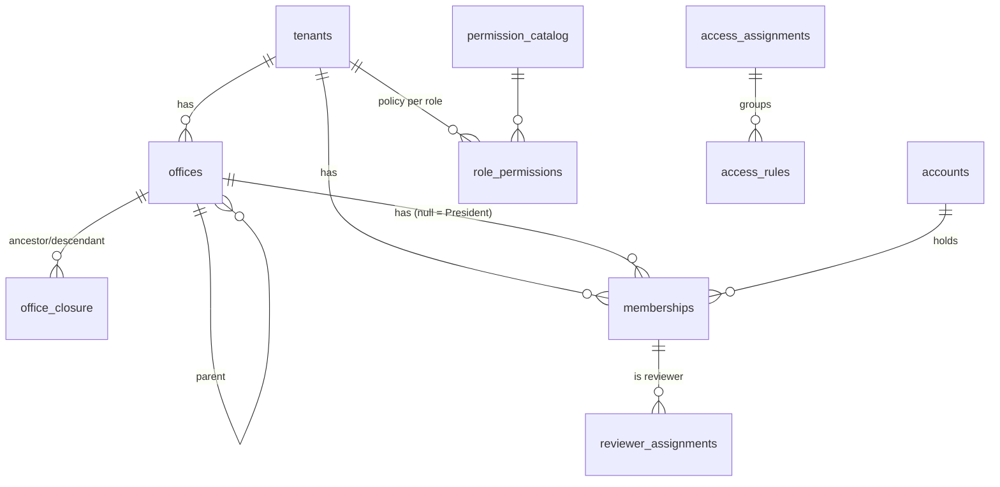

# Blueprint 02 — Networks, offices, memberships and access

Status: **draft for owner review (2026-10-08)**. Contract: D-01, D-02, A-01–A-05, W-05, W-06, D-10 (seat counting only, see "Not in it"), D-11 (audit log), T-01, T-04. Builds on Blueprint 01 (accounts, UID, PIN gate, step-up, references, idempotency).

Part A is for the owner: what this slice does, in plain language. Part B is the exact build spec that migrations, functions and tests are written from.

---

## Part A — What this slice does

### What's in it
1. **Networks.** A network (tenant) is one organization: its own people, offices and settings, fully separated from every other network. Until Paystack checkout is built, an Elivate admin creates a network and names its President (see Q1).
2. **Offices in three levels.** World Team → Director → Team Leader. Every office belongs to exactly one network and sits under the right kind of parent; loops are impossible. President Team Members create offices of every type, and every office gets a leader when it's created.
3. **Memberships.** A membership says "this person belongs to this office with this one role". A person can hold several (for example a Director in one office and a member somewhere else). One of them is their main (primary) membership in that network.
4. **Membership changes, each with a reason:** add, move (ends the old one and starts the new one), suspend, reactivate, end, and change an office's leader (the old leader's membership ends, the new leader's starts). History is kept; nothing is deleted, and no money record changes.
5. **Permissions.** Each network starts with the approved default permissions for the five roles (the A-03 table). A leader's permissions cover their office **and everything below it**. A President Team Member's cover the whole network.
6. **Network permission settings.** The President can switch configurable permissions on or off per role. Protected ones (like "view own wallet") can't be changed.
7. **Special access (grants and denies).** A leader with "manage access rules" can give or block a specific permission for a specific person, for the whole network, an office and everything below it, or one member. A deny always beats a grant, and a grant beats the role default. Grants can expire; denies stay until someone lifts them. A reason is required for each. You can only hand out access inside what you control yourself.
8. **Evidence reviewers.** The President picks the specific people who review payout evidence. That one list decides who sees the review queue and who can clear or reject. Nobody reviews their own operation.
9. **Workspace switching.** Someone with several memberships picks which one they're working in. The server checks that choice every time, and switching never adds permissions.
10. **Network audit log.** Every change above is recorded (who, what, when, why), and the President can read the log for their network.

### Not in it (later slices or still open)
- **Invitations and joining by link** → Blueprint 03 (`INV` codes, email through Cloudflare). This slice adds existing accounts to offices by their UID.
- **Seat limits per plan** → the subscription slice (W-19). Until then there is no member cap; the seat count rule is written into the data now so it can be enforced later.
- **Wallets** → the ledger slice. Creating a membership doesn't create a wallet yet.
- **Workspace requests** (W-04, `WRQ`) stay blocked on U-04.
- The onboarding wizard (needs the NIN provider, U-02).
- Billing Owner, network branding and settings (W-19, W-20).

### Decisions I need from you
| # | Question | My recommendation |
|---|---|---|
| Q1 | How does a network get created before Paystack checkout exists (U-03)? | **An Elivate admin creates it** in the admin app, naming the network and its first President by UID, with a reason and PIN. Paystack checkout replaces this for real customers later. |
| Q2 | Can offices skip a level, for example a Director office directly under the network or a Team Leader office under a World Team office? | **No. Strictly World Team → Director → Team Leader**, as the old backend did. Simple to read and report on. |
| Q3 | Where do ordinary Members sit? | **Only in Team Leader offices** (old backend rule). A Director who also wants members directly under them creates a Team Leader office for that. |
| Q4 | How many leaders per office? | **Exactly one leader per office.** World Team offices may also hold extra World Team Members who aren't the leader. Director and Team Leader offices have only their one leader in that role. |
| Q5 | Who can add or remove President Team Members? | **Only President Team Members, with reason and PIN.** The network must always keep at least one. |
| Q6 | Do move, suspend and end membership also need the PIN (they already need a reason)? | **Yes.** They change who can see and move money; the PIN is quick. Adding a membership doesn't need it. |

---

## Part B — Build spec

### B1. Layout
- New private schemas: `org` (networks, offices, closure, memberships), `authz` (catalog, role policies, access rules, reviewer assignments, confirmations, resolver). Same rules as slice 01: not exposed via the Data API, privileged functions `SECURITY DEFINER` with `search_path = ''`, executable by `service_role` only through `api.*`.
- New Edge Function `org` (one function, several routes), same envelope, JWT handling and logging rules as `security`. Every route first passes the slice 01 session gate (`ready`, or `step_up` where marked).
- Selected workspace: the client sends `X-Membership: <membership id>`. The server checks it is the actor's own active membership in an active network and office (A-02). It is context only and never a permission.

### B2. Data

| Table | Key columns | Rules |
|---|---|---|
| `org.tenants` | `id`, `name`, `short_name`, `status` (`active`/`suspended`/`deactivated`), `authz_version`, `created_by`, `created_at` | Status here is security status; commercial status is separate (D-10). |
| `org.offices` | `id`, `tenant_id`, `parent_office_id`, `office_type` (`world_team`/`director`/`team_leader`), `name`, `status` (`active`/`closed`) | Composite FK keeps parent in the same tenant. Parent type per Q2; only `world_team` has no parent. A leader membership is created in the same command. |
| `org.office_closure` | `tenant_id`, `ancestor_id`, `descendant_id`, `depth` | Includes self (depth 0). Maintained **incrementally** on office insert (hierarchy is fixed per Q2; offices aren't re-parented in this slice) under a per-tenant advisory lock. |
| `org.memberships` | `id`, `tenant_id`, `office_id` (null only for `president_team_member`), `user_id`, `role`, `is_leader`, `is_primary`, `status` (`active`/`suspended`/`ended`), `started_at`, `ended_at`, `ended_reason`, `replaced_by_id` | Role matches office type (Q3). Unique: one non-ended membership per (tenant, user, office, role); one primary per (tenant, user) among non-ended; one active leader per office (Q4). `ended_at` set iff `ended`. |
| `org.membership_events` | `id`, `tenant_id`, `membership_id`, `action`, `from_status`, `to_status`, `reason`, `actor_user_id`, `at` | Append-only. |
| `authz.permission_catalog` | `key`, `protected`, `grantable`, `scope` (`self`/`office`/`tenant`/`assignment`), `wallet_holder_baseline`, `can_target_own_wallet`, `step_up` | Exactly the 31 A-03 rows; immutable after seeding. |
| `authz.default_role_permissions` | `role`, `permission_key`, `allowed` | The A-03 matrix. |
| `authz.role_permissions` | `tenant_id`, `role`, `permission_key`, `allowed`, `updated_by`, `updated_at` | Seeded from defaults when the tenant is created, in the same transaction. Only non-protected rows editable. |
| `authz.access_assignments` | `id`, `tenant_id`, `subject_user_id`, `created_by`, `reason`, `created_at`, `revoked_at`, `revoked_by`, `revoke_reason` | Groups rules for listing and bulk revoke. |
| `authz.access_rules` | `id`, `assignment_id`, `permission_key`, `effect` (`allow`/`deny`), `scope_type` (`tenant`/`office_subtree`/`member`), `scope_office_id`, `scope_user_id`, `starts_at`, `expires_at`, `revoked_at` | One permission/effect/scope per row. Deny has no `expires_at`. Grantable permissions only. Validated **once at creation** against the creator's authority; revocation is a separate check on the revoker (fixes legacy bug c). |
| `authz.reviewer_assignments` | `id`, `tenant_id`, `membership_id`, `assigned_by`, `reason`, `assigned_at`, `ended_at`, `ended_by` | At most one active per membership. |
| `authz.action_confirmations` | `id`, `user_id`, `session_id`, `action`, `target_type`, `target_id`, `created_at`, `consumed_at` | For presidency transfer / tenant deactivation (A-05). Bound to action, target **and** type, and consumed atomically (fixes legacy bug d). Created in this slice; used by those commands later. |
| `audit.tenant_events` | `id`, `tenant_id`, `actor_user_id`, `action`, `target_type`, `target_id`, `reason`, `safe_before`, `safe_after`, `request_id`, `at` | Append-only (same trigger as `audit.security_events`). Source for the President's audit log. |

**Primary membership:** the first membership in a network is primary. When the primary ends or moves, the earliest other non-ended membership in that network becomes primary. If none is left, the person has none (ending everything is allowed; W-05).

**Seat count (stored, not enforced yet):** `org.billable_accounts(tenant_id)` counts distinct accounts with an active or suspended membership (D-10).

### B3. Resolver

`authz.decide(actor_user_id, session_id, permission_key, target)` → `{ allowed, reason, source, step_up }`, where `target` is one of: tenant, office, membership, or user-in-tenant. Order (A-01):

1. Session gate (slice 01). The account must be `active` (or `restricted` for non-money reads).
2. Resolve the target **from the database**: membership → office + user + tenant, office → tenant. A user-in-tenant target loads that user's active memberships in the tenant. Unknown or other-tenant targets → `not_found`.
3. Hard checks: tenant active, target office active, known permission, leader self-target guard (`can_target_own_wallet = false` and target user = actor → deny).
4. Actor's active memberships in the tenant whose office is in the target's ancestor chain (closure), or any President Team membership.
5. Self/baseline permissions: allowed only for the owner's own target (wallet rows activate in the ledger slice).
6. Explicit rules active now for actor + permission whose scope covers the target. `member` scope matches the **target user** however the target was given (fixes legacy bug b). Any deny → deny. Otherwise any allow → allow.
7. Role policy: `role_permissions` for the roles of the step-4 memberships. Office scope covers the subtree; President scope covers the tenant.
8. `review_financial_evidence` comes only from an active reviewer assignment, never from role policy or rules.
9. Default deny. Then step-up per catalog and A-05.

No caching in this slice: every call resolves live, so revocations take effect on the next request, including retries. `authz_version` is bumped on every membership/rule/policy change, ready for caching later.

Selected workspace narrowing (A-02): a leadership action from workspace W must target W's subtree, or be allowed by a matching explicit grant for that exact permission.

### B4. Commands (`api.*`) and routes (`org` function)

All writes take `idempotencyKey`; replay re-runs `authz.decide` before returning the stored result, for **every** command (fixes legacy bug a). `R` = reason required (3–500 chars). `S` = step-up required.

| Route | Command | Permission / actor | Notes |
|---|---|---|---|
| `POST /admin/tenants` | `api.create_tenant` | platform admin · R · S | `name`, `shortName`, `presidentUid`. Creates tenant, seeds role policy, President Team membership (primary). Q1 |
| `GET /org/workspaces` | `api.my_workspaces` | self | My non-ended memberships with tenant, office and role. |
| `GET /org/capabilities` | `api.my_capabilities` | self, in `X-Membership` | Permission keys allowed in that workspace (safe list, no internals). |
| `GET /org/offices` | `api.list_offices` | any active member of tenant | Visible offices (own subtree; President: all), filter by type/name/status, cursor paging. |
| `POST /org/offices` | `api.create_office` | President Team | `type`, `name`, `parentOfficeId`, `leaderUid`. Creates office + leader membership. |
| `PATCH /org/offices/{id}` | `api.rename_office` | `manage_members` over office | Name only. |
| `POST /org/offices/{id}/leader` | `api.change_office_leader` | `manage_members` over office · R · S | Replacement semantics (W-05). |
| `GET /org/members` | `api.list_members` | `manage_members` or `view_managed_wallets` over office | Filter by office (subtree), role, status; cursor paging. |
| `POST /org/memberships` | `api.add_membership` | `manage_members` over target office | `userUid`, `officeId`, `role`. Not leader roles (use leader change); not President (Q5). |
| `POST /org/memberships/{id}/move` | `api.move_membership` | `move_membership` over both offices · R · S | Ends old, creates new, primary carried over. |
| `POST /org/memberships/{id}/suspend` · `/reactivate` | `api.set_membership_status` | `suspend_membership` · R · S | Not the network's last active President Team membership. |
| `POST /org/memberships/{id}/end` | `api.end_membership` | `end_membership` · R · S | Same last-President guard. Leaders: use leader change. |
| `POST /org/presidents` · `DELETE` | `api.add_president` · `api.remove_president` | President Team · R · S | Q5; keeps ≥ 1. |
| `GET /org/role-permissions` | `api.list_role_permissions` | President Team | Matrix with protected flags. |
| `PUT /org/role-permissions` | `api.set_role_permission` | `manage_role_permissions` · R · S | Non-protected rows only. |
| `GET /org/access` | `api.list_access_assignments` | `manage_access_rules` | Subject, permissions, effect, scope, start/expiry, created by, reason, revoked (W-06 field set). |
| `POST /org/access` | `api.create_access_assignment` | `manage_access_rules` · R · S | `subjectUid`, `rules[]`. Subject must be active in tenant. Each rule's scope ⊆ actor's effective scope for `manage_access_rules`. Grantable permissions only. |
| `POST /org/access/{id}/revoke` | `api.revoke_access_assignment` | `manage_access_rules` covering its scope · R · S | Bulk revokes all rules in it. |
| `GET /org/reviewers` · `POST` · `DELETE` | `api.list_reviewers` · `api.assign_reviewer` · `api.end_reviewer` | President Team · R · S on writes | Specific active memberships only. |
| `GET /org/audit` | `api.tenant_audit_log` | President Team | Read-only, cursor paging, safe fields only. |

### B5. Wire contract
Same envelope and codes as Blueprint 01 B5. New codes:

| Code | HTTP | When |
|---|---|---|
| `workspace_invalid` | 403 | `X-Membership` missing, not yours, or not active |
| `hierarchy_invalid` | 422 | Wrong parent type, cross-tenant parent, closed parent |
| `role_office_mismatch` | 422 | Role doesn't fit the office type (Q3) |
| `membership_exists` | 409 | Same person/office/role already non-ended |
| `last_president` | 409 | Would leave no active President Team Member |
| `scope_exceeds_authority` | 403 | Access rule beyond your own scope |
| `permission_not_grantable` | 422 | Protected or non-grantable permission |
| `self_target_forbidden` | 403 | Leadership action on your own wallet/membership |

### B6. Tests (written first, must all pass in CI)
pgTAP:
1. Office levels: valid chain works; wrong parent type, cross-tenant parent and parentless non-World-Team are rejected. Closure rows correct after inserts; concurrent inserts in one tenant don't corrupt closure.
2. Role/office matching (Q3); one leader per office (Q4); one primary per tenant; unique non-ended membership.
3. Primary handover on end/move; ending all memberships leaves account (and later wallet) intact.
4. Move: old `ended` with reason, new `active`, history row for both; financial provenance untouched (asserted again in ledger slice).
5. Leader change replaces leadership; the outgoing person's other memberships are untouched.
6. Last President Team member can't be suspended, ended or removed.
7. Tenant creation seeds exactly the A-03 matrix (31 × 5); protected rows can't be edited; non-protected edit changes decisions immediately.
8. Resolver matrix: each A-03 office permission for each role at own office, descendant office, sibling office and other tenant (allow/allow/deny/deny); President allowed tenant-wide; nothing across tenants.
9. Precedence: deny > grant > role allow, including a `member`-scope deny when the target is given as user-in-tenant; expired grant and revoked assignment stop working on the next call and on replay.
10. Access rule outside creator's scope → `scope_exceeds_authority`; protected permission → `permission_not_grantable`; inactive subject rejected; revocation works even after the creator lost scope.
11. Evidence review only via assignment; President without assignment can't review; self-review denied.
12. TL/Director with `manage_members` can't move/suspend/end (W-05 acceptance).
13. Every R command without reason → `validation_error`; every S command without step-up → `step_up_required`.
14. Replay after losing authority → `authorization_denied`; same key different payload → `idempotency_conflict`.
15. `anon`/`authenticated` can't execute `api.*` or read `org`/`authz` tables; `audit.tenant_events` append-only.
16. Seat count counts distinct accounts with active/suspended memberships; second membership doesn't add a seat.

Deno:
17. `org` route validation, envelope, unknown fields rejected; `X-Membership` validated; actor only from JWT.
