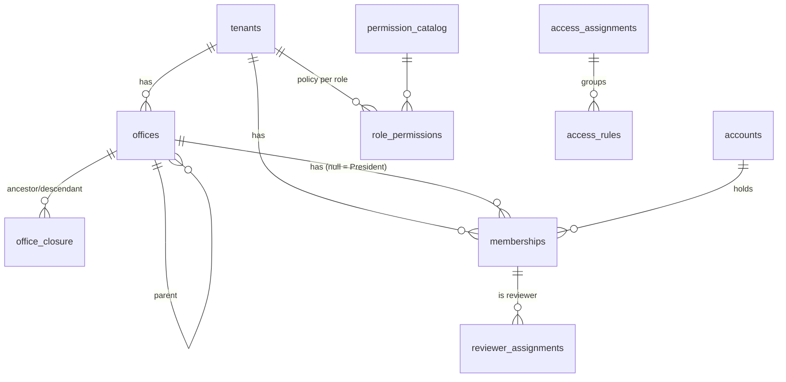

# Blueprint 02 — Networks, offices, memberships and access

Status: **approved by owner 2026-10-08** (Q1–Q6 answered the same day; recorded below and in W-05). Contract: D-01, D-02, A-01–A-05, W-05, W-06, D-10 (seat counting only, see "Not in it"), D-11 (audit log), T-01, T-04. Builds on Blueprint 01 (accounts, UID, PIN gate, step-up, references, idempotency).

Part A is for the owner: what this slice does, in plain language. Part B is the exact build spec that migrations, functions and tests are written from.

---

## Part A — What this slice does

### What's in it
1. **Networks.** A network (tenant) is one organization: its own people, offices and settings, fully separated from every other network. A signed-in person starts their own network and becomes its first President Team Member. The network waits as "awaiting payment" until the plan is paid; the plan choice and Paystack payment are built in the billing slice. Until then, an Elivate admin can activate a network (for development and the pilot).
2. **Offices.** Three kinds, from highest to lowest: World Team, Director, Team Leader. An office can sit at the top of the network or under any higher kind of office, so a Team Leader office can exist on its own and later be placed under a new World Team or Director office. Loops are impossible. President Team Members create and re-place offices, and every office gets at least one leader when it's created.
3. **Memberships.** A membership says "this person belongs to this office with this one role". Members can sit in any office. A person can hold several memberships (for example a Director in one office and a member somewhere else). One of them is their main (primary) membership in that network.
4. **Membership changes, each with a reason and PIN:** move (ends the old one and starts the new one), suspend, reactivate and end. Adding a membership needs neither. Offices can have several leaders: leaders are added and removed, or one is replaced by another (the outgoing leader's membership ends, the incoming leader's starts). An office always keeps at least one leader. History is kept; nothing is deleted, and no money record changes.
5. **Permissions.** Each network starts with the approved default permissions for the five roles (the A-03 table). A leader's permissions cover their office **and everything below it**. A President Team Member's cover the whole network.
6. **Network permission settings.** The President can switch configurable permissions on or off per role. Protected ones (like "view own wallet") can't be changed.
7. **Special access (grants and denies).** A leader with "manage access rules" can give or block a specific permission for a specific person, for the whole network, an office and everything below it, or one member. A deny always beats a grant, and a grant beats the role default. Grants can expire; denies stay until someone lifts them. A reason is required for each. You can only hand out access inside what you control yourself.
8. **Evidence reviewers.** The President picks the specific people who review payout evidence. That one list decides who sees the review queue and who can clear or reject. Nobody reviews their own operation.
9. **Workspace switching.** Someone with several memberships picks which one they're working in. The server checks that choice every time, and switching never adds permissions.
10. **Network audit log.** Every change above is recorded (who, what, when, why), and the President can read the log for their network.

### Not in it (later slices or still open)
- **Invitations and joining by link** → Blueprint 03 (`INV` codes, email through Cloudflare). This slice adds existing accounts to offices by their UID.
- **Seat limits per plan** → the subscription slice (W-19). Until then there is no member cap; the seat count rule is written into the data now so it can be enforced later.
- **Wallets** → the ledger slice. Creating a membership doesn't create a wallet yet.
- **Workspace requests** (W-04, `WRQ`) stay blocked on U-04.
- The onboarding wizard (needs the NIN provider, U-02).
- Billing Owner, network branding and settings (W-19, W-20).

### Owner decisions (2026-10-08)
| # | Question | Decision |
|---|---|---|
| Q1 | How is a network created? | **The President Team Member creates it themselves, choosing a plan and paying during setup.** This slice builds the self-service creation (network starts `pending_payment`); plan choice and Paystack activation come in the billing slice. Until then an Elivate admin can activate a network, with a reason and PIN. |
| Q2 | Fixed office levels? | **No fixed chain.** An office's parent must be a higher kind (World Team > Director > Team Leader) or none. A Team Leader office can come first and later be placed under a new World Team or Director office. |
| Q3 | Where do ordinary Members sit? | **In any office.** |
| Q4 | How many leaders per office? | **Several.** Every membership holding the office's leader role (World Team Member, Director or Team Leader matching the office kind) is a leader. At least one at all times. |
| Q5 | Who adds or removes President Team Members? | **Only President Team Members, with reason and PIN;** at least one always remains. |
| Q6 | PIN for move, suspend and end membership? | **Yes**, in addition to the reason. |

---

## Part B — Build spec

### B1. Layout
- New private schemas: `org` (networks, offices, closure, memberships), `authz` (catalog, role policies, access rules, reviewer assignments, confirmations, resolver). Same rules as slice 01: not exposed via the Data API, privileged functions `SECURITY DEFINER` with `search_path = ''`, executable by `service_role` only through `api.*`.
- New Edge Function `org` (one function, several routes), same envelope, JWT handling and logging rules as `security`. Every route first passes the slice 01 session gate (`ready`, plus step-up where marked S). Routes live under `/functions/v1/org/...`; the admin route is `/functions/v1/org/admin/...` (the same function).
- Selected workspace: the client sends `X-Membership: <membership id>`. The server (`authz.require_workspace`) checks it is the actor's own active membership in an active office (A-02). It is context only and never a permission. As built, a membership in a network still awaiting payment (`pending_payment`) is accepted as a workspace so the founder can select it; every organizational read and change then requires an active network and fails with `network_not_active`. A-02's wording ("active tenant") versus this founder case is an open question for the owner; the code is unchanged until it is answered.

### B2. Data

| Table | Key columns | Rules |
|---|---|---|
| `org.tenants` | `id`, `name`, `short_name`, `status` (`pending_payment`/`active`/`suspended`/`deactivated`), `authz_version`, `created_by`, `created_at`, `activated_at`, `activated_by`, `activation_source` (`admin`/`payment`) | Status here is security/lifecycle status; commercial status is separate (D-10). While `pending_payment` only the founder sees it and no offices or memberships can be added. One `pending_payment` network per founder at a time. |
| `org.offices` | `id`, `tenant_id`, `parent_office_id`, `office_type` (`world_team`/`director`/`team_leader`), `name`, `status` (`active`/`closed`) | Composite FK keeps parent in the same tenant. Parent null, or of a strictly higher kind (Q2); never itself or a descendant. At least one leader membership is created in the same command. |
| `org.office_closure` | `tenant_id`, `ancestor_id`, `descendant_id`, `depth` | Includes self (depth 0). Maintained **incrementally** under a per-tenant advisory lock: insert adds the new office's rows; re-placing an office deletes the links between its subtree and its old ancestors and adds links to the new ones in the same transaction. |
| `org.office_moves` | `id`, `tenant_id`, `office_id`, `from_parent_id`, `to_parent_id`, `reason`, `actor_user_id`, `at` | Append-only history of re-placements. |
| `org.memberships` | `id`, `tenant_id`, `office_id` (null only for `president_team_member`), `user_id`, `role`, `is_primary`, `status` (`active`/`suspended`/`ended`), `started_at`, `ended_at`, `ended_reason`, `replaced_by_id` | `member` fits any office; `world_team_member`/`director`/`team_leader` only the matching office kind, and holding it makes the person a leader of that office (Q3, Q4). Unique: one non-ended membership per (tenant, user, office, role); one primary per (tenant, user) among non-ended. An active office keeps ≥ 1 active leader. `ended_at` set iff `ended`. |
| `org.membership_events` | `id`, `tenant_id`, `membership_id`, `action`, `from_status`, `to_status`, `reason`, `actor_user_id`, `at` | Append-only. |
| `authz.permission_catalog` | `key`, `protected`, `grantable`, `scope` (`self`/`office`/`tenant`/`assignment`), `wallet_holder_baseline`, `can_target_own_wallet` | Exactly the 31 A-03 rows; immutable after seeding. |
| `authz.default_role_permissions` | `role`, `permission_key`, `allowed` | The A-03 matrix. |
| `authz.role_permissions` | `tenant_id`, `role`, `permission_key`, `allowed`, `updated_by`, `updated_at` | Seeded from defaults when the tenant is created, in the same transaction. Only non-protected rows editable. |
| `authz.access_assignments` | `id`, `tenant_id`, `subject_user_id`, `created_by`, `reason`, `created_at`, `revoked_at`, `revoked_by`, `revoke_reason` | Groups rules for listing and bulk revoke. |
| `authz.access_rules` | `id`, `assignment_id`, `permission_key`, `effect` (`allow`/`deny`), `scope_type` (`tenant`/`office_subtree`/`member`), `scope_office_id`, `scope_user_id`, `starts_at`, `expires_at`, `revoked_at` | One permission/effect/scope per row. Deny has no `expires_at`. Grantable permissions only. Validated **once at creation** against the creator's authority; revocation is a separate check on the revoker (fixes legacy bug c). |
| `authz.reviewer_assignments` | `id`, `tenant_id`, `membership_id`, `assigned_by`, `reason`, `assigned_at`, `ended_at`, `ended_by` | At most one active per membership. |
| `authz.action_confirmations` | `id`, `user_id`, `session_id`, `action`, `target_type`, `target_id`, `created_at`, `consumed_at` | For presidency transfer / tenant deactivation (A-05). Bound to action, target **and** type, and consumed atomically (fixes legacy bug d). Created in this slice; used by those commands later. |
| `audit.tenant_events` | `id`, `tenant_id`, `actor_user_id`, `action`, `target_type`, `target_id`, `reason`, `safe_before`, `safe_after`, `request_id`, `at` | Append-only (same trigger as `audit.security_events`). Source for the President's audit log. |

**Primary membership:** the first membership in a network is primary. When the primary ends or moves, the earliest other non-ended membership in that network becomes primary. If none is left, the person has none (ending everything is allowed; W-05).

**Seat count (stored, not enforced yet):** `org.billable_accounts(tenant_id)` counts distinct accounts with an active or suspended membership (D-10).

### B3. Resolver

`authz.decide(actor_user_id, session_id, permission_key, target)` → `{ allowed, reason, source, step_up }`, where `target` is one of: tenant, office, membership, or user-in-tenant. Order (A-01):

1. Session gate (slice 01). The account must be `active` (or `restricted` for non-money reads).
2. Resolve the target **from the database**: membership → office + user + tenant, office → tenant. A user-in-tenant target loads that user's active memberships in the tenant. Unknown or other-tenant targets → `not_found`.
3. Hard checks: tenant active, target office active, known permission, leader self-target guard (`can_target_own_wallet = false` and target user = actor → deny).
4. Actor's active memberships in the tenant whose office is in the target's ancestor chain (closure), or any President Team membership.
5. Self/baseline permissions: allowed only for the owner's own target (wallet rows activate in the ledger slice).
6. Explicit rules active now for actor + permission whose scope covers the target. `member` scope matches the **target user** however the target was given (fixes legacy bug b). Any deny → deny. Otherwise any allow → allow.
7. Role policy: `role_permissions` for the roles of the step-4 memberships. Office scope covers the subtree; President scope covers the tenant.
8. `review_financial_evidence` comes only from an active reviewer assignment, never from role policy or rules.
9. Default deny. Step-up is enforced by each command (`S` in B4), per A-05.

No caching in this slice: every call resolves live, so revocations take effect on the next request, including retries. `authz_version` is bumped on every membership/rule/policy change, ready for caching later.

Selected workspace narrowing (A-02): a leadership action from workspace W must target W's subtree, or be allowed by a matching explicit grant for that exact permission. Self-service rows are narrowed the same way: a person's own-wallet actions come from a workspace whose role allows them, so the President workspace never shows them (P-03). Reviewer assignments count only within the reviewer's own office subtree (President Team reviewers: the whole network).

Lock order for membership changes: people (sorted) → office tree → tenant/office rows (`FOR NO KEY UPDATE`) → membership rows.

### B4. Commands (`api.*`) and routes (`org` function)

All writes take `idempotencyKey`; replay re-runs `authz.decide` before returning the stored result, for **every** command (fixes legacy bug a). `R` = reason required (3–500 chars). `S` = step-up required. Names are 2–100 characters and short names 1–30; the Edge checks text the same way as the database (characters after trimming spaces).

Transport notes:
- Path ids must be UUIDs. A non-UUID id doesn't match any route, so it returns `404 not_found` (not `validation_error`); clients should treat it as a bad link, not a missing record.
- `DELETE /org/presidents/{id}` and `DELETE /org/reviewers/{id}` take a JSON body (`reason`, `idempotencyKey`). That is valid HTTP, but some proxies and clients drop DELETE bodies; the server-side frontend uses `fetch`, which keeps them. Future native clients must send the body too.
- No route returns the signed-in person's own profile (name) yet; `GET /security/state` returns only the UID. The W-22 profile route is a later slice.

| Route | Command | Permission / actor | Notes |
|---|---|---|---|
| `POST /org/networks` | `api.start_network` | any account at gate `ready` | `name`, `shortName`. Creates tenant `pending_payment`, seeds role policy, founder's President Team membership (primary). Q1 |
| `POST /org/admin/tenants/{id}/activate` | `api.activate_tenant` | platform admin · R · S | `pending_payment` → `active` (`activation_source = admin`). The billing slice adds the payment path. |
| `GET /org/workspaces` | `api.my_workspaces` | self | My non-ended memberships with tenant, office and role. |
| `GET /org/capabilities` | `api.my_capabilities` | self, in `X-Membership` | Permission keys allowed in that workspace (safe list, no internals). |
| `GET /org/offices` | `api.list_offices` | any active member of tenant | Visible offices (own subtree; President: all), filter by type/name/status, cursor paging. `memberCount` = distinct people with an active membership anywhere in the office's subtree (owner decision 53, 2026-10-08); `leaderCount` = the office's own active leaders. |
| `POST /org/offices` | `api.create_office` | President Team | `type`, `name`, `parentOfficeId?`, `leaderUids[]` (≥ 1). Creates office + leader memberships. |
| `PATCH /org/offices/{id}` | `api.rename_office` | `manage_members` over office | Name only. |
| `POST /org/offices/{id}/place` | `api.place_office` | President Team · R · S | `parentOfficeId` or null. Moves the office and its whole subtree (Q2). Money provenance is untouched; subtree totals follow the current tree. |
| `POST /org/offices/{id}/leaders` | `api.add_office_leader` | `manage_members` over office, and the office strictly below the actor's own office (President Team: any office) · R · S | `leaderUid`. Adds a leader membership. A leader cannot add a co-leader to their own office (owner decision 1, 2026-10-08). |
| `POST /org/offices/{id}/leaders/replace` | `api.replace_office_leader` | `manage_members` over office, and the office strictly below the actor's own office (President Team: any office) · R · S | `outgoingMembershipId`, `incomingUid`. Outgoing leader's membership ends, incoming starts (W-05). |
| `GET /org/members` | `api.list_members` | `manage_members` or `view_managed_wallets` over office | Filter by office (subtree), role, status; cursor paging. |
| `POST /org/memberships` | `api.add_membership` | `manage_members` over target office | `memberUid`, `officeId`. Role `member` only (leaders via the leader routes, Presidents via Q5). |
| `POST /org/memberships/{id}/move` | `api.move_membership` | `move_membership` over both offices · R · S | Ends old, creates new, primary carried over. |
| `POST /org/memberships/{id}/suspend` · `/reactivate` | `api.set_membership_status` | `suspend_membership` · R · S | Not the network's last active President Team membership. |
| `POST /org/memberships/{id}/end` | `api.end_membership` | `end_membership` · R · S | Same last-President guard; ending an office's last active leader is refused (`last_leader`), use replace. |
| `POST /org/presidents` · `DELETE /org/presidents/{membershipId}` | `api.add_president` · `api.remove_president` | President Team · R · S | Q5; keeps ≥ 1. |
| `GET /org/role-permissions` | `api.list_role_permissions` | President Team | Matrix with protected flags. |
| `PUT /org/role-permissions` | `api.set_role_permission` | `manage_role_permissions` · R · S | Non-protected rows only. |
| `GET /org/access` | `api.list_access_assignments` | `manage_access_rules` | Subject, permissions, effect, scope, start/expiry, created by, reason, revoked (W-06 field set). |
| `POST /org/access` | `api.create_access_assignment` | `manage_access_rules` · R · S | `subjectUid`, `rules[]`. Subject must be active in tenant. Each rule's scope ⊆ actor's effective scope for `manage_access_rules`. Grantable permissions only. |
| `POST /org/access/{id}/revoke` | `api.revoke_access_assignment` | `manage_access_rules` covering its scope · R · S | Bulk revokes all rules in it. |
| `GET /org/reviewers` · `POST` · `DELETE /org/reviewers/{assignmentId}` | `api.list_reviewers` · `api.assign_reviewer` · `api.end_reviewer` | President Team · R · S on writes | Specific active memberships only. |
| `GET /org/audit` | `api.tenant_audit_log` | President Team | Read-only, cursor paging, safe fields only. |

### B5. Wire contract
Same envelope and codes as Blueprint 01 B5. New codes:

| Code | HTTP | When |
|---|---|---|
| `workspace_invalid` | 403 | `X-Membership` missing, not yours, or not active |
| `hierarchy_invalid` | 422 | Wrong parent type, cross-tenant parent, closed parent |
| `role_office_mismatch` | 422 | Role doesn't fit the office type (Q3) |
| `membership_exists` | 409 | Same person/office/role already non-ended |
| `last_president` | 409 | Would leave no active President Team Member |
| `last_leader` | 409 | Would leave an active office with no active leader |
| `network_not_active` | 409 | Network is `pending_payment`, suspended or deactivated |
| `scope_exceeds_authority` | 403 | Access rule beyond your own scope |
| `permission_not_grantable` | 422 | Protected or non-grantable permission |
| `self_target_forbidden` | 403 | Leadership action on your own wallet/membership (also used by `security` for an admin's own account status) |

### B6. Tests (written first, must all pass in CI)
pgTAP:
1. Offices: any kind at the top works; parent of equal or lower kind, cross-tenant parent, and placing under itself or a descendant are rejected. Closure rows correct after inserts and after re-placing a subtree (insert a World Team above an existing Team Leader office; its members become covered by the World Team's leaders). Concurrent writes in one tenant don't corrupt closure.
2. Members in any office kind; leader roles only in matching kind (Q3); several leaders per office, last one can't be ended or moved (Q4); one primary per tenant; unique non-ended membership.
2a. `start_network` creates a `pending_payment` network the founder alone sees; offices and memberships are refused until active; a second pending network for the same founder is refused; admin activation needs reason + step-up.
3. Primary handover on end/move; ending all memberships leaves account (and later wallet) intact.
4. Move: old `ended` with reason, new `active`, history row for both; financial provenance untouched (asserted again in ledger slice).
5. Leader replace ends the outgoing leadership and starts the incoming; the outgoing person's other memberships are untouched.
6. Last President Team member can't be suspended, ended or removed.
7. Tenant creation seeds exactly the A-03 matrix (31 × 5); protected rows can't be edited; non-protected edit changes decisions immediately.
8. Resolver matrix: each A-03 office permission for each role at own office, descendant office, sibling office and other tenant (allow/allow/deny/deny); President allowed tenant-wide; nothing across tenants.
9. Precedence: deny > grant > role allow, including a `member`-scope deny when the target is given as user-in-tenant; expired grant and revoked assignment stop working on the next call and on replay.
10. Access rule outside creator's scope → `scope_exceeds_authority`; protected permission → `permission_not_grantable`; inactive subject rejected; revocation works even after the creator lost scope.
11. Evidence review only via assignment; President without assignment can't review; self-review denied.
12. TL/Director with `manage_members` can't move/suspend/end (W-05 acceptance).
13. Every R command without reason → `validation_error`; every S command without step-up → `step_up_required`.
14. Replay after losing authority → `authorization_denied`; same key different payload → `idempotency_conflict`.
15. `anon`/`authenticated` can't execute `api.*` or read `org`/`authz` tables; `audit.tenant_events` append-only.
16. Seat count counts distinct accounts with active/suspended memberships; second membership doesn't add a seat.

Deno:
17. `org` route validation, envelope, unknown fields rejected; `X-Membership` validated; actor only from JWT.
