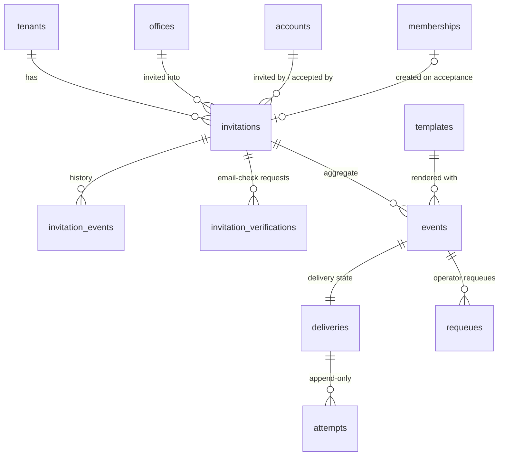
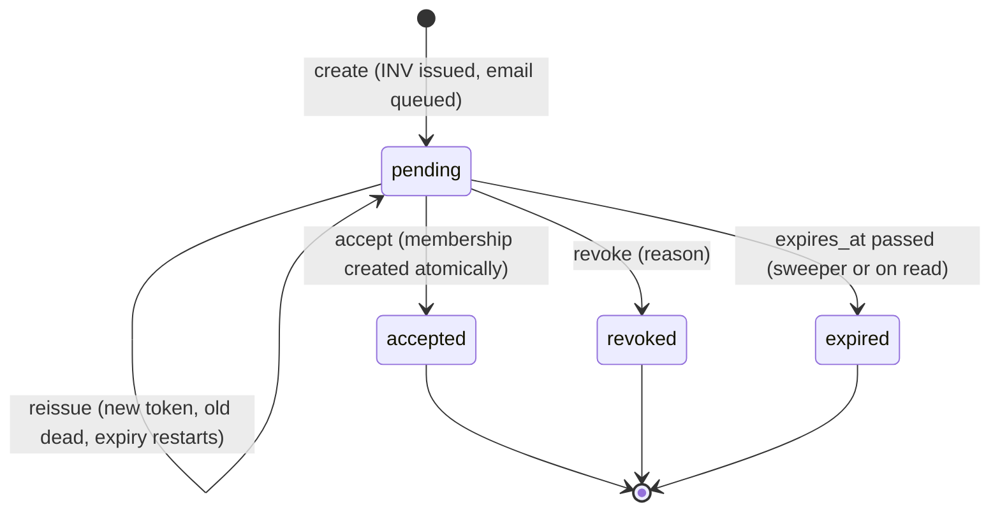

# Blueprint 03 — Invitations and email delivery

Status: **approved by owner 2026-10-08** (decisions table below). Contract: W-02, W-03, W-21 (communications), T-03, D-01 (`INV`), D-02 (invitation states), A-01–A-05, W-05 (reasons, step-up), D-10 (seat rule, enforced later), T-01, T-04, U-11 (open parts surfaced, not decided). Builds on Blueprint 01 (accounts, UID, PIN gate, step-up, `refs.issue`, `identity.replay`/`identity.store_result`) and Blueprint 02 (networks, offices, memberships, `authz.decide`/`authz.require`, `org.require_writer`, `org.create_membership`, `audit.record_tenant`, lock order). Track A; migrations reserved `2026100901xxxx`.

Part A is for the owner: what this slice does, in plain language. Part B is the exact build spec that migrations, functions and tests are written from.

---

## Part A — What this slice does

### What's in it
1. **Invite someone by email.** A leader picks an office, a role and the person's email. The system creates an invitation with a code like `INV-7K3M-9QP2` and emails a private join link. Only a fingerprint (digest) of the link's secret is stored, never the link itself.
2. **Who may invite whom.** Every leader can invite members into the offices they lead and below. Leader roles can only be given **below** your own level, never as a peer: a Team Leader can't create another Team Leader (that was a bug in the old system). Inviting a leader needs a reason and your PIN, like adding a leader today. See Q1.
3. **Joining.** The link opens a page that shows the email the invitation was sent to (greyed out, not editable). The person proves they own that email (Supabase sends them a sign-in email), sets a password if they're new, and joins. Joining creates their membership in the same step, with the exact office and role in the invitation, nothing else. If they already have an account they just sign in.
4. **Links expire and work once.** A link stops working after it is used, revoked, replaced or expired (Q2). Expired and revoked invitations stay in history; nothing is deleted.
5. **Resend, revoke, list.** Leaders see the invitations for their offices with status (pending, accepted, expired, revoked) and email status (waiting, sent, failed). "Resend" makes a fresh link and kills the old one (Q3). "Revoke" cancels it, with a reason (Q9).
6. **Reliable email.** Emails are written to a durable queue (the "outbox") in the same database step as the invitation, so an invitation never exists without its email queued, and a failed email never undoes the invitation. A background worker sends them through **Cloudflare Email Sending**, retries with growing waits, and parks emails that keep failing for an Elivate admin to retry. "Sent" means Cloudflare accepted it, not that it reached the inbox.
7. **One email per event.** Sign-in, email-check and PIN-reset emails keep coming from Supabase (already connected to Cloudflare). The invitation email comes from the app. The two never send the same thing twice.
8. **Ready for the next slices.** Wallet creation (Blueprint 04) and payout-account alerts (Blueprint 05) plug in through hooks defined here.

### Not in it (later slices or still open)
- Wallet creation itself (Blueprint 04 fills the hook defined here).
- Seat limits per plan (subscription slice; a hook is reserved, D-10 rule unchanged).
- Other notification emails (income, withdrawals, security alerts…) and the in-app bell: the event catalogue, recipient and consent rules are still open (**U-11**). This slice builds only the invitation email and the delivery machinery they will reuse.
- QR invitations (future convenience, W-03).
- Inviting someone straight into the President Team (Q1 recommends no; Presidents are added by UID, Blueprint 02 Q5).
- The onboarding wizard after joining (NIN provider still open, U-02).
- Branded per-network email designs (only the approved Root email layout, P-06).

### Owner decisions (2026-10-08)
| # | Question | Owner decision |
|---|---|---|
| Q1 | Who may invite which roles? | **B.** Members by any `invite_members` holder within scope; leader roles only into offices strictly **below** the inviter's own office (President Team: any office), with reason + PIN; President Team Member never by invitation. The same "strictly below" rule now also governs the slice 02 add/replace-leader commands (tidy-up track). |
| Q2 | Link lifetime | **7 days.** |
| Q3 | Resend policy | **B.** Fresh link, old link dies immediately, expiry restarts; max 5 reissues per invitation, 1 per minute; expired/revoked can't be reissued. |
| Q4 | Sender and wording | `noreply@elivatewallet.com`, name "Elivate Wallet", no reply-to. Production uses the main domain; development moves to `noreply@dev.elivatewallet.com` once that subdomain is onboarded in Cloudflare Email Sending (until then dev may use the main domain). Subject "You're invited to join <Network> on Elivate Wallet"; P-06 layout. |
| Q5 | Worker trigger | **A.** `pg_cron` every minute → `outbox-worker` via `pg_net`, worker secret in Vault. |
| Q6 | Cloudflare transport | **REST API** with its own Email-Sending-only token, separate from the Auth SMTP token, one token per environment. |
| Q7 | Join before PIN? | **A.** W-02 onboarding order becomes: verify email → accept invitation (allowed at gate `pin_setup_required`) → set PIN → bank account. |
| Q8 | Link only, or in-app list too? | **B.** Emailed link or the in-app "Invitations for you" list for a signed-in person whose verified email matches. |
| Q9 | Reason to revoke | **Required.** |
| Q10 | Inviter loses role | **Keep pending invitations;** acceptance re-checks office active + role still fits. |

---

## Part B — Build spec

### B1. Layout
- `org` gains invitations (they belong to the network like memberships). New private schema `outbox` holds email events and delivery state. Same rules as slices 01/02: not exposed via the Data API, RLS on every table, privileged entry points only as `api.*` `SECURITY DEFINER` with `search_path = ''`, revoked from `public/anon/authenticated`, executable by `service_role` only. No other schema gets definer functions (test 008 pattern extends to `outbox`).
- New Edge Function `invitations` (one function, several routes; shared `http.ts`/`validate.ts`, same envelope/logging). `verify_jwt = false` in `config.toml` because `preview` and `verify-email` are reached by people who are not signed in; every other route verifies the bearer in the handler exactly like `org`/`security` (`getClaims`, `sub` + `session_id`). Leadership routes take `X-Membership`.
- New Edge Function `outbox-worker`, `verify_jwt = false`, reachable only with `Authorization: Bearer <OUTBOX_WORKER_SECRET>` (constant-time compare). Not callable with a user JWT (T-03).
- Admin dead-letter routes go into the existing `security` function under `/admin/outbox/…` (platform admin + step-up, like other admin routes).
- Shared modules: `_shared/invite_token.ts` (token derivation/digest), `_shared/email/cloudflare.ts` (REST adapter), `_shared/email/templates.ts` (template registry/rendering, HTML escaping).

**Secrets/env (names only; `.env.example` gets empty placeholders):**
| Name | Used by | Notes |
|---|---|---|
| `INVITATION_TOKEN_SECRET` | `invitations`, `outbox-worker` | 32 random bytes hex. Derives link tokens; never in the database. |
| `CLOUDFLARE_ACCOUNT_ID` | `outbox-worker` | Identifier, not a secret, but kept in env. |
| `CLOUDFLARE_EMAIL_API_TOKEN` | `outbox-worker` | API token scoped to Email Sending for the account; distinct from the Auth SMTP token (Q6). |
| `EMAIL_FROM_ADDRESS`, `EMAIL_FROM_NAME` | `outbox-worker` | Per Q4. Sent as `from: { address, name }` (REST named-address form). |
| `APP_ORIGIN` | `invitations`, `outbox-worker` | `https://app.elivatewallet.com`; join link base and Auth `emailRedirectTo` (must be in the Auth redirect allowlist). |
| `OUTBOX_WORKER_SECRET` | `outbox-worker`; Vault secret `outbox_worker_secret` for `pg_cron` | 32 random bytes hex. |
| Vault `outbox_worker_url` | `pg_cron` job | Function URL (`https://<ref>.supabase.co/functions/v1/outbox-worker`). Set by the owner/approved operation, never in Git. |

If any of `CLOUDFLARE_ACCOUNT_ID`, `CLOUDFLARE_EMAIL_API_TOKEN`, `EMAIL_FROM_ADDRESS`, `APP_ORIGIN`, `INVITATION_TOKEN_SECRET` is missing, the worker runs maintenance only, claims nothing (deliveries stay pending, no attempts burned) and reports `email provider not configured`. If `OUTBOX_WORKER_SECRET` is missing every call is refused.

### B2. Data

| Table | Key columns | Rules |
|---|---|---|
| `org.invitations` | `id`, `reference` (unique, `INV-…` via `refs.issue('INV')`), `tenant_id`, `office_id` (not null), `role` (`org.role`, never `president_team_member`), `email` (lower/trimmed, ≤ 254), `status` (`pending`/`accepted`/`expired`/`revoked`), `expires_at`, `token_id` (uuid), `token_digest` (bytea, 32 bytes, unique), `token_key_version`, `issue_count` (1–6), `last_issued_at`, `invited_by`, `inviter_membership_id`, `reason` (leader roles), `created_at`, `accepted_at`, `accepted_user_id`, `accepted_membership_id`, `revoked_at`, `revoked_by`, `revoke_reason` | Composite FK `(tenant_id, office_id)` → offices. Role must fit the office kind (same rule as memberships: `member` anywhere, leader role only its matching kind). Unique pending per `(tenant_id, office_id, role, email)` → `invitation_exists` (legacy allowed only one pending per tenant+email, blocking a second office). Check: accepted ⇔ `accepted_*` set; revoked ⇔ `revoked_*` set. Immutable columns (tenant, office, role, email, reference, inviter) guarded by trigger like `org.memberships`. |
| `org.invitation_events` | `id`, `tenant_id`, `invitation_id`, `action` (`created`/`reissued`/`revoked`/`expired`/`accepted`), `actor_user_id` (null for system expiry), `reason`, `at` | Append-only (`audit.reject_change`). |
| `org.invitation_verifications` | `id`, `invitation_id`, `requested_at` | Rate-limits "send me the sign-in email" per invitation (60 s cooldown, 5 per 24 h). Holds no email or token. |
| `outbox.templates` | `key` (e.g. `invitation.issued`), `version`, `duplicate_safe`, `params` (allowed param names) | Seeded by migration; each later slice inserts its own rows in its migration; update/delete/truncate rejected (statement trigger). Enqueue rejects unknown templates/params and non-scalar values. |
| `outbox.events` | `id`, `template`, `tenant_id` (nullable), `aggregate_type`, `aggregate_id`, `recipient_user_id` (nullable), `recipient_email` (nullable), `params` (jsonb, safe values only), `dedupe_key` (unique), `occurred_at`, `available_at` | **Immutable** (row + truncate triggers). Exactly one of `recipient_user_id` / `recipient_email`: user recipients resolve their current Auth email at send time; `recipient_email` only for people who may have no account yet (invitees). Never stores tokens, links, PINs, full bank numbers, evidence or free text from users. |
| `outbox.deliveries` | `event_id` PK, `status` (`pending`/`processing`/`retry_scheduled`/`sent`/`skipped`/`dead_lettered`), `cycle`, `attempt_count`, `max_attempts` (8), `next_attempt_at`, `lease_token`, `lease_expires_at`, `worker_id`, `provider_message_id`, `sent_at`, `skipped_reason`, `dead_lettered_at`, `last_error_code` | Created by trigger on event insert. Shape check per status (ported from legacy `outbox_delivery_state`). `sent` = provider accepted, not inbox delivery. |
| `outbox.attempts` | `id`, `event_id`, `cycle`, `attempt_number`, `lease_token` (unique), `outcome` (`sent`/`retryable_failure`/`permanent_failure`/`outcome_unknown`/`lease_expired`/`skipped`), `provider_status`, `error_code` (`^[a-z][a-z0-9_.-]{0,127}$`), `latency_ms`, `started_at`, `finished_at` | Append-only. Safe codes only; no raw responses, addresses or bodies. |
| `outbox.requeues` | `id`, `event_id`, `from_cycle`, `to_cycle`, `reason`, `actor_user_id`, `at` | Append-only; platform admin + reason + step-up (legacy used a free-text "operator reference" with no admin check). |

`audit.tenant_events.target_type` check is widened to include `invitation` (migration drops/re-adds the constraint).

**Token scheme (only a digest stored):** per issue the Edge Function draws a random `token_id` (uuid) and derives `token = base64url(HMAC-SHA256(INVITATION_TOKEN_SECRET, "inv:v1:" || token_id))`, `digest = SHA-256(token)`. Postgres stores `token_id` + `digest`, never the token. The worker re-derives the token from `token_id` to build the link; preview/accept hash the presented token and look up the digest. A database leak alone yields no usable link. `token_key_version` allows secret rotation (rotation kills unsent/pending links; leaders reissue). The token and digest are excluded from the idempotency fingerprint (they are server-generated), so a retried create keeps the first commit's token.

**Link:** `{APP_ORIGIN}/join#t=<token>` — fragment, so it never reaches servers, logs or `Referer` (legacy put it in `?token=` and in the Auth `next=` redirect). The join page reads it, then calls `POST …/preview` with the token in the body.

### B3. States, resolver and authority

A `pending` invitation past `expires_at` is treated as expired everywhere immediately; `api.outbox_run_maintenance` (called by each worker run) records the transition (`status = expired`, event row) so history is explicit. Expiry never creates or leaves a membership.

Delivery: `pending → processing → sent | retry_scheduled | skipped | dead_lettered`; `retry_scheduled → processing`; expired lease → attempt `lease_expired`, back to claimable (or dead-lettered at the limit); admin requeue: `dead_lettered → pending` with `cycle + 1`.

**Invite-role rule (Q1 option B), `org.invite_allowed(actor, workspace, office, role)`:**
| Inviter's workspace | `member` | `team_leader` | `director` | `world_team_member` | `president_team_member` |
|---|---|---|---|---|---|
| Team Leader (own TL office) | own office + below | **no** (fixes legacy bug) | no | no | no |
| Director | own office + subtree | TL offices strictly below | **no** | no | no |
| World Team Member | own office + subtree | TL offices below | Director offices below | **no** | no |
| President Team | any office | any TL office | any Director office | any World Team office | no (add by UID, B02 Q5) |
| Explicit `invite_members` grant only (no covering native leadership) | within grant scope | no | no | no | no |

Mechanics: always `authz.require(actor, 'invite_members', tenant, office, null, workspace)` (deny > grant > role, selected-workspace narrowing, A-01/A-02). For a leader role additionally: role fits the office kind (`role_office_mismatch`); and the workspace is President Team, or the workspace is a leadership (not a plain member seat) whose office is a **strict** ancestor of the target office (`org.office_closure.depth ≥ 1`), else `role_not_invitable`. The rule lives in `org.is_strictly_below(workspace, office_id)` so the slice 02 leader commands can share it (owner decision 1). Leader-role invitations need reason + step-up (same as `api.add_office_leader`). Self-invitation (email equals the actor's Auth email) → `self_target_forbidden`; acceptance also refuses when `accepted_user_id = invited_by`.

**Acceptance checks (W-02/W-03), in order:** live session; account `active`; Q7 gate (`ready` or `pin_setup_required`; `pin_required`/`pin_locked`/`account_blocked` refuse); Auth email confirmed (`auth.users.email_confirmed_at` not null — legacy didn't check) and `lower(email)` equals the invitation email; invitation pending and unexpired; tenant `active`; office `active`; role still fits; then create.

**Lock order (extends Blueprint 02):** people (sorted, `org.lock_person`) → office tree (only when changing it; not here) → tenant/office rows `FOR NO KEY UPDATE` → **invitation row `FOR UPDATE`** → seats advisory lock (subscription hook) → membership rows → **wallet hook** (account-level lock, last). Revoke and reissue lock only the invitation row and then write events/outbox (no further row locks), so they can't form a cycle with acceptance. Acceptance reads the invitation unlocked to learn tenant/office (immutable), takes the locks in order, then re-reads it `FOR UPDATE` and re-validates.

### B4. Commands (`api.*`) and routes

All writes take `idempotencyKey`; every command runs session gate → workspace → authorization → `identity.replay` → state checks → effects, so replays re-check current authority (fixes legacy bug: replay before authorization; and legacy generated a new key per call). `R` = reason (3–500, `identity.require_reason`), `S` = step-up. Writers use `org.require_writer` (restricted accounts can't invite).

| Route (`invitations` function) | Command | Actor / checks | Effects / result |
|---|---|---|---|
| `GET /invitations` (`X-Membership`; `officeId?`, `status?`, `cursor?`, `limit?`) | `api.list_invitations` | `invite_members` over each listed office (subtree) | Reference, email, office, role, status, expiresAt, invitedBy (UID/name), issueCount, delivery (`waiting`/`sent`/`failed`), timestamps. Cursor paging (`org.encode_cursor`). |
| `POST /invitations` (`X-Membership`) `{officeId, role, email, reason?, idempotencyKey}` | `api.create_invitation(p_user_id, p_session_id, p_membership_id, p_office_id, p_role, p_email, p_token_id, p_token_digest, p_reason, p_idempotency_key, p_request_id)` | B3 rule; leader roles R·S; tenant active; per-actor cap 50 creates/hour (`rate_limited`) | Invitation + `INV` ref + event + `audit.record_tenant('invitation.created', 'invitation', …)` + outbox event `invitation.issued` (dedupe `invitation.issued:<id>:1`) in one transaction. Returns `{invitationId, reference, status, expiresAt}`; never the token. |
| `POST /invitations/{id}/reissue` `{idempotencyKey}` | `api.reissue_invitation(…, p_invitation_id, p_token_id, p_token_digest, …)` | Same authority as creating it now; pending only; Q3 caps | New `token_id`/digest (old link dead), `expires_at` restarts, `issue_count + 1`, event, audit, outbox event (dedupe `…:<issue_count>`). |
| `POST /invitations/{id}/revoke` `{reason, idempotencyKey}` | `api.revoke_invitation` | `invite_members` over the office (leader-role invitations: the B3 leader rule) · R (Q9) | `revoked`; queued unsent emails are `skipped` at claim. Accepted → `conflict`. |
| `POST /invitations/preview` `{token}` (no session) | `api.invitation_preview(p_token_digest)` | Digest matches a pending, unexpired invitation in an active network/office | `{email}` only (W-02 step 1). Anything else → `invitation_unavailable` (one response; no account-existence or password flags). |
| `POST /invitations/verify-email` `{token}` (no session) | `api.request_invitation_verification(p_token_digest)` | As preview; cooldown/cap | Returns the bound email to the Edge Function, which calls Supabase Auth `signInWithOtp({ email, options: { shouldCreateUser: true, emailRedirectTo: APP_ORIGIN + "/join" } })`. The posted body has no email field (server derives it, W-02 step 3). Response: `{ sent: true }` without echoing the email. |
| `GET /invitations/mine` (session) | `api.my_invitations` | Q8-B; verified email | Pending, unexpired invitations for the caller's confirmed email: reference, network, office, role, expiresAt. |
| `POST /invitations/accept` `{token \| invitationId, idempotencyKey}` (session) | `api.accept_invitation(p_user_id, p_session_id, p_token_digest, p_invitation_id, p_idempotency_key, p_request_id)` | Exactly one of token/id (id only under Q8-B); B3 acceptance checks | In one transaction: `org.create_membership(tenant, office, user, role, actor = user)` (primary if none), invitation `accepted`, event, `org.bump_authz_version`, audit `invitation.accepted`, wallet hook (via `org.create_membership`). Returns `{membershipId, tenantId, officeId, role, isPrimary}`. Same user re-accepting an accepted invitation returns the same result; anyone else → `invitation_unavailable`. |

Password setup is not an API route: the verified Auth session calls Supabase `updateUser({ password })` directly (W-02 step 4); the join page shows it only after the OTP/magic-link session exists.

| Route | Command | Notes |
|---|---|---|
| `POST /outbox-worker/run` (worker secret) | `api.outbox_run_maintenance()` then `api.outbox_claim(p_worker_id, p_batch_size ≤ 25, p_lease_seconds = 60)` → send each → `api.outbox_complete(p_event_id, p_lease_token, p_provider_message_id, p_latency_ms)` or `api.outbox_fail(p_event_id, p_lease_token, p_outcome, p_error_code, p_provider_status, p_latency_ms)` | Claim uses `FOR UPDATE … SKIP LOCKED` (ported from legacy `claim_outbox_deliveries`), recovers expired leases, and **checks relevance**: an `invitation.issued` event whose invitation is no longer pending or whose `token_id` is not current is marked `skipped` instead of returned. Claim returns template, version, params, recipient email (resolved), and `token_id` for invitation templates. Complete/fail are stale-lease safe and idempotent per lease token. |
| `GET /security/admin/outbox` (`limit?`) | `api.outbox_dead_letters(p_user_id, p_session_id, p_limit)` | Platform admin; newest first; template, event id, tenant id, cycle, attempts, last error code, times. No recipient addresses. |
| `POST /security/admin/outbox/{eventId}/requeue` `{reason, idempotencyKey}` | `api.outbox_requeue` | Platform admin · R · S; new delivery cycle; requeue row + `audit.record`. |

**Retry policy (deterministic, T-03):** delay = `min(3600, 15 × 2^(attempt−1))` seconds, 8 attempts, then `dead_lettered` (ported from legacy). Classification by the adapter: 2xx with `success: true` → `sent` (store `result.message_id`), unless the recipient is listed in `result.permanent_bounces` / `result.suppressed_recipients` → `permanent_failure`; 2xx without `success: true` → `outcome_unknown`; 429 / 5xx / fetch error (DNS, refused connection) → `retryable_failure`; 4xx other than 429 → `permanent_failure` (`provider.rejected[.<cloudflare code>]`) → dead-letter; our 15 s timeout → `outcome_unknown`: retried only when the template is `duplicate_safe` (true for `invitation.issued`: a second copy carries the same link), otherwise dead-lettered for an admin to decide. Every request carries header `X-Elivate-Outbox: outbox:<event-id>:<cycle>` for correlation; Cloudflare's send API offers no idempotency key, so delivery is at-least-once and we never claim exactly-once.

**Worker trigger (Q5-A):** migration enables `pg_cron` and `pg_net` and schedules `outbox-worker` every minute: the job reads `outbox_worker_url` and `outbox_worker_secret` from Vault at run time and does nothing when they're absent (local/CI). The secrets themselves are set only by an owner-approved operation.

**Auth vs application email (W-21, T-03) — never both for one event:**
| Event | Path | Never |
|---|---|---|
| Invitation created / reissued | Outbox → Cloudflare REST (`invitation.issued`) | `auth.admin.inviteUserByEmail` (legacy used it: an Auth invite email that pre-created the Auth user, failed for existing accounts and was not retried) |
| Invitee with **no account** proves the email | Supabase Auth `signInWithOtp(shouldCreateUser: true)` → Auth's Cloudflare SMTP (confirm/magic-link template). This is the first moment an Auth user (and UID) exists, matching W-02 step 3. | An outbox email for it |
| Invitee **with an account** | Normal password sign-in (no email) or the same OTP route | — |
| PIN reset, password recovery, email change, sign-up confirmation | Supabase Auth SMTP (unchanged, Blueprint 01) | An outbox email for it |

So an invitee without an account receives exactly two emails for two different events: the app's invitation (Cloudflare REST) and, when they click Join, Supabase's ownership-verification email (Cloudflare SMTP).

### B5. Wire contract
Same envelope and codes as Blueprints 01/02. Reused: `validation_error`, `authentication_required`, `pin_setup_required`, `pin_required`, `pin_locked`, `step_up_required`, `account_blocked`, `authorization_denied`, `not_found`, `idempotency_conflict`, `conflict` (e.g. revoke accepted, reissue cap, not pending), `rate_limited`, `internal_error`, `workspace_invalid`, `role_office_mismatch`, `membership_exists`, `network_not_active`, `self_target_forbidden`. New:

| Code | HTTP | When |
|---|---|---|
| `invitation_unavailable` | 410 | Preview/verify/accept with an unknown, expired, revoked, replaced, other-user-accepted token, or inactive network/office. One response for all (W-02 privacy). |
| `invitation_exists` | 409 | A pending invitation already exists for that email, office and role. |
| `role_not_invitable` | 403 | Role not allowed for the inviter (B3 matrix) or `president_team_member`. |
| `invitation_email_mismatch` | 403 | Signed-in account's email isn't the invitation's email. |
| `email_unverified` | 403 | Signed-in account's email isn't confirmed yet. |

Logs (both functions): `requestId`, route, status, code, latency; worker adds event id, template, outcome, provider status. Never tokens, links, digests, recipient addresses, names, subjects or provider response bodies.

### B6. Tests (written first, must all pass in CI)
pgTAP:
1. Create: `INV-` reference matches the D-01 pattern; only digest + `token_id` stored (no column holds a token-shaped value); invitation, event, tenant audit row and exactly one outbox event commit together; failure (e.g. bad role) leaves none of them.
2. Role matrix (Q1): every cell of the B3 table for TL/D/W/P workspaces, own office vs descendant vs sibling vs other tenant; TL inviting TL → `role_not_invitable`; President role → `role_not_invitable`; leader role in wrong office kind → `role_office_mismatch`; explicit grant allows members only; deny beats grant.
3. Leader-role invitation without reason → `validation_error`; without step-up → `step_up_required`; member invitation needs neither. Self-invite → `self_target_forbidden`. Restricted account can't invite.
4. Duplicate pending (same email/office/role) → `invitation_exists`; same email to another office works; after revoke a new one works.
5. Idempotency: same key → same invitation, no second email; same key different payload → `idempotency_conflict`; replay after losing `invite_members` → `authorization_denied`.
6. Preview: pending → `{email}` only; expired, revoked, accepted, reissued-old-token, unknown digest, inactive office, non-active network → identical `invitation_unavailable`.
7. Accept: unconfirmed email → `email_unverified`; other email → `invitation_email_mismatch`; matching → membership with exact office/role, primary when first, `authz_version` bumped, invitation `accepted`; second accept by same user returns same membership; by another user → `invitation_unavailable`; expired/revoked → no membership; existing same membership → `membership_exists` and invitation stays pending.
8. Q7 gate: `pin_setup_required` may accept; `pin_required`, `pin_locked`, suspended account may not.
9. Concurrency: two sessions accepting at once → one membership; accept racing revoke → exactly one wins, consistent rows; lock order exercised with parallel accept + `replace_office_leader` on the same office without deadlock. *Not automated yet:* pgTAP runs in one session, so these races are covered by the lock order (B3) and the unique indexes, not by a test; a multi-session harness is a follow-up.
10. Reissue: old token dead immediately, new token works, expiry restarted, cap and cooldown enforced, expired/revoked not reissuable, queued email for the old token is `skipped` at claim.
11. Wallet hook: `org.on_membership_created` is called exactly once per created membership on every path (accept, add, move, leader add/replace, create office, add president, start network), after the membership row exists, inside the same transaction (test stub records calls; a raising stub rolls the acceptance back).
12. Outbox: events immutable; unknown template/param rejected; claim skips locked rows (`SKIP LOCKED`), recovers expired leases, backoff schedule exact, dead-letter at 8, stale lease token can't complete/fail, complete is idempotent, `outcome_unknown` retried only for duplicate-safe templates, requeue needs admin + reason + step-up and opens a new cycle.
13. Expiry maintenance marks overdue pending invitations `expired` with an event and creates no membership.
14. Privileges: `anon`/`authenticated` can't use `outbox`, read `org.invitations`, or execute any new `api.*`; only `api.*` are definer; every `org`/`outbox` function pins `search_path = ''`; `audit.tenant_events` accepts `invitation` targets and stays append-only.

Deno:
15. `invitations` routes: validation, unknown fields rejected, envelope; preview/verify-email work without a session and never accept an `email` field; other routes require a valid JWT; actor only from the JWT; `X-Membership` validated.
16. Token: derivation deterministic per secret and `token_id`, differs across secrets; digest = SHA-256(token); link uses `#t=`; token/link never in responses (except the email body) or logs.
17. Cloudflare adapter: request shape (`from`, `to`, `subject`, `html`, `text`, `headers.X-Elivate-Outbox`), Bearer token header; 2xx/429/5xx/4xx/network-before/timeout-after map to `sent`/`retryable`/`retryable`/`permanent`/`retryable`/`outcome_unknown`; no secret or address in logs.
18. Templates: network names and roles are HTML-escaped; only allowed params render; copy fits P-06 (headline, one line, one button, `INV` reference); text part present.
19. Worker: rejects missing/wrong worker secret (`authentication_required`); processes a claimed batch, reports complete/fail per event; a thrown render error becomes `permanent_failure` without stopping the batch.

### B7. Planned migrations (Track A range `2026100901xxxx`)
| File | Contents |
|---|---|
| `20261009010100_membership_hooks.sql` | `org.on_membership_created` and `org.check_seat_capacity` stubs (created only if absent, see Cross-track); `org.create_membership` re-created to call them; `audit.tenant_events.target_type` gains `invitation`. |
| `20261009010200_invitations.sql` | `org.invitation_status`, `org.invitations`, `org.invitation_events`, `org.invitation_verifications`, triggers, `org.invite_allowed`, expiry helper. |
| `20261009010300_outbox.sql` | Schema `outbox`, templates (seed `invitation.issued` v1), events, deliveries, attempts, requeues, `outbox.enqueue_email`, claim/complete/fail/requeue internals, backoff. |
| `20261009010400_invitation_commands.sql` | `api.list_invitations`, `api.create_invitation`, `api.reissue_invitation`, `api.revoke_invitation`, `api.invitation_preview`, `api.request_invitation_verification`, `api.my_invitations`, `api.accept_invitation`; privileges. |
| `20261009010500_outbox_api.sql` | `api.outbox_run_maintenance`, `api.outbox_claim`, `api.outbox_complete`, `api.outbox_fail`, `api.outbox_dead_letters`, `api.outbox_requeue`; privileges. |
| `20261009010600_outbox_schedule.sql` | Enable `pg_cron`, `pg_net`; schedule the worker call reading Vault secrets at run time. |

Tests: `backend/supabase/tests/030_invitations.sql`, `031_invite_role_limits.sql`, `032_outbox.sql`, `033_hooks_and_privileges.sql`; `backend/tests/invitations_handler_test.ts`, `outbox_worker_test.ts`, `email_test.ts`, `security_outbox_routes_test.ts`. Config: `[functions.invitations] verify_jwt = false`, `[functions.outbox-worker] verify_jwt = false`; `.env.example` placeholders from B1. No `supabase config push` (would overwrite dashboard Auth/SMTP settings).

### Cross-track interfaces

**Wallet hook (Track B, Blueprint 04, migrations `2026100902xxxx`).**
- Signature: `org.on_membership_created(p_membership org.memberships) returns void`, `language plpgsql`, `set search_path = ''`, **not** `SECURITY DEFINER` (it runs inside the caller's definer command; keeps the "only `api.*` are definer" test true).
- Called by `org.create_membership` right after the membership row is inserted and its `created` event recorded, inside the same transaction, for every creation path (acceptance, add membership, move destination, leader add/replace, create office, add president, start network). Reactivation of a suspended membership does not call it (no new belonging).
- Stub (Track A): body is a no-op. It is created in a `do` block **only if the function does not exist**, never with `create or replace`, so if Track B's migration is applied first on a remote it isn't overwritten; on a fresh replay A's stub is created first and B's `create or replace` wins.
- Track B fills it: decide eligibility itself (President Team role alone creates no wallet, P-03/D-01; a mixed-role person still gets exactly one global wallet), create the wallet idempotently (unique per account; existing wallet → no-op), raise a contract error to roll the whole acceptance back if creation is impossible.
- Lock order: it runs **last**, after people → tenant/office rows → invitation row → seats lock → membership rows. It may take only an account-level lock (e.g. `pg_advisory_xact_lock(hashtextextended('ledger.wallet:' || user_id, 0))`) and wallet rows; it must not lock org rows, tenants or invitations, and must not call back into `org`. The person lock held by the caller is per tenant, so two acceptances for the same account in different networks can race here: the account-level lock or a unique constraint with `on conflict do nothing` is required.
- It must not enqueue outbox events that duplicate an acceptance notification Track A might add later; wallet-specific notifications use their own template keys.

**Seat hook (subscription slice).** `org.check_seat_capacity(p_tenant_id uuid, p_user_id uuid) returns void`, same stub rules, called by `org.create_membership` immediately before the insert. When filled it must take a per-tenant advisory lock (`org.seats:<tenant>`), never a tenant row lock (`create_membership` is reached after office row locks on some paths), and count with `org.billable_accounts` (D-10: an existing counted account consumes no new seat).

**Outbox for other tracks (Track C payout accounts, Blueprint 05, and later slices).**
- Enqueue inside the business transaction: `outbox.enqueue_email(p_template text, p_dedupe_key text, p_aggregate_type text, p_aggregate_id uuid, p_tenant_id uuid, p_recipient_user_id uuid, p_recipient_email text, p_params jsonb) returns uuid`. Prefer `p_recipient_user_id` (current email resolved at send time); use `p_recipient_email` only for people without an account.
- A new email needs a new template row (key, version, `duplicate_safe`, allowed params) in that track's own migration plus its renderer in `_shared/email/templates.ts`; the event catalogue and recipient/consent rules are U-11, so each new template needs owner approval first. W-17 says payout-account changes generate "approved after-commit holder alerts"; Track C should propose its template for approval rather than assume one.
- Params must be safe display values: masked account numbers only (W-17: full numbers stay out of notifications), no evidence, no reasons (P-06: review reasons stay in Wallet). Money emails may show exact amount + currency + public reference (P-06).
- Optional relevance check at claim (like invitations' `skipped`) is added per template in `api.outbox_claim`'s dispatch.

### Legacy bugs fixed (from `legacy-backend/`)
1. Any `invite_members` holder could invite a `team_leader`, so a Team Leader could create a peer leader (`functions/create-invitation`, `internal.create_invitation` checks only `invite_members`). → B3 matrix.
2. `create-invitation` generated a fresh idempotency key per call (`crypto.randomUUID()`), so retries created duplicates; `internal.create_invitation`/`revoke_invitation`/`accept_invitation` returned replays before re-authorizing. → client key, replay after authorization.
3. Expiry hardcoded to 1 hour. → Q2.
4. Raw token returned to the inviter (`joinUrl`) and placed in `?token=` and in the Auth `next=` redirect. → never returned; fragment link; Auth redirect carries no token.
5. Email sent with `auth.admin.inviteUserByEmail`: Auth invite template, pre-created Auth users at invite time, failed for existing accounts, failure only surfaced as `emailSent: false`, never retried. → durable outbox + Cloudflare REST; Auth used only for ownership verification.
6. Acceptance compared emails but not `email_confirmed_at`. → `email_unverified`.
7. One pending invitation per tenant+email blocked inviting the same person to a second office. → unique per office+role+email.
8. Revocation had no reason. → Q9.
9. Outbox worker never deployed; dead-letter requeue accepted a free-text operator reference without admin authority or step-up. → scheduled worker; admin + reason + step-up.
Ported as proven: SHA-256 digest of a 32-byte random token, leased `SKIP LOCKED` claiming, attempt history, lease-expiry recovery, deterministic exponential backoff, dead-letter shape checks.

### Contract gaps and conflicts found
- **W-02 wizard vs Blueprint 01 gate** (Q7): W-02 first-use onboarding sets the PIN at step 6 after acceptance; Blueprint 01 B3 allows only PIN setup until a PIN exists.
- **Slice 02 peer-leader gap:** `api.add_office_leader` and `api.replace_office_leader` (`20261008000900_org_commands.sql`) require only `manage_members` over the office, so a Team Leader can add or swap a co-Team Leader in their own office — the same escalation as legacy bug 1. Owner decision 1 applies the strict-ancestor rule there too; the tidy-up track changes those commands and can reuse `org.is_strictly_below`.
- **U-11 still open:** notification catalogue, recipient/consent rules for emailing non-users (invitees), sender/template rules beyond Q4, and the Cloudflare Workers Paid plan check (sending to arbitrary recipients requires it; the dev project's Email Sending plan is unconfirmed). Live invitation email can't be claimed until real delivery is verified.
- **W-21 wording:** it lists "invitations" among Cloudflare-sent Auth emails; this design sends the invitation as an application email and uses Auth only for ownership verification, which satisfies T-03's "no duplicate Auth email path". Flagging so the wording can be aligned.
- **D-10 seats:** acceptance can't enforce capacity until the subscription slice fills the seat hook (Blueprint 02 "Not in it" already defers this).
- **Auth email rate limit:** local `config.toml` has `[auth.rate_limit] email_sent = 2` per hour; the hosted limit is dashboard-managed (not pushed). Invitation verification plus PIN resets may hit a low hosted limit; check the dashboard value before the pilot.
- `audit.tenant_events.target_type` has no `invitation` value; this slice widens it.
