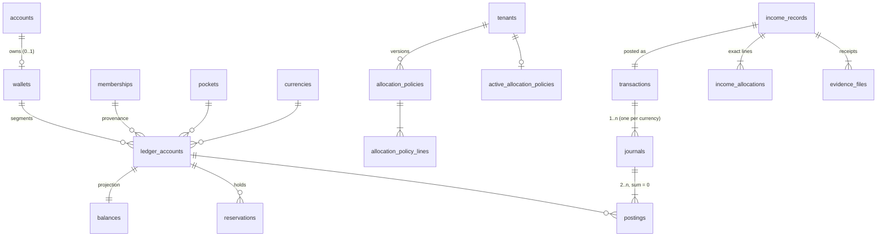

# Blueprint 04 — Wallets, pockets, ledger and income

Status: **draft, awaiting owner decisions** (Q1–Q11 below). Contract: D-01, D-02, F-01, F-02, F-03, E-01, A-01–A-05, W-07, W-08, W-05 (subtree totals, provenance), W-23 (allocation versions), T-01, T-03, T-04; open contracts U-01 (pockets, percentages, rounding, Debt) and U-07 (currency scales). Builds on Blueprint 01 (session gate, step-up, references, idempotency) and Blueprint 02 (networks, offices, office tree, memberships, resolver, tenant audit log). Track B; reserved migration range `2026100902xxxx`.

Part A is for the owner: what this slice does, in plain language. Part B is the exact build spec that migrations, functions and tests are written from. Part B is written so that each open decision is a seed value or a switch, not a rewrite.

---

## Part A — What this slice does

### What's in it
1. **One wallet per person.** Everyone who holds at least one non-President membership gets exactly one wallet, the first time they join an office. A second membership, in the same network or another, never creates a second wallet. A President-only account has no wallet. People who already have memberships get their wallet when this slice is installed.
2. **Money keeps its origin.** Inside the wallet, money is kept in separate "segments": which network and membership it came from, its currency, and its pocket. Naira and dollars are never added together, and money from two networks is never pooled. Moving a member to another office doesn't move old money; it stays recorded against where it was earned.
3. **Pockets.** Every network uses the same list of pockets (Debt is one of them). The list, the rules for each pocket and the default split are your decisions (Q1–Q6).
4. **Recording income.** A leader with the "record income" permission records money that came in for one of their members: amount, currency, where it came from, the date, and at least one receipt. Leaders can't record income into their own wallet.
5. **Instant split into pockets.** On confirm, Wallet splits the amount into pockets using the network's current percentages and posts it immediately. The split is exact to the kobo/cent: the pocket amounts always add up to exactly the income, and leftover kobo are handed out by a fixed rule (Q5). Each income keeps the exact split it was posted with; changing the percentages later only affects future income.
6. **A real ledger underneath.** Every money change is a balanced double-entry record that can never be edited or deleted. The database itself refuses unbalanced or edited records. Balances shown on screen are kept in step with the ledger in the same step that posts the money.
7. **Safe retries.** If the app loses connection after "Confirm", retrying with the same request can never post the income twice. A leader can also cancel an attempt whose outcome is unknown: if it had already posted, they're shown the posted income instead.
8. **Holds for later withdrawals.** The ledger can put a hold on part of a pocket ("reserved"), so Available = Posted − Reserved. Withdrawals and pocket transfers (later slices) use it; it's built and tested now so those slices only add their screens and rules.
9. **What people see.** Members see their own wallet: per network, per currency, per pocket, Posted / Reserved / Available, and their activity. Leaders see the wallets of members in their office and everything below it (never their own through leadership). Office money totals cover the office and everything below it, per currency, never mixed.
10. **Every income is recorded in the network's audit log** with its `INC-XXXX-XXXX` reference.

### Not in it (later slices or still open)
- Withdrawals, payout recording and receipt verification (W-09/W-10), pocket transfers (W-13), currency conversion (W-12), adjustments (W-14), reversals (W-15), returned funds (W-16). They use this slice's ledger and holds.
- Payout bank accounts → Blueprint 05.
- Statements and report exports (W-18), notification emails/bell entries (event list is still open, U-11).
- Kill switches and plan-based suspension of money actions (W-23, D-10): income gets those checks when those slices land.

### Decisions I need from you
| # | Question | Options | My recommendation |
|---|---|---|---|
| Q1 | **Which pockets exist (besides Debt)?** (U-01: names and display order; the contract forbids me guessing "Savings/Spend") | A) You give the list now (names, order). B) Start with one interim pocket you name, plus Debt; add the rest later (new pockets only affect future income). | **A.** The pilot needs real pockets; the list is seed data of any length, so nothing else changes. |
| Q2 | **What may each pocket do?** (U-01 direction flags) | A) Every ordinary pocket: money can move in and out, can be withdrawn from, never below zero. Debt: may be negative, receives transfers only up to zero, never a source, never withdrawn (W-13). B) You set rules per pocket (e.g. a locked pocket with no transfers out or withdrawals). | **A**, unless one of your pockets is meant to be locked. Simplest to explain to members. |
| Q3 | **Default split for new networks.** (U-01 percentages) | A) One default split (to 0.01%), copied into every network when it's activated. B) No default; Elivate sets each network's split before it can record income. | **A**, with your percentages. Pilot networks can record income on day one. |
| Q4 | **Who can change a network's split?** (no A-03 permission covers it) | A) Elivate admins only, per network, with reason and PIN; each change is a new version. B) The President, through a new protected permission (changes the A-03 catalogue). C) One split for all networks; no per-network versions. | **A.** W-23 puts allocation versions under platform control; no new permission to invent. |
| Q5 | **Leftover kobo/cents rule.** (U-01 rounding) | A) Largest remainder: each pocket gets its share rounded down; leftover units go one at a time to the pockets that lost the biggest fraction, ties by pocket order. B) Leftover units go one at a time in pocket order (legacy rule). C) All leftovers go to one named pocket. | **A.** No pocket is ever more than one kobo from its exact share; still fully deterministic. |
| Q6 | **Can income go into Debt?** (U-01 Debt edge cases) | A) No: a split can't include Debt. B) Yes, capped at bringing Debt to zero; the excess is spread over the other pockets (as W-14 does for adjustments). | **A.** Debt is settled by transfers/adjustments (later slices); keeps income simple. |
| Q7 | **Currencies and decimals.** (U-07 scales) | A) NGN and USD, both to 2 decimals (kobo, cents). B) NGN only for now. C) Add others (name them). | **A.** The contract names NGN/USD; withdrawals stay NGN-only (W-09). |
| Q8 | **PIN to record income?** (A-05: sensitive financial step-up not yet set) | A) Yes, every income (5-minute PIN window). B) No PIN. C) PIN only above an amount you set. | **A.** Income later becomes withdrawable money; the PIN is quick and the window covers a batch. |
| Q9 | **What does the leader enter with income?** (W-08 "source/date/notes/fee facts") | A) Amount, currency, source (free text, e.g. "Fiverr"), date received, optional provider reference, optional notes, optional fee (recorded only, never deducted). B) As A, but source from a fixed list you supply. | **A.** No source list exists yet; free text can be tightened later. |
| Q10 | **Receipt files.** (E-01 leaves limits open) | A) PDF, JPEG or PNG; up to 10 MB each; 1–5 per income; unused uploads expire after 2 hours. B) Other limits (say which). | **A.** Same limits the legacy backend ran with. |
| Q11 | **Can a person still see their own money from a network they've left, or one that's suspended?** | A) Yes, always, read-only (all their own segments, every network). B) Only networks where they still hold an active non-President membership. | **A.** It's their money; whether they can withdraw it is decided in the withdrawals blueprint. |

---

## Part B — Build spec

### B1. Layout
- New private schemas (not exposed through the Data API, `revoke all … from public, anon, authenticated`): `ledger` (wallets, pockets, accounts, transactions, journals, postings, balances, reservations, allocation policies), `finance` (operations: income now; withdrawals, transfers later), `evidence` (receipt files and upload intents). Same rules as slices 01/02: only `api.*` functions are `SECURITY DEFINER`, all functions `set search_path = ''`, `api.*` executable by `service_role` only (the existing privilege loop at the end of the migration set).
- New Edge Function `ledger` (one function, several routes), same envelope, JWT handling, CORS and logging as `org`, built on `_shared/http.ts` and `_shared/validate.ts`. `config.toml`: `[functions.ledger] verify_jwt = true`. No new secrets: Storage access uses the service client the function already has.
- Leadership routes take the selected workspace in `X-Membership` (validated by `authz.require_workspace`/`org.change_workspace`, A-02). Own-wallet routes (`/me/…`) are account-level and take no workspace: Personal Home is not a membership (P-06, W-21 "Personal shows each active network separately").
- Private Storage bucket `financial-evidence` is created **in a migration** (`insert into storage.buckets … public = false, file_size_limit, allowed_mime_types` per Q10), not through `config.toml`, because `supabase config push` must not be run against the development project (AGENTS.md). No `storage.objects` policies for `anon`/`authenticated`: uploads use single-object signed upload tokens issued by the Edge Function; downloads are short-lived signed URLs issued only after an authorization check.
- Money in transport is always a decimal **string** (`"125000.50"`). SQL outputs amounts as `amount::text` inside `jsonb_build_object`; a bare `numeric` in jsonb becomes a JSON number and loses precision in JavaScript (F-01.4).

### B2. Data



| Table | Key columns | Rules |
|---|---|---|
| `ledger.currencies` | `code` (`^[A-Z]{3}$`) PK, `scale` 0–6, `active` | Seeded from **Q7**. Immutable except `active`. |
| `ledger.pockets` | `key` (`^[a-z][a-z0-9_]*$`) PK, `name`, `sort_order` unique, `allows_negative`, `transfer_in`, `transfer_out`, `withdrawable`, `income_eligible` | System catalogue (D-01), seeded from **Q1/Q2**; immutable (statement trigger, like `authz.permission_catalog`). `debt` is always present: `allows_negative`, `transfer_in`, not `transfer_out`, not `withdrawable`; `income_eligible` per **Q6**. Only `debt` may have `allows_negative` (check). |
| `ledger.wallets` | `id`, `owner_user_id` unique → `identity.accounts`, `created_at` | At most one per account (D-01). No update of identity columns, no delete (`audit.reject_change`). Created only by `ledger.ensure_wallet`. |
| `ledger.accounts` | `id`, `class` (`member_value`/`system`), `currency` → currencies, `tenant_id`; member: `wallet_id`, `membership_id`, `office_id`, `owner_user_id`, `pocket_key`; system: `system_key` | A member-value account is one **segment** (D-01: wallet + origin tenant/membership + currency + pocket). Unique `(wallet_id, membership_id, currency, pocket_key)` for members, `(tenant_id, currency, system_key)` for system. `office_id` is copied from the membership (immutable since slice 02, `org.check_membership_role`), so office totals never join memberships. Composite FKs `(tenant_id, membership_id)`, `(tenant_id, office_id)`. Never updated or deleted. System keys now: `external_inflow`; later slices add `external_outflow`, `fx_clearing`, `adjustment`. System accounts are **per tenant** (fix l). |
| `ledger.transactions` | `id`, `reference` unique (from `refs.issue`), `type` (`income` now; later slices extend the check), `tenant_id`, `office_id`, `membership_id`, `wallet_id`, `owner_user_id`, `actor_user_id`, `idempotency_key`, `posted_at`, `metadata` jsonb | Inserted complete (`posted_at = now()`), never updated or deleted (fix f). Unique `(actor_user_id, idempotency_key)` as a second guard behind `identity.command_results`. One provenance context per transaction; it may hold several journals (one per currency). The transaction carries the operation's public reference (`INC-…`); there is no separate "FT" reference (D-01 lists none). |
| `ledger.journals` | `id`, `transaction_id`, `entry_no`, `currency` | One currency each. Immutable. |
| `ledger.postings` | `id` bigint identity, `journal_id`, `account_id`, `line_no`, `amount numeric(38,18)` ≠ 0 | Immutable. Insert trigger: account currency = journal currency; amount has no more decimals than the currency scale; member-value accounts match the transaction's wallet/membership; the parent transaction was created in the **same database transaction** (`ledger.transactions.db_xact_id xid8 default pg_current_xact_id()` equals `pg_current_xact_id()`; the top-level id, so PL/pgSQL exception blocks don't break it), so nobody can append to an old transaction even with table access. |
| `ledger.balances` | `account_id` PK, `tenant_id`, `office_id`, `wallet_id`, `currency`, `pocket_key`, `allows_negative`, `posted numeric(38,18)`, `reserved numeric(38,18)` ≥ 0, `version`, `updated_at` | Projection for **member-value accounts only** (system accounts get none, so there is no hot row per tenant). Row created with the account. Updated only by triggers: posting insert (`posted += amount`), reservation insert/settle (`reserved ± amount`). `check (allows_negative or posted - reserved >= 0)`: no ordinary pocket can go below zero **available**, not just posted (fix i). |
| `ledger.reservations` | `id`, `account_id`, `amount` > 0, `purpose` (`withdrawal`/`pocket_transfer`), `source_type`, `source_id`, `status` (`active`/`consumed`/`released`), `consumed_amount`, `consumed_by_transaction_id`, `release_reason`, `actor_user_id`, `created_at`, `settled_at` | One table for every kind of hold (fix e). Status moves only `active → consumed` or `active → released`; settled rows are immutable. `consumed_amount ≤ amount`. Unique `(source_type, source_id)` where `status = 'active'`. Built and tested now; first used by withdrawals/transfers. |
| `ledger.default_allocation_lines` | `pocket_key` PK, `basis_points` 1–10000 | Platform default split from **Q3** (empty if Q3 = B). Sum = 10000 when non-empty. |
| `ledger.allocation_policies` | `id`, `tenant_id`, `version` (unique per tenant), `created_by`, `reason`, `created_at`, `source` (`default`/`admin`) | Immutable versions (F-01.6). |
| `ledger.allocation_policy_lines` | `policy_id`, `pocket_key`, `basis_points` 1–10000 | Inserted with the version in one command; immutable. Sum exactly 10000; only `income_eligible` pockets. Weights are integer basis points (0.01%), exact. |
| `ledger.active_allocation_policies` | `tenant_id` PK, `policy_id`, `activated_at`, `activated_by` | One active version per tenant (D-01). Replaced, never deleted. |
| `finance.income_records` | `id`, `reference` (`INC-…`) unique, `tenant_id`, `office_id`, `membership_id`, `wallet_id`, `owner_user_id`, `currency`, `amount` > 0, `source`, `received_on` date, `provider_reference`, `notes`, `fee_amount`, `fee_currency`, `policy_id`, `transaction_id` unique, `recorded_by`, `idempotency_key`, `recorded_at` | Fields per **Q9**. Fee is a recorded fact only, never posted. Immutable. Corrections later use W-15 reversal plus a new income, never edits (W-08). |
| `finance.income_allocations` | `income_id`, `pocket_key`, `basis_points`, `amount` ≥ 0, `account_id` | The exact posted split, including zero lines, so later policy changes can't alter history (F-01.6). PK `(income_id, pocket_key)`. Immutable. |
| `evidence.files` | `id`, `tenant_id`, `purpose` (`income` now; `payout_receipt` etc. later), `uploaded_by`, `target_membership_id`, `command_key` (the income idempotency key), `object_path` (server-built `<tenant>/<purpose>/<id>`), `declared_name`, `declared_mime`, `declared_size`, `declared_sha256`, `size`, `sha256`, `mime`, `status`, `expires_at`, `attached_type`, `attached_id`, `created_at`, `finalized_at` | Bound to actor, target and command key (W-08 step 2). Limits per **Q10**. Once `attached`, immutable. Clients never choose Storage paths (E-01). |

`audit.tenant_events.target_type` gains `wallet`, `income`, `allocation_policy`, `evidence` (the check constraint is dropped and re-created with the full list; see Cross-track interfaces).

### B3. States

| Object | States | Notes |
|---|---|---|
| Wallet | exists | Never deleted or closed in this slice (U-08 owns closure). Ending every membership leaves it intact (W-05). |
| Income | `posted` | No pending or approval state (W-08, P-08). Failure posts nothing. |
| Income attempt (by idempotency key) | none → `posted` \| `cancelled` | `cancelled` is a stored marker under the same key; a later post with that key fails `attempt_cancelled`. Cancel after post returns the posted result (W-08 recovery). |
| Evidence file | `pending → finalized → attached`; `pending/finalized → expired \| cancelled` | Finalization checks real bytes (size, SHA-256, MIME by magic bytes). Expired/cancelled objects are deleted from Storage by the cleanup step of the evidence worker slice; until then they stay private and unreferenced. |
| Reservation | `active → consumed \| released` | Affects `available`, never `posted` (F-02). |

**Wallet eligibility.** A person is eligible while they hold at least one non-ended membership whose role is not `president_team_member` (P-03, D-01). The wallet is created at the first such membership and kept afterwards; becoming President-only later does not delete it (U-08 owns mixed-role transitions).

**Income target eligibility** (W-08 step 1, conservative until U-08): the target membership is in the workspace's tenant, `active`, not a President Team membership, its office is `active`, and the owner's account is `active` or `restricted` (receiving money is not the holder's own action). Anything else → `target_not_eligible`.

### B3a. Allocation (parameterised on Q3–Q6)
`ledger.allocate(p_policy_id uuid, p_currency text, p_amount numeric) returns table (pocket_key text, basis_points int, amount numeric)`, `stable`, pure:
1. `units = amount × 10^scale` (an integer, because the amount has already passed the scale check).
2. `base_i = floor(units × bps_i / 10000)`; `left = units − Σ base_i` (0 ≤ left < number of lines).
3. Hand out `left` single units by the **Q5** rule. A: order by `(units × bps_i) mod 10000` descending, then pocket `sort_order`. B: by pocket `sort_order`. C: all to the named pocket.
4. Return `base_i (+1) / 10^scale` per line, zero lines included. Invariant (asserted in the function): `Σ amount = p_amount`.
Computed **once** per command (fix d). If Q6 = B, a Debt line is capped at `−debt posted balance` and the excess is re-spread over the non-Debt lines by the same rule.

### B3b. Who can see and do what (resolver use)
All checks go through `authz.decide`/`authz.require` (slice 02) with the target given as **(segment origin office, owner user)**, so A-02 subtree rules, explicit grants/denies and the leader self-target guard apply unchanged.

| Read / action | Who | Check |
|---|---|---|
| Own wallet, own activity, own transaction detail | The wallet owner | Session gate (`identity.require_session`); account `active` or `restricted` (suspended/deactivated are already blocked by the gate). Per segment: **Q11** A = every own segment; B = only tenants where `authz.decide(actor, 'view_own_wallet', tenant, null, actor)` allows (needs an active non-President membership, as the resolver's self branch already requires). |
| Managed wallets list / one member's wallet / their activity | Leader in workspace W | `view_managed_wallets` per segment: `authz.decide(actor, 'view_managed_wallets', W.tenant, segment.office_id, owner, W.id)`. Self is excluded by the self-target guard (W-07 "no self-wallet leadership listing"). Only segments of W's tenant. |
| Office totals | Leader in workspace W | `view_managed_wallets` **or** `view_scoped_financial_reports` over the office (same either/or pattern as `api.list_members`). |
| Allocation policy (read) | Any active member of the tenant | `authz.require_workspace`; percentages are not sensitive and members see their own splits anyway. |
| Record income, cancel attempt | `record_income` over the target | `authz.require(actor, 'record_income', tenant, target.office_id, target.user_id, W.id)`; `org.require_writer` (restricted actors can't); step-up per **Q8**. |
| Create/activate a network's split | Per **Q4**: A = platform admin (`identity.require_platform_admin`) | Reason (`identity.require_reason`) + step-up. |

**Office subtree totals** (W-05: total for the office and everything below it, per currency; provenance unchanged, the view follows the current tree):
```sql
select b.currency, b.pocket_key, sum(b.posted), sum(b.reserved)
from org.office_closure c
join ledger.balances b on b.office_id = c.descendant_id
where c.ancestor_id = $office
group by b.currency, b.pocket_key;
```
Performance approach: aggregate on demand from the projection, no rollup table. `org.office_closure` PK `(ancestor_id, descendant_id)` drives the scan; `ledger.balances` has a covering index `(office_id, currency, pocket_key) include (posted, reserved)`. At the design ceiling (20,000 members × 2 currencies × ~6 pockets ≈ 240k rows in one tenant) a root-office total is one index-only scan; a per-office rollup table would make every posting update a shared office row (hot-row contention during income batches) and is deferred until a benchmark shows it's needed. Re-placing an office needs no money update: the closure change alone moves its totals.
**Deny exclusion** (W-07 "excluded scope cannot contribute silently"): after the root check passes, the actor's active explicit denies for that permission inside the subtree (`office_subtree` denies on descendant offices, `member` denies) are subtracted, and the response carries `excluded: { offices: n, members: n }` instead of a silently smaller total.

### B3c. Lock order (extends Blueprint 02)
Blueprint 02: people (sorted) → office tree → tenant/office rows (`FOR NO KEY UPDATE`) → membership rows. Extended, for every command:

1. PIN-proof row (`identity.require_session`; platform-admin commands take the `identity.platform_admins` advisory lock before it, as today).
2. Idempotency advisory lock (`identity.replay`; `cancel_income_attempt` takes the same key lock).
3. People (sorted, advisory) → office tree (advisory) → tenant/office rows (`FOR NO KEY UPDATE`) — org changes only.
4. Membership rows: `FOR UPDATE` for org changes; **`FOR SHARE`** for money commands (blocks a concurrent end/suspend of the target, compatible with FK checks and with other money commands).
5. Wallet row: only inserted (`ledger.ensure_wallet`, unique insert) inside membership creation, after the membership row. Money commands never lock wallet rows.
6. Active allocation policy row (`FOR SHARE`).
7. Evidence rows (sorted by id, `FOR UPDATE`).
8. Domain operation row (`FOR UPDATE`; e.g. a withdrawal request, later slices).
9. Segment accounts ensured in pocket `sort_order` (unique inserts), then `ledger.balances` rows **sorted by account id** `FOR UPDATE`.
10. Reservation rows (sorted by id).

No money command takes a person or tree lock, and no org command touches balances or reservations, so the two families can't wait on each other in a cycle.

### B3d. Internal ledger API (used by this slice and the next ones; not callable by clients)
| Function | Behaviour |
|---|---|
| `ledger.ensure_wallet(p_user_id uuid) returns uuid` | Idempotent. If the person is eligible (B3), `insert … on conflict (owner_user_id) do nothing` and return the wallet id; otherwise return `null` and create nothing. Takes no row locks besides the unique insert; safe while holding person/office/membership locks. |
| `ledger.wallet_for(p_user_id uuid) returns uuid` | Wallet id or `null`. `ledger.require_wallet(p_user_id)` raises `no_wallet`. |
| `ledger.segment_account(p_wallet_id, p_membership_id, p_currency, p_pocket_key) returns uuid` | Ensures the segment account and its balance row (`on conflict do nothing`). Checks the membership belongs to the wallet owner and is not President Team. Does **not** require the membership to be active: later returns/reversals post to ended memberships (fix g); activity rules live in each command. |
| `ledger.system_account(p_tenant_id, p_currency, p_key) returns uuid` | Ensures a tenant system account. |
| `ledger.available(p_account_id) returns numeric` | `posted − reserved` from the projection. |
| `ledger.reserve(p_account_id, p_amount, p_purpose, p_source_type, p_source_id, p_actor_user_id) returns uuid` | Locks the balance row; source pocket must be `transfer_out` or `withdrawable` as the purpose requires; `p_amount` positive and within scale; raises `insufficient_funds` (details: `available` as a string) when `available < amount`. |
| `ledger.release(p_reservation_id, p_reason, p_actor_user_id)` | `active → released`; reason required. |
| `ledger.post(p_type, p_reference, p_membership_id, p_actor_user_id, p_idempotency_key, p_journals jsonb, p_consume jsonb default '[]', p_metadata jsonb default '{}') returns uuid` | `p_journals`: `[{currency, postings: [{accountId, amount (text)}]}]`. Validates shape; locks balance rows sorted by account id; consumes each `p_consume` item `{reservationId, amount}` (`active → consumed`, `amount ≤ reservation`) **before** inserting postings, so a settled hold doesn't double-count; inserts the transaction, journals and postings. Database-enforced: each journal ≥ 2 postings summing to exactly 0 and single-currency; the transaction has ≥ 1 journal and ≥ 1 member-value posting (deferred constraint triggers, checked at commit); no ordinary pocket below zero available (check on `ledger.balances`; `check_violation` on that constraint is mapped to `insufficient_funds`). |
| `ledger.verify_balances() returns setof record` | Rows where the projection differs from `Σ postings` / `Σ active reservations`. Empty in every test (F-01.7, P-07.7). |

### B4. Commands (`api.*`) and routes (`ledger` function)

Order in every command, as in slice 02: session gate (step-up where marked) → workspace → load target from the database → authorization → input checks → idempotent replay → locks and state checks → effects → `identity.store_result`. Replays therefore re-check current authority (A-01, F-03). `R` = reason required (3–500 chars, `identity.require_reason`). `S` = step-up.

| Route | Command | Permission / actor | Notes |
|---|---|---|---|
| `GET /ledger/me/wallet` | `api.my_wallet` | wallet owner | Per tenant (network name) → currency → pocket: `posted`, `reserved`, `available` (strings); per-currency totals per tenant; never across currencies or tenants. President-only → `no_wallet`. Segment visibility per Q11. |
| `GET /ledger/me/activity` | `api.my_activity` | wallet owner | Filters: `tenantId`, `currency`, `pocket`, `direction` (`in`/`out`), `type`, `from`/`to` (UTC dates, inclusive), cursor `(posted_at, id)` desc; limit 1–100 (`org.page_limit`). Each item: reference, type, posted time, signed per-currency amount for this wallet. |
| `GET /ledger/me/transactions/:id` | `api.my_transaction` | wallet owner | Detail: type, reference, network, office, pocket lines (signed), income facts (source, date, provider reference, notes, fee), evidence file names (no download in this slice). |
| `GET /ledger/policy` | `api.allocation_policy` | active member of workspace tenant | Current version: pockets, percentages (basis points as integers and display percent strings), version, activated at. `allocation_policy_missing` if none. |
| `GET /ledger/currencies` | `api.ledger_currencies` | signed in | Active currencies and scales; pocket catalogue with flags. |
| `GET /ledger/wallets` | `api.list_managed_wallets` | `view_managed_wallets` (per row) | Members with at least one segment in workspace tenant and scope: person (`org.person`), per-currency posted/reserved/available. Filters: `officeId` (subtree), `q` (name/UID), cursor `(uid)`. |
| `GET /ledger/wallets/:walletId` · `/activity` · `/transactions/:id` | `api.managed_wallet` · `api.managed_wallet_activity` · `api.managed_transaction` | `view_managed_wallets` per segment | Only the workspace tenant's segments the actor covers. Same shapes as the `/me` reads. |
| `GET /ledger/offices/:officeId/totals` | `api.office_totals` | `view_managed_wallets` or `view_scoped_financial_reports` over office | B3b subtree totals per currency and pocket, `distinctMembers`, `segments`, `excluded`. |
| `GET /ledger/income/targets` | `api.income_targets` | `record_income` (per row) | Active, eligible memberships in scope (not self, not President Team), cursor paging; plus the active policy summary and currencies, so the form shows real setup state (W-08 step 1). |
| `POST /ledger/evidence/uploads` | `api.create_evidence_upload` | `record_income` over target · S per Q8 | Body: `purpose` (`income`), `targetMembershipId`, `idempotencyKey` (the **income** command key), `fileName`, `mimeType`, `size`, `sha256`. Creates `evidence.files` (`pending`, expires per Q10); Edge then issues a signed upload token for the server-built path. Returns `evidenceId`, `uploadUrl`, `token`, `expiresAt`. Not itself idempotent beyond the file id; abandoned files expire. |
| `POST /ledger/evidence/uploads/:id/finalize` | `api.finalize_evidence_upload` | uploader, same target authority | Edge downloads the private object (≤ limit + 1 bytes), computes size, SHA-256 and MIME from magic bytes (`%PDF-`, `FF D8 FF`, `89 50 4E 47 0D 0A 1A 0A`), compares with the declared values and passes the **computed** facts; any mismatch → `evidence_invalid` and the file is marked `cancelled`. |
| `POST /ledger/income` | `api.record_income` | `record_income` over target · S per Q8 | Body: `targetMembershipId`, `currency`, `amount` (string), `source`, `receivedOn` (`YYYY-MM-DD`, not after tomorrow UTC), `providerReference?`, `notes?`, `fee?` `{amount, currency}`, `evidenceIds[]` (1–5 per Q10), `idempotencyKey`. Effects in one transaction: lock target membership `FOR SHARE` and re-check eligibility; lock evidence rows (each `finalized`, `purpose = income`, `uploaded_by` = actor, same target, `command_key` = this key, unexpired, unattached); lock active policy (`allocation_policy_missing` if none); `ledger.allocate` once; `refs.issue('INC')`; `ledger.post('income', …)` with one journal per income: tenant `external_inflow` −amount, each non-zero allocation line +amount on its segment; insert `finance.income_records` + `income_allocations`; evidence → `attached`; `audit.record_tenant(…, 'income.recorded', 'income', id, …, safe_after {reference, currency, amount, membershipId})`; capture the after-commit event (Cross-track 2). Result: `{incomeId, reference, status: 'posted', transactionId, currency, amount, allocations: [{pocket, basisPoints, amount}]}`, amounts as strings. |
| `POST /ledger/income/cancel` | `api.cancel_income_attempt` | `record_income` over the original target | Body: `idempotencyKey`, `targetMembershipId`, `reason` (R). Under the key lock: posted → return the posted result (after re-checking authority); not posted → store the `cancelled` marker, cancel evidence bound to that key, audit `income.attempt_cancelled`. Never deletes anything. |
| `POST /admin/tenants/:id/allocation-policies` | `api.set_allocation_policy` | per Q4 (A: platform admin) · R · S | Body: `lines: [{pocket, basisPoints}]`, `reason`, `idempotencyKey`. Validates (sum 10000, known `income_eligible` pockets, no duplicates → `policy_invalid`), creates version N+1 and makes it active in one step. Audited in both `audit.security_events` and the tenant log. |

**Default split at activation (Q3 = A):** an `after update of status` trigger on `org.tenants` (`pending_payment → active`) creates version 1 from `ledger.default_allocation_lines` when the tenant has no policy; the migration backfills already-active tenants the same way. If Q3 = B, nothing is seeded and income returns `allocation_policy_missing` until an admin sets a split.

**Income has no separate reason field:** W-08 asks for source, date and notes, and the 2026-10-07 "mandatory reason" rules cover membership, leader and access changes. Reasons are mandatory here for policy changes and attempt cancellation.

**Wallet creation and backfill.** Trigger `memberships_ensure_wallet` (`after insert on org.memberships for each row when (new.role <> 'president_team_member')`) calls `ledger.ensure_wallet(new.user_id)`. Every membership path (all go through `org.create_membership`, plus invitation acceptance in Blueprint 03) is covered without code changes. The migration then runs `ledger.backfill_wallets()`: one wallet per account with a non-ended non-President membership, `on conflict do nothing`.

### B5. Wire contract
Same envelope and codes as Blueprints 01 and 02. Amounts are strings in both directions; `validate.ts` gains `decimal(body, field)` (`^[0-9]{1,20}(\.[0-9]{1,18})?$`, string only; JSON numbers are rejected), `date`, `currency` (`^[A-Z]{3}$`) and `uuidList(body, field, min, max)`. The database re-checks scale and sign. New codes:

| Code | HTTP | When |
|---|---|---|
| `no_wallet` | 409 | The person has no wallet (President-only); own-wallet reads and later withdrawal/payout-account setup |
| `target_not_eligible` | 409 | Income target not an active, non-President membership in an active office, or owner account suspended/deactivated |
| `currency_not_supported` | 422 | Currency not in the active list (Q7) |
| `allocation_policy_missing` | 409 | The network has no active split |
| `policy_invalid` | 422 | Split doesn't total 100%, unknown/duplicate/ineligible pocket |
| `evidence_required` | 422 | No receipt given |
| `evidence_invalid` | 422 | Receipt not finalized, expired, already used, bound to another actor/target/key, or bytes don't match |
| `attempt_cancelled` | 409 | This idempotency key's attempt was cancelled |
| `insufficient_funds` | 409 | Hold or debit would take an ordinary pocket below zero available; `details.available` (string). Defined now, used by later slices |

Amount shape and scale errors use `validation_error` with `details.field`. Logs: `requestId`, route, status, code, latency; never amounts, UIDs, wallet ids, file names or hashes.

### B6. Tests (written first, must all pass in CI)
pgTAP (one file per group; deferred checks are tested with `set constraints all immediate` because each pgTAP file runs in one rolled-back transaction):

`009_ledger_core.sql`
1. Unbalanced journal, single-posting journal, mixed-currency journal, zero amount, amount beyond scale, and a transaction without member postings are all rejected.
2. Transactions, journals, postings, settled reservations, wallets, accounts, income rows and attached evidence reject update/delete/truncate (`invariant_violation`).
3. Projection: after a mixed workload `ledger.verify_balances()` is empty; `posted` = Σ postings, `reserved` = Σ active holds.
4. Ordinary pocket can't go below zero available; Debt can go negative.
5. Holds: reserve beyond available → `insufficient_funds`; two holds that exactly exhaust available succeed, a third fails; release frees; consume via `ledger.post` settles; consuming twice or consuming a released hold fails; `consumed_amount` > amount fails.
6. Exact decimals: 18-decimal and 20-integer-digit values survive round-trips; outputs are JSON strings (`jsonb_typeof = 'string'`).
7. Appending postings to a transaction from an earlier database transaction is rejected: checked by a two-transaction `psql` step added to `scripts/verify-database.sh` (pgTAP can't commit).

`010_wallets.sql`
8. Adding a member creates exactly one wallet; a second membership (other office, other network) does not; a President-only founder has none; that founder gets one when added as a member; ending every membership leaves the wallet; wallets can't be deleted.
9. Backfill: with the trigger disabled inside the test, memberships inserted, `ledger.backfill_wallets()` creates one wallet each and is idempotent; `ledger.ensure_wallet` returns `null` for an ineligible person.

`011_income.sql`
10. Happy path: Team Leader records income for a member: `posted`, reference matches `^INC-[0-9A-HJKMNP-TV-Z]{4}-[0-9A-HJKMNP-TV-Z]{4}$`, allocation lines sum exactly, segment balances and the tenant `external_inflow` account mirror each other, evidence `attached`, one tenant audit row.
11. Allocation property: 1,000 random amounts × several splits: Σ lines = amount; each line within one minor unit of the exact share; same input → same output; leftovers follow the Q5 rule on hand-checked cases.
12. Authorization: member denied; sibling Team Leader denied; Director over the subtree and President allowed; other network → `not_found`; leader recording into own membership → `self_target_forbidden`; President Team membership target → `target_not_eligible`; explicit deny beats role allow; sibling grant works.
13. Validation: zero, negative, too many decimals, unsupported currency, future date, no evidence, evidence of another actor/target/key, expired, unfinalized or reused evidence → right code, no postings.
14. Idempotency: same key and payload → same result with `replayed: true`, one transaction; different payload → `idempotency_conflict`; replay after the actor lost `record_income` → `authorization_denied`; cancelled attempt → `attempt_cancelled`; cancel after posting returns the posted result.
15. Policy: no policy → `allocation_policy_missing`; a new version changes future splits only, posted allocations unchanged; invalid splits → `policy_invalid`; Debt line rejected (Q6 = A); non-admin, missing reason and missing step-up rejected; activation of a network seeds version 1 (Q3 = A).
16. Step-up (Q8 = A): without PIN window → `step_up_required`; restricted actor → `authorization_denied`.
17. Provenance: after the member is moved, old income stays on the old membership and office, new income lands on the new membership; the old office's totals still include the old segment (W-05).

`012_ledger_reads.sql`
18. Own wallet: per network/currency/pocket posted/reserved/available as strings; President-only → `no_wallet`; money from an ended membership visible per Q11.
19. Managed: Team Leader sees subtree members, not siblings, never self; a `member`-scope deny hides that member; activity cursor with equal timestamps neither skips nor repeats.
20. Office totals: subtree sum per currency equals the sum of member balances below; currencies never mixed; re-placing an office moves its totals to the new ancestors; denied scope reported in `excluded`.

`013_ledger_privileges.sql`
21. `anon`/`authenticated` have no usage on `ledger`, `finance`, `evidence`; RLS on every table; only `api.*` are definer; every function pins an empty `search_path`; every `api.*` is executable by `service_role` only; bucket `financial-evidence` is private with no client policies.

Deno (`tests/ledger_handler_test.ts`):
22. Route validation and envelope: amounts must be decimal strings (numbers rejected), currency/date/UUID-list formats, unknown fields rejected, `X-Membership` required on leadership routes and ignored on `/me` routes; actor only from the JWT.
23. Finalize: oversize, SHA-256 mismatch and magic-byte mismatch → `evidence_invalid`; object path is never taken from the client.
24. Logs contain no amounts, UIDs, wallet ids, file names or hashes.

Benchmark (script, not a CI gate): 20,000 synthetic members, 240k segments in one tenant; root-office totals and a 50-row managed-wallet page timed and `EXPLAIN`-checked for index use.

### B7. Migrations (reserved range `2026100902xxxx`)
| File | Contents |
|---|---|
| `20261009020100_ledger_core.sql` | Schemas `ledger`, `finance`, `evidence`; currencies (Q7 seed), pockets (Q1/Q2 seed, Debt); wallets, accounts, transactions, journals, postings, balances, reservations; immutability, posting checks, projection triggers, deferred balance/completeness triggers; `ledger.segment_account`, `system_account`, `available`, `reserve`, `release`, `post`, `verify_balances`. |
| `20261009020200_wallets.sql` | `ledger.ensure_wallet`, `wallet_for`, `require_wallet`, trigger `memberships_ensure_wallet`, `ledger.backfill_wallets()` and its call. |
| `20261009020300_allocation_policies.sql` | Default lines (Q3 seed), policy tables, `ledger.allocate` (Q5/Q6), tenant-activation trigger and backfill, `api.set_allocation_policy`, `api.allocation_policy`. |
| `20261009020400_evidence.sql` | `evidence.files`, bucket `financial-evidence` (Q10 limits), `api.create_evidence_upload`, `api.finalize_evidence_upload`. |
| `20261009020500_income.sql` | `finance.income_records`, `income_allocations`, `api.record_income`, `api.cancel_income_attempt`, `api.income_targets`. |
| `20261009020600_ledger_reads.sql` | `api.my_wallet`, `my_activity`, `my_transaction`, `ledger_currencies`, `list_managed_wallets`, `managed_wallet`, `managed_wallet_activity`, `managed_transaction`, `office_totals`. |
| `20261009020700_ledger_privileges.sql` | `audit.tenant_events.target_type` widened (full union, see Cross-track 3); `api.*` revoke/grant loop; RLS assertions. |

Plus: `supabase/functions/ledger/{index.ts,handler.ts,deno.json}`, `_shared/http.ts` codes, `_shared/validate.ts` helpers, `config.toml` entry, tests above. Nothing is pushed or deployed to the development project without an explicit owner go-ahead.

### B8. Legacy port: what is reused and which bugs are fixed
Ported from `legacy-backend/supabase/migrations/20260919111739_wallet_domain_tables.sql`, `20260919193503_ledger_domain_tables.sql`, `20260919193505_ledger_posting_contract.sql`, `20260920062455_financial_operation_commands.sql`: `numeric(38,18)` amounts with per-currency scale check; member-value vs system accounts with provenance context; immutable journals and postings; deferred balanced-journal and transaction-completeness constraint triggers; trigger-maintained projections; sorted account locking; basis-point policies summing to 10000; integer minor-unit allocation; Debt flags.

| # | Legacy problem | Fix here |
|---|---|---|
| a | `financial_ops.record_income` returns a replay before authorizing (also the audit's F-03 finding) | Replay after `authz.require`, as every slice 02 command |
| b | Idempotency keys are global UUIDs, so another actor's key collides and reveals existence | Per-actor keys via `identity.replay`/`store_result`, plus `(actor_user_id, idempotency_key)` unique on transactions |
| c | `calculate_policy_allocations` inner-joins pre-existing ledger accounts; missing segments silently drop lines, then the command fails | Segments created on demand by `ledger.segment_account` |
| d | Allocation computed three times per income | Once |
| e | Two reservation tables (`funding_reservations`, `pocket_transfer_reservations`) summed by hand in `available_balance` | One `ledger.reservations` table; `reserved` projected on the balance row |
| f | Mutation gates rely on session settings (`ledger.current_transaction_id`, `ledger.projection_write`) that any session able to run SQL can set; transactions are inserted then updated to "posted" | Rows inserted complete; update/delete/truncate always rejected; same-transaction `db_xact_id` guard for postings; no GUC bypass |
| g | Account and transaction triggers require account, tenant, office and membership to be `active` at every posting, which would block returned funds and reversals on ended memberships | Activity rules checked by each command; the ledger only checks provenance consistency |
| h | Income locks the membership `FOR UPDATE` outside any documented order | `FOR SHARE` at a fixed place in the extended lock order |
| i | Non-negative check is on posted balance only; holds aren't part of it | `check (allows_negative or posted - reserved >= 0)` on the projection |
| j | References `FT-`/`INC-` + hex | `refs.issue('INC')` (D-01 format) |
| k | Wallet/policy functions use `search_path = pg_catalog, public` | Empty `search_path` everywhere |
| l | System counter accounts are global per currency | Per tenant: tenant-scoped reconciliation and backups (T-03) |
| m | Allocation remainder order is a per-policy `remainder_rank` nobody approved | Q5 rule using catalogue order |

### Cross-track interfaces
1. **Track A (Blueprint 03, invitations, `2026100901xxxx`) → wallet creation.** Provided function: **`ledger.ensure_wallet(p_user_id uuid) returns uuid`**: idempotent, returns the wallet id, or `null` (creating nothing) when the person holds no non-ended non-President membership; must be called after the membership row exists in the same transaction; takes no locks besides the unique insert on `ledger.wallets`, so it is safe as the last step while person/office/membership locks are held (lock order step 5). It is wired by the `after insert` trigger `memberships_ensure_wallet` on `org.memberships`, so invitation acceptance gets a wallet automatically as long as it creates the membership through `org.create_membership` (or any insert into `org.memberships`). Recommendation to Track A: **don't reference `ledger.*`** (its migrations replay before the ledger exists and its tests run without it). If Track A still wants a named hook, make it a no-op function in `org` taking the new `org.memberships` row; my migration replaces its body with `perform ledger.ensure_wallet(p_membership.user_id)`. Track A tells me the name.
2. **Track A → after-commit events.** F-02 requires the income commit to capture a durable outbox event. If Blueprint 03 provides the email outbox, `api.record_income` calls its enqueue function in the same transaction with topic `income.posted`, aggregate `income`/`<id>` and dedupe key `income:<id>`, payload limited to the D-01/P-06 email-safe fields (reference, amount, currency). Proposed shape, to be matched to Track A's actual name: `(p_tenant_id uuid, p_topic text, p_aggregate_type text, p_aggregate_id text, p_payload jsonb, p_dedupe_key text)`. No template or bell entry ships until U-11 lists the event. If the outbox isn't merged when this slice is built, income still records the event by calling it in a follow-up migration before the pilot enables income.
3. **Shared edits both tracks make:** (a) `audit.tenant_events.target_type`: each migration drops and re-creates the check with the **full union**; mine runs second, so it must include Track A's values (e.g. `invitation`); (b) `_shared/http.ts` `errorStatus`/`messages` and `config.toml` function entries: plain text merges; (c) `refs.issued` types: `INC` already exists, no change.
4. **Blueprint 05 (payout accounts).** Ownership is by wallet (W-17): `ledger.wallet_for(p_user_id)`/`ledger.require_wallet(p_user_id)` (`no_wallet`), FK to `ledger.wallets(id)`; NUBAN proofs bind to the wallet id. Payout-account screens should show the `no_wallet` setup state for President-only accounts.
5. **Withdrawals, transfers, conversion, adjustments, reversal, returns (later blueprints).** They use `ledger.segment_account`, `ledger.available`, `ledger.reserve` (purposes `withdrawal`, `pocket_transfer`), `ledger.release`, `ledger.post(… p_consume …)` (settles holds before posting; a linked conversion consumes the source hold and creates the destination hold in one transaction, W-12), `ledger.system_account` (`external_outflow`, `fx_clearing`, `adjustment`), the `insufficient_funds` code and lock order steps 8–10. They extend `ledger.transactions.type`, `ledger.reservations.purpose` and `evidence.files.purpose` checks, and add `reverses_transaction_id`/`corrects_transaction_id` for W-15. Withdrawals pick sources only from `withdrawable` pockets in NGN (W-09).

### Contract conflicts and gaps found
1. **No permission for allocation policy changes.** A-03 (`01-domain-rules.md`) has no key for editing a tenant's split, while D-01 makes policies tenant-level and W-23 (`02-workflows.md`) centralises "allocation versions" under platform controls → Q4.
2. **Own-wallet reads vs the resolver.** `authz.decide`'s self branch (`backend/supabase/migrations/20261008000800_authz.sql`) requires an active membership in that tenant, so a holder who left a network (or whose network is suspended) couldn't see that network's money; W-05 says ending memberships doesn't delete the wallet but doesn't say who can see it → Q11.
3. **Closed offices.** `org.office_status` has `closed` but no close command exists; `authz.decide` returns `not_found` for a closed target office (same file), so money originating in a closed office would vanish from every leader's view, the President's included. Needs handling when office closing is designed.
4. **Income into a suspended membership or to a suspended/restricted account** is unspecified (D-02, U-08). This draft refuses suspended/ended memberships and suspended/deactivated accounts, and allows restricted accounts (they can't *initiate* movement, D-02).
5. **Step-up for income** is not settled (A-05, U-02/U-07) → Q8.
6. **Outbox and event catalogue.** F-02 requires outbox capture in the money commit; the outbox isn't built yet (Track A) and the event list is U-11 → Cross-track 2.
7. **Kill switches and commercial suspension** (W-23, D-10) aren't built; income must add those checks when they land.
8. **Income evidence checking.** W-08 says "verify required evidence/content", but E-03's strict comparison is payout-only and U-07 leaves income criteria open. This slice checks real file bytes (type, size, checksum) and binding only; no content verification or malware scanning (E-01 mentions asynchronous scanning; no scanner is chosen).
9. **"Reasons" for income.** The task brief lists reasons for income; the contract doesn't require one (W-08 lists source/date/notes). Reasons are mandatory here for policy changes and attempt cancellation only.
10. **W-27 vs W-09.** W-27 says no "NGN-only withdrawal" rule may be imported without approval, but W-09 records the owner's 2026-10-05 approval of NGN-only withdrawals. W-27's line is stale; suggest removing "NGN-only withdrawal" from it.
11. **Fee facts.** W-08 mentions "approved … fee facts" but no approved fee contract exists; Q9 records the fee as information only, never deducted or posted.
