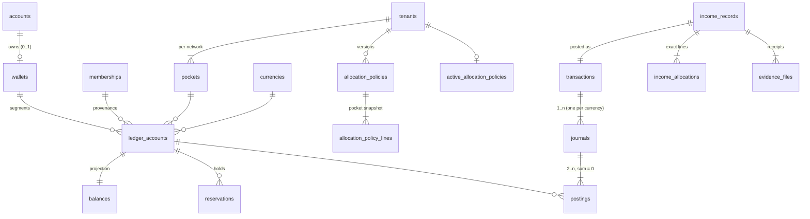

# Blueprint 04 — Wallets, pockets, ledger and income

Status: **approved by owner 2026-10-08** (decisions recorded below; owner decisions 11–23 of 2026-10-08). Contract: D-01, D-02, F-01, F-02, F-03, E-01, A-01–A-05, W-07, W-08, W-05 (subtree totals, provenance), W-23 (allocation versions), T-01, T-03, T-04; open contracts U-01 (pockets, percentages, rounding, Debt) and U-07 (currency scales). Builds on Blueprint 01 (session gate, step-up, references, idempotency) and Blueprint 02 (networks, offices, office tree, memberships, resolver, tenant audit log). Track B; reserved migration range `2026100902xxxx`.

Part A is for the owner: what this slice does, in plain language. Part B is the exact build spec that migrations, functions and tests are written from. Part B records the approved design.

---

## Part A — What this slice does

### What's in it
1. **One wallet per person.** Everyone who holds at least one non-President membership gets exactly one wallet, the first time they join an office. A second membership, in the same network or another, never creates a second wallet. A President-only account has no wallet. People who already have memberships get their wallet when this slice is installed.
2. **Money keeps its origin.** Inside the wallet, money is kept in separate "segments": which network and membership it came from, its currency, and its pocket. Naira and dollars are never added together, and money from two networks is never pooled. Moving a member to another office doesn't move old money; it stays recorded against where it was earned.
3. **Pockets.** Each network starts with Point Value, Business Investment, Personal Investment, Upkeep and Savings (split 40/10/15/25/10), plus Debt. The President Team can rename, add and retire pockets and change the split for their network, with a reason and PIN; every change is a new version that only affects future income. A pocket can be retired only when it holds nothing in any currency. Debt is fixed.
4. **Recording income.** A leader with the "record income" permission records money that came in for one of their members: amount, currency (NGN or USD), where it came from, the date, optional provider reference, notes and fee (recorded only, never deducted), and 1–5 receipts (PDF/JPEG/PNG, up to 10 MB each). It needs the PIN (5-minute window). Leaders can't record income into their own wallet.
5. **Instant split into pockets.** On confirm, Wallet splits the amount into pockets using the network's current percentages and posts it immediately. The split is exact to the kobo/cent: the pocket amounts always add up to exactly the income; leftover kobo go to the pockets that lost the largest fraction, ties by display order. Each income keeps the exact split it was posted with; changing the percentages later only affects future income.
6. **A real ledger underneath.** Every money change is a balanced double-entry record that can never be edited or deleted. The database itself refuses unbalanced or edited records. Balances shown on screen are kept in step with the ledger in the same step that posts the money.
7. **Safe retries.** If the app loses connection after "Confirm", retrying with the same request can never post the income twice. A leader can also cancel an attempt whose outcome is unknown: if it had already posted, they're shown the posted income instead.
8. **Holds for later withdrawals.** The ledger can put a hold on part of a pocket ("reserved"), so Available = Posted − Reserved. Withdrawals and pocket transfers (later slices) use it; it's built and tested now so those slices only add their screens and rules.
9. **What people see.** Members see their own wallet: per network, per currency, per pocket, Posted / Reserved / Available, and their activity, always, even after leaving a network or while it's suspended (read-only). Leaders see the wallets of members in their office and everything below it (never their own through leadership). Office money totals cover the office and everything below it, per currency, never mixed.
10. **Every income is recorded in the network's audit log** with its `INC-XXXX-XXXX` reference.

### Not in it (later slices or still open)
- Withdrawals, payout recording and receipt verification (W-09/W-10), pocket transfers (W-13), currency conversion (W-12), adjustments (W-14), reversals (W-15), returned funds (W-16). They use this slice's ledger and holds.
- Payout bank accounts → Blueprint 05.
- Statements and report exports (W-18), notification emails/bell entries (event list is still open, U-11; no income email is sent and no outbox event is written, see Cross-track 2).
- A close-office command (decision 23 only fixes who still sees money from closed offices).
- Kill switches and plan-based suspension of money actions (W-23, D-10): income gets those checks when those slices land.

### Owner decisions (2026-10-08)
| # | Question | Owner answer |
|---|---|---|
| Q1 (11) | Which pockets exist? | **Point Value, Business Investment, Personal Investment, Upkeep, Savings**, in that display order, plus **Debt**. Pockets are **per network and editable by the President Team** ("everything"): rename, add, retire (only at zero balance in every currency) and change percentages, with reason + PIN; every change is a new version and applies to future income only. Debt is fixed and not editable. Gated by a new protected, President-only permission (`manage_allocation`, A-03 catalogue). |
| Q2 (12) | What may each pocket do? | **A.** Ordinary pockets: in and out, withdrawable, never below zero. Debt: may be negative, receives transfers only up to zero, never a source, never withdrawn. |
| Q3 (13) | Default split | **A.** Copied into each network at activation (and backfilled for networks already active): Point Value 40%, Business Investment 10%, Personal Investment 15%, Upkeep 25%, Savings 10% (precision 0.01%). |
| Q4 (14) | Who changes a network's split? | **Superseded by Q1:** the President Team, per network. Elivate admins may still view versions. |
| Q5 (15) | Leftover kobo/cents | **A.** Largest remainder; ties by pocket display order. |
| Q6 (16) | Income into Debt? | **A.** No. |
| Q7 (17) | Currencies | **A.** NGN and USD, both 2 decimals. |
| Q8 (18) | PIN to record income? | **A.** Yes, step-up (5-minute window). |
| Q9 (19) | Income fields | **A.** Amount, currency, source (free text), date received, optional provider reference, optional notes, optional fee (recorded only, never deducted). |
| Q10 (20) | Receipts | **A.** PDF/JPEG/PNG, ≤ 10 MB each, 1–5 per income, unused uploads expire after 2 hours. |
| Q11 (21) | Own money after leaving / suspended network | **A.** Always visible to its owner, read-only. Implemented as a self-only read path that needs no active membership. |
| (22) | Income targets | Refused for suspended/ended memberships and suspended/deactivated accounts; allowed for restricted accounts. |
| (23) | Closed offices | Money stays visible to the President Team and higher-up leaders (checked against the nearest active ancestor office). The close-office command comes later. |

---

## Part B — Build spec

### B1. Layout
- New private schemas (not exposed through the Data API, `revoke all … from public, anon, authenticated`): `ledger` (wallets, per-network pockets, accounts, transactions, journals, postings, balances, reservations, allocation versions), `finance` (operations: income now; withdrawals, transfers later), `evidence` (receipt files and upload intents). Same rules as slices 01/02: only `api.*` functions are `SECURITY DEFINER`, all functions `set search_path = ''`, `api.*` executable by `service_role` only (the existing privilege loop at the end of the migration set).
- New Edge Function `ledger` (one function, several routes), same envelope, JWT handling, CORS and logging as `org`, built on `_shared/http.ts` and `_shared/validate.ts`. `config.toml`: `[functions.ledger] verify_jwt = true`. No new secrets: Storage access uses the service client the function already has.
- Leadership routes take the selected workspace in `X-Membership` (validated by `authz.require_workspace`/`org.change_workspace`, A-02). Own-wallet routes (`/me/…`) are account-level and take no workspace: Personal Home is not a membership (P-06, W-21 "Personal shows each active network separately").
- Private Storage bucket `financial-evidence` is created **in a migration** (`insert into storage.buckets … public = false, file_size_limit, allowed_mime_types` per Q10: 10 MB, PDF/JPEG/PNG), not through `config.toml`, because `supabase config push` must not be run against the development project (AGENTS.md). No `storage.objects` policies for `anon`/`authenticated`: uploads use single-object signed upload tokens issued by the Edge Function; downloads are short-lived signed URLs issued only after an authorization check.
- Money in transport is always a decimal **string** (`"125000.50"`). SQL outputs amounts as `amount::text` inside `jsonb_build_object`; a bare `numeric` in jsonb becomes a JSON number and loses precision in JavaScript (F-01.4).

### B2. Data



| Table | Key columns | Rules |
|---|---|---|
| `ledger.currencies` | `code` (`^[A-Z]{3}$`) PK, `scale` 0–6, `active` | Seeded NGN 2, USD 2 (Q7). Only `active` may change; no delete. |
| `ledger.default_pockets` | `name` PK, `sort_order`, `basis_points` | Platform default (Q3): Point Value 4000, Business Investment 1000, Personal Investment 1500, Upkeep 2500, Savings 1000. Immutable (statement trigger). |
| `ledger.pockets` | `id`, `tenant_id`, `kind` (`ordinary`/`debt`), `name` (1–40), `sort_order`, `status` (`active`/`retired`), `created_by`, `created_at`, `retired_at` | **Per network** (Q1). Behaviour comes from `kind` (Q2): `ordinary` = in/out, withdrawable, income-eligible, never below zero; `debt` = may be negative, transfers in only (up to zero), never a source, never withdrawn, never income-eligible. Exactly one `debt` per tenant (partial unique), always last, never renamed or retired. Active names unique per tenant, case-insensitive (deferrable exclusion constraint so one command can swap names). `id`, `tenant_id`, `kind`, `created_at` immutable; `retired` is final; no delete. Changed only by `api.set_allocation`. |
| `ledger.wallets` | `id`, `owner_user_id` unique → `identity.accounts`, `created_at` | At most one per account (D-01). No update, no delete. Created only by `ledger.ensure_wallet`. |
| `ledger.accounts` | `id`, `class` (`member_value`/`system`), `tenant_id`, `currency`; member: `wallet_id`, `membership_id`, `office_id`, `owner_user_id`, `pocket_id`; system: `system_key` | A member-value account is one **segment** (D-01: wallet + origin tenant/membership + currency + pocket). Unique `(wallet_id, membership_id, currency, pocket_id)` for members, `(tenant_id, currency, system_key)` for system. Insert trigger checks the membership belongs to the tenant and the wallet owner, is not President Team, and `office_id` is the membership's office (immutable since slice 02). FK `(tenant_id, office_id)` → offices, `(tenant_id, pocket_id)` → pockets. Never updated or deleted. System keys now: `external_inflow`; later slices add `external_outflow`, `fx_clearing`, `adjustment`. System accounts are **per tenant** (fix l). |
| `ledger.transactions` | `id`, `reference` unique → `refs.issued`, `type` (`income` now), `tenant_id`, `office_id`, `membership_id`, `wallet_id`, `owner_user_id`, `actor_user_id`, `idempotency_key`, `posted_at`, `metadata`, `db_xact_id` | Inserted complete (trigger sets `posted_at = now()`, `db_xact_id = pg_current_xact_id()`), never updated or deleted (fix f). One provenance context per transaction; one journal per currency. The transaction carries the operation's public reference (`INC-…`). |
| `ledger.journals` | `id`, `transaction_id`, `entry_no`, `currency` | Unique `(transaction_id, currency)`. Immutable. |
| `ledger.postings` | `id` bigint identity, `journal_id`, `account_id`, `line_no`, `amount numeric(38,18)` ≠ 0 | Immutable. Insert trigger: the parent transaction was created **in this database transaction** (`db_xact_id = pg_current_xact_id()`, top-level id), account currency = journal currency, amount within the currency scale, account tenant = transaction tenant, member-value accounts belong to the transaction's wallet. |
| `ledger.balances` | `account_id` PK, `tenant_id`, `office_id`, `wallet_id`, `owner_user_id`, `membership_id`, `currency`, `pocket_id`, `allows_negative`, `posted`, `reserved` ≥ 0, `version`, `updated_at` | Projection for **member-value accounts only** (no hot row per tenant). Created with the account at zero. Changed only from inside the posting/reservation triggers (`pg_trigger_depth() > 1`; a direct update is rejected, no GUC bypass). `check (allows_negative or posted - reserved >= 0)` (fix i). |
| `ledger.reservations` | `id`, `account_id`, `amount` > 0, `purpose` (`withdrawal`/`pocket_transfer`), `source_type`, `source_id`, `status` (`active`/`consumed`/`released`), `consumed_amount`, `consumed_by_transaction_id`, `release_reason`, `actor_user_id`, `created_at`, `settled_at` | One table for every hold (fix e). `active → consumed | released` only; settled rows immutable; `0 < consumed_amount ≤ amount`. Unique `(source_type, source_id, account_id)` while active. Built and tested now; first used by withdrawals/transfers. |
| `ledger.allocation_policies` | `id`, `tenant_id`, `version` (unique per tenant), `source` (`default`/`president`), `reason`, `created_by`, `created_at` | Immutable versions (F-01.6, W-23). |
| `ledger.allocation_policy_lines` | `policy_id`, `pocket_id`, `name`, `sort_order`, `basis_points` 0–10000 | One line per active ordinary pocket of that version, with a **snapshot** of its name and order. Sum exactly 10000, at least one line (deferred constraint trigger). Immutable. |
| `ledger.active_allocation_policies` | `tenant_id` PK, `policy_id`, `version`, `activated_at`, `activated_by` | One active version per tenant (D-01). Replaced, never deleted. Income takes it `FOR SHARE`, `api.set_allocation` `FOR UPDATE`, so a split change and an income never interleave. |
| `finance.income_records` | `id`, `reference` unique, `tenant_id`, `office_id`, `membership_id`, `wallet_id`, `owner_user_id`, `currency`, `amount` > 0, `source`, `received_on`, `provider_reference`, `notes`, `fee_amount`, `fee_currency`, `policy_id`, `transaction_id` unique, `recorded_by`, `idempotency_key`, `recorded_at` | Fields per Q9. Unique `(recorded_by, idempotency_key)` as a second guard behind `identity.command_results`. Fee is a recorded fact only. Immutable; corrections later use W-15 reversal plus a new income. |
| `finance.income_allocations` | `income_id`, `pocket_id`, `pocket_name`, `basis_points`, `amount` ≥ 0, `account_id` | The exact posted split including zero lines (F-01.6). PK `(income_id, pocket_id)`. Immutable. |
| `finance.income_attempt_cancellations` | `actor_user_id`, `idempotency_key` PK, `tenant_id`, `target_membership_id`, `reason`, `cancelled_at` | Cancel marker for an attempt whose outcome was unknown (W-08 recovery). Immutable. |
| `evidence.files` | `id`, `tenant_id`, `purpose` (`income`), `uploaded_by`, `target_membership_id`, `command_key`, `object_path` (`<tenant>/<purpose>/<id>`, server-built), `declared_name`, `declared_mime`, `declared_size`, `declared_sha256`, `size`, `sha256`, `mime`, `status`, `expires_at`, `attached_type`, `attached_id`, `created_at`, `finalized_at`, `settled_at` | Bound to actor, target and income command key (W-08 step 2). Q10 limits. `pending → finalized → attached`; `pending/finalized → expired | cancelled`; settled rows immutable; no delete. Clients never choose Storage paths (E-01). |

`audit.tenant_events.target_type` is re-created with the full union: slice 02 values, `invitation` (Blueprint 03), and `allocation_policy`, `income`, `evidence` (this slice).

### B3. States

| Object | States | Notes |
|---|---|---|
| Wallet | exists | Never deleted or closed in this slice (U-08). Ending every membership leaves it intact (W-05). |
| Pocket | `active → retired` | Retire only when every segment of that pocket has `posted = 0` and `reserved = 0`, in every currency. |
| Income | `posted` | No pending or approval state (W-08, P-08). Failure posts nothing. |
| Income attempt (by actor + idempotency key) | none → `posted` \| `cancelled` | A later post with a cancelled key fails `attempt_cancelled`. Cancel after post returns the posted result. |
| Evidence file | `pending → finalized → attached`; `pending/finalized → expired \| cancelled` | Finalization checks real bytes (size, SHA-256, MIME by magic bytes). Storage cleanup of expired/cancelled objects belongs to the evidence-cleanup worker (later); until then they stay private and unreferenced. |
| Reservation | `active → consumed \| released` | Affects `available`, never `posted` (F-02). |

**Wallet eligibility.** A person is eligible while they hold at least one non-ended membership whose role is not `president_team_member` (P-03, D-01). The wallet is created at the first such membership and kept afterwards.

**Income target eligibility** (W-08 step 1, decision 22): the target membership is in the workspace's tenant, `active`, not President Team, its office is `active`, and the owner's account is `active` or `restricted`. Anything else → `target_not_eligible`.

### B3a. Allocation
`ledger.allocate(p_policy_id uuid, p_currency text, p_amount numeric) returns table (pocket_id uuid, basis_points int, amount numeric)`:
1. `units = amount × 10^scale` (an integer; the amount already passed the scale check).
2. `base_i = floor(units × bps_i / 10000)`; `left = units − Σ base_i` (0 ≤ left < number of lines).
3. Hand out `left` single units by **largest remainder** (Q5): order by `(units × bps_i) mod 10000` descending, then the line's `sort_order` (display order), then pocket id.
4. Return `(base_i + extra_i) / 10^scale` per line, zero lines included, in display order. The function asserts `Σ amount = p_amount`.
Computed **once** per command (fix d). Debt is never a line (Q6).

### B3b. Who can see and do what

| Read / action | Who | Check |
|---|---|---|
| Own wallet, own activity, own transaction detail | The wallet owner | Session gate only (`identity.require_session`); **no membership or network check** (Q11): every segment the person owns, any network, any status. President-only → `no_wallet`. |
| Managed wallets list / one member's wallet / their activity / transaction | Leader in workspace W | Per segment: `ledger.segment_visible(actor, 'view_managed_wallets', W.tenant, segment.office_id, owner, W.id)`: `authz.decide` with the segment's origin office; if that office is **closed** (decision 23) the check uses the nearest **active** ancestor office, or the tenant itself (President Team) when none. Self is excluded by the self-target guard. Only W's tenant. |
| Office totals | Leader in workspace W | Root: `view_managed_wallets` **or** `view_scoped_financial_reports` over the office; then per segment with the same either/or, and excluded scope is reported. |
| Allocation (pockets + split) read | Any active member of the workspace tenant | `authz.require_workspace`. |
| Allocation versions read | Any active member of the tenant; Elivate admins (decision 14) | Workspace, or `identity.require_platform_admin`. |
| Change pockets and split | `manage_allocation` (protected, President-only, tenant scope) | `org.require_writer` + step-up, `authz.require(actor, 'manage_allocation', tenant, null, null, W.id)`, reason. |
| Upload income receipt, record income, cancel attempt | `record_income` over the target | `authz.require(actor, 'record_income', tenant, target.office_id, target.user_id, W.id)`; `org.require_writer` (restricted actors can't); step-up (Q8) for upload and record. |

**`manage_allocation`** is added to the A-03 catalogue as `protected = true`, `grantable = false`, `scope = 'tenant'`, President Team only (decision 11). The migration inserts it (catalogue triggers paused inside the migration only), adds the default role rows, and seeds `authz.role_permissions` for every existing tenant. If the contract tidy-up (`backend/00-contract-and-tidy-up`) lands it first under another name, this slice is renamed on rebase.

**Office subtree totals** (W-05):
```sql
select b.currency, b.pocket_id, sum(b.posted), sum(b.reserved)
from org.office_closure c
join ledger.balances b on b.office_id = c.descendant_id
where c.ancestor_id = $office
group by b.currency, b.pocket_id;
```
Aggregated on demand from the projection; covering index `(office_id, currency, pocket_id) include (posted, reserved)`. No rollup table (a per-office rollup would make every posting update a shared row). Re-placing an office moves its totals with no money update. Visibility is evaluated once per distinct `(office, owner)` pair, not per segment. **Deny exclusion** (W-07): segments the actor can't see are subtracted and counted in `excluded: { offices, members }` instead of silently shrinking the total.

### B3c. Lock order (extends Blueprint 02)
1. PIN-proof row (`identity.require_session`).
2. Idempotency advisory lock (`identity.replay`; `cancel_income_attempt` takes the same key lock via `finance.lock_attempt`).
3. People (sorted, advisory) → office tree (advisory) → tenant/office rows (`FOR NO KEY UPDATE`) — org changes only.
4. Membership rows: `FOR UPDATE` for org changes; **`FOR SHARE`** for money commands.
5. Wallet row: only inserted (`ledger.ensure_wallet`, unique insert) by the membership hook, last in `org.create_membership`. Money commands never lock wallet rows.
6. Active allocation policy row (`FOR SHARE` for income; `FOR UPDATE` for `api.set_allocation`, which then updates pocket rows).
7. Evidence rows (sorted by id, `FOR UPDATE`).
8. Domain operation row (`FOR UPDATE`; later slices).
9. Segment accounts ensured in pocket display order (unique inserts), then `ledger.balances` rows **sorted by account id** `FOR UPDATE`.
10. Reservation rows (sorted by id).

No money command takes a person or tree lock, and no org command touches balances or reservations. Later slices that move money **into** a pocket (transfers, adjustments, returns) must take the active allocation row `FOR SHARE` and require the pocket `active`, so a retirement can't race them.

### B3d. Internal ledger API (used by this slice and the next ones; not callable by clients)
| Function | Behaviour |
|---|---|
| `ledger.ensure_wallet(p_user_id uuid) returns uuid` | Idempotent. Eligible (B3) → `insert … on conflict (owner_user_id) do nothing`, returns the wallet id; otherwise returns `null` and creates nothing. Only the unique insert; safe as the last step while person/office/membership locks are held. |
| `ledger.wallet_for(p_user_id uuid) returns uuid` / `ledger.require_wallet(p_user_id uuid) returns uuid` | Wallet id or `null` / raises `no_wallet`. |
| `org.on_membership_created(p_membership org.memberships) returns void` | Track A's hook (called by `org.create_membership`); this slice replaces its body with `perform ledger.ensure_wallet(p_membership.user_id)` for non-President roles. No trigger on `org.memberships`. |
| `ledger.segment_account(p_wallet_id, p_membership_id, p_currency, p_pocket_id) returns uuid` | Ensures the segment account and its balance row. Does **not** require the membership to be active: later returns/reversals post to ended memberships (fix g); activity rules live in each command. |
| `ledger.system_account(p_tenant_id, p_currency, p_key) returns uuid` | Ensures a tenant system account. |
| `ledger.available(p_account_id) returns numeric` | `posted − reserved`. |
| `ledger.reserve(p_account_id, p_amount, p_purpose, p_source_type, p_source_id, p_actor_user_id) returns uuid` | Locks the balance row; the pocket must be an active `ordinary` pocket (Debt is never a source); amount positive and within scale; `insufficient_funds` (`details.available` string) when `available < amount`. |
| `ledger.release(p_reservation_id, p_reason, p_actor_user_id)` | `active → released`; reason required. |
| `ledger.post(p_type, p_reference, p_membership_id, p_actor_user_id, p_idempotency_key, p_journals jsonb, p_consume jsonb default '[]', p_metadata jsonb default '{}') returns uuid` | `p_journals`: `[{currency, postings: [{accountId, amount (text)}]}]`. Validates shape and balance up front; locks balance rows sorted by account id; inserts the transaction; consumes each `{reservationId, amount}` (`active → consumed`, `amount ≤ reservation`, same wallet) **before** inserting postings; inserts journals and postings. A `check_violation` on the available constraint becomes `insufficient_funds`. Deferred constraint triggers re-check at commit: each journal ≥ 2 postings summing to 0; each transaction ≥ 1 journal and ≥ 1 member-value posting. |
| `ledger.verify_balances()` | Rows where the projection differs from `Σ postings` / `Σ active holds`. Empty in every test (F-01.7, P-07.7). |

### B4. Commands (`api.*`) and routes (`ledger` function)

Order in every command, as in slice 02: session gate (step-up where marked) → workspace → load target → authorization → input checks → idempotent replay → locks and state checks → effects → `identity.store_result`. Replays re-check current authority (A-01, F-03). `R` = reason (3–500 chars). `S` = step-up.

| Route | Command | Permission / actor | Notes |
|---|---|---|---|
| `GET /ledger/me/wallet` | `api.my_wallet` | wallet owner | Per network: name, status, whether the person still has an active membership there, pockets (current names and order), and per currency: `posted`, `reserved`, `available` and per pocket. Strings; never across currencies or networks. |
| `GET /ledger/me/activity` | `api.my_activity` | wallet owner | Filters `tenantId`, `currency`, `pocketId`, `direction` (`in`/`out`), `type`, `from`/`to` (UTC dates, inclusive); cursor `(posted_at, id, currency)` desc; limit 1–100. Item: transaction id, reference, type, posted time, network, currency, signed amount for this wallet. |
| `GET /ledger/me/transactions/:id` | `api.my_transaction` | wallet owner | Type, reference, network, office, pocket lines (signed), income facts (source, date, provider reference, notes, fee, basis points), receipt names/types/sizes (no download in this slice). |
| `GET /ledger/allocation` | `api.allocation_policy` | active member of workspace tenant | Current version: pockets in display order with `basisPoints` and a `percent` string, Debt last with no percentage, version, activated at. `allocation_policy_missing` if none. |
| `GET /ledger/allocation/versions` | `api.allocation_versions` | active member of workspace tenant | All versions, newest first, with their pocket snapshot. |
| `GET /ledger/admin/tenants/:id/allocation-versions` | `api.admin_allocation_versions` | Elivate admin | Same shape (decision 14). |
| `PUT /ledger/allocation` | `api.set_allocation` | `manage_allocation` · R · S | Body: `expectedVersion`, `pockets: [{pocketId?, name, basisPoints}]` (1–12, display order = array order), `reason`, `idempotencyKey`. A listed `pocketId` keeps that pocket (rename/reorder/new %); no `pocketId` adds a pocket; an active ordinary pocket left out is retired (`conflict` `pocket_not_empty` unless zero everywhere). Sum 10000, names unique, Debt can't be listed → `policy_invalid`. `expectedVersion` ≠ current → `conflict` `version_changed`. Creates version N+1 and activates it in one step; tenant audit `allocation.changed`. |
| `GET /ledger/currencies` | `api.ledger_currencies` | signed in | Active currencies and scales. |
| `GET /ledger/wallets` | `api.list_managed_wallets` | `view_managed_wallets` (per segment) | Owners with at least one visible segment in the workspace tenant: person, per-currency totals. Filters `officeId` (subtree), `q` (name/UID); cursor by UID. |
| `GET /ledger/wallets/:walletId` · `/activity` · `/ledger/wallets/:walletId/transactions/:id` | `api.managed_wallet` · `api.managed_wallet_activity` · `api.managed_transaction` | `view_managed_wallets` per segment | Only visible segments of the workspace tenant. Same shapes as the `/me` reads. |
| `GET /ledger/offices/:officeId/totals` | `api.office_totals` | `view_managed_wallets` or `view_scoped_financial_reports` | B3b totals per currency and pocket, `distinctMembers`, `segments`, `excluded`. |
| `GET /ledger/income/targets` | `api.income_targets` | `record_income` (per row) | Eligible memberships in scope (not self, not President Team), cursor paging, plus the active allocation and currencies (W-08 step 1). |
| `POST /ledger/evidence/uploads` | `api.create_evidence_upload` | `record_income` over target · S | Body: `targetMembershipId`, `idempotencyKey` (the **income** key), `fileName`, `mimeType`, `size`, `sha256`. Creates a `pending` file (expires in 2 h); Edge then issues a signed upload token for the server-built path. Returns `evidenceId`, `uploadUrl`, `token`, `expiresAt`. At most 10 open files per income key (`rate_limited`). |
| `POST /ledger/evidence/uploads/:id/finalize` | `api.evidence_upload_target` then `api.finalize_evidence_upload` | uploader, same target authority | Edge reads the server path, downloads the private object, computes size, SHA-256 and MIME from magic bytes (`%PDF-`, `FF D8 FF`, `89 50 4E 47 0D 0A 1A 0A`) and passes the **computed** facts; any mismatch → file `cancelled`, `evidence_invalid`. Missing object → `evidence_invalid` (`not_uploaded`), file stays pending. |
| `POST /ledger/income` | `api.record_income` | `record_income` over target · S | Body: `targetMembershipId`, `currency`, `amount` (string), `source`, `receivedOn` (`YYYY-MM-DD`, ≤ tomorrow UTC), `providerReference?`, `notes?`, `fee?` `{amount, currency}`, `evidenceIds[]` (1–5), `idempotencyKey`. One transaction: cancelled-key check; target `FOR SHARE` + eligibility; wallet; active allocation `FOR SHARE`; evidence rows; `ledger.allocate` once; `refs.issue('INC')`; `ledger.post('income', …)` (tenant `external_inflow` −amount, each non-zero line +amount on its segment); income record + allocations; evidence `attached`; tenant audit `income.recorded`. Result `{incomeId, reference, status: 'posted', transactionId, currency, amount, allocations: [{pocketId, pocket, basisPoints, amount}]}`. |
| `POST /ledger/income/cancel` | `api.cancel_income_attempt` | `record_income` over the original target · R | Body: `idempotencyKey`, `targetMembershipId`, `reason`. Under the key lock: posted → the posted result (`replayed: true`); otherwise store the cancel marker, cancel evidence bound to that key, audit `income.attempt_cancelled`. Never deletes anything. |

**Default split at activation (Q3):** an `after update of status` trigger on `org.tenants` (`pending_payment → active`, admin or payment) creates the five pockets, Debt and version 1 (`source = 'default'`) when the tenant has none; the migration backfills every already-activated tenant the same way.

**Income has no reason field** (W-08 lists source/date/notes); reasons are mandatory for split changes and attempt cancellation.

**Wallet creation and backfill.** Through Track A's hook only (Cross-track 1); the migration also runs `ledger.backfill_wallets()` for every account with a non-ended non-President membership.

### B5. Wire contract
Same envelope and codes as Blueprints 01 and 02. Amounts are decimal **strings** both ways; `validate.ts` gains `decimal` (`^[0-9]{1,20}(\.[0-9]{1,18})?$`, JSON numbers rejected), `date`, `currency`, `uuidList`, `integer`. The database re-checks scale and sign. Codes added to `_shared/http.ts` (append-only):

| Code | HTTP | When |
|---|---|---|
| `no_wallet` | 409 | The person has no wallet (President-only) |
| `target_not_eligible` | 409 | Income target not an active non-President membership in an active office, or owner suspended/deactivated |
| `currency_not_supported` | 422 | Currency not active (Q7) |
| `allocation_policy_missing` | 409 | The network has no active split |
| `policy_invalid` | 422 | Split doesn't total 100%, duplicate/unknown pocket, Debt listed, too many pockets |
| `evidence_required` | 422 | No receipt given |
| `evidence_invalid` | 422 | Receipt not finalized, expired, used, bound to another actor/target/key, or bytes don't match |
| `attempt_cancelled` | 409 | This idempotency key's attempt was cancelled |
| `insufficient_funds` | 409 | Hold or debit would take an ordinary pocket below zero available; `details.available` |

`conflict` reasons added: `version_changed`, `pocket_not_empty`. Logs: `requestId`, route, status, code, latency; never amounts, UIDs, wallet ids, file names or hashes.

### B6. Tests (written first, must all pass in CI)
pgTAP files `040_`–`045_` (deferred checks tested with `set constraints all immediate`):

`040_ledger_core.sql` — unbalanced/single-posting/mixed-currency journals, zero amount, beyond-scale amount and a transaction without member postings rejected; immutability of transactions, journals, postings, settled reservations, wallets, accounts; direct balance updates rejected; appending to a transaction from an earlier database transaction rejected; projection equals postings/holds (`verify_balances` empty); ordinary pocket can't go below zero available, Debt can; holds (exhaust, release, consume via `ledger.post`, double consume, over-consume); exact 18-decimal and 20-digit round-trips; JSON string outputs.

`041_wallets.sql` — `ensure_wallet` idempotent and `null` for President-only; backfill one per eligible account and idempotent; wallets can't be deleted; via `org.create_membership` (after slice 03): adding a member creates exactly one wallet, a second membership doesn't, a President-only founder has none until added as a member, ending every membership keeps it.

`042_allocation.sql` — activation seeds the five pockets + Debt and version 1 (40/10/15/25/10); allocation property (Σ = amount, each line within one minor unit, deterministic, largest remainder with display-order ties on hand-checked cases); `set_allocation`: rename/add/reorder/percent change creates N+1, history keeps old snapshot; retire only at zero (else `pocket_not_empty`); Debt can't be listed; invalid sums/duplicates → `policy_invalid`; stale `expectedVersion` → `version_changed`; non-President, protected-permission change, missing reason and missing step-up rejected; members read; admins read versions.

`043_income.sql` — happy path (reference format, exact split, segment and `external_inflow` mirror, evidence attached, one audit row); authorization (member, sibling leader denied; Director/President allowed; other network `not_found`; self `self_target_forbidden`; President Team target `target_not_eligible`; explicit deny; sibling grant); decision 22 (suspended/ended membership, suspended account refused; restricted account allowed); validation (zero, negative, too many decimals, unsupported currency, future date, no/foreign/expired/unfinalized/reused evidence); idempotency (replay, conflict, replay after losing permission, cancel then post, cancel after post); policy change affects future income only; step-up; restricted actor; provenance after a move.

`044_ledger_reads.sql` — own wallet per network/currency/pocket as strings, `no_wallet`, visible after the membership ended and while the network is suspended; managed lists (subtree, not siblings, never self, member deny hides); activity cursor with equal timestamps; office totals (subtree sum, currencies separate, re-placement, `excluded`); closed office visible to higher-up leaders and the President only.

`045_ledger_privileges.sql` — no `anon`/`authenticated` usage on `ledger`, `finance`, `evidence`; RLS everywhere; only `api.*` definer; empty `search_path`; `api.*` executable by `service_role` only; bucket `financial-evidence` private with Q10 limits and no client policies; `manage_allocation` protected and not grantable.

Deno `tests/ledger_handler_test.ts` — decimal strings only, currency/date/UUID-list formats, unknown fields, `X-Membership` required on leadership routes and not used on `/me`; actor only from the JWT; finalize: oversize, SHA-256 mismatch, magic-byte mismatch, missing object; path never from the client; logs contain no amounts, ids, file names or hashes.

Benchmark (not a CI gate, deferred): 20,000 members / 240k segments in one tenant; root totals and a managed page `EXPLAIN`-checked.

### B7. Migrations (reserved range `2026100902xxxx`)
| File | Contents |
|---|---|
| `20261009020100_ledger_core.sql` | Schemas `ledger`, `finance`, `evidence`; currencies; per-tenant pockets; wallets, accounts, transactions, journals, postings, balances, reservations; immutability, posting checks, projection triggers, deferred checks; `segment_account`, `system_account`, `available`, `reserve`, `release`, `post`, `verify_balances`. |
| `20261009020200_wallets.sql` | `ensure_wallet`, `wallet_for`, `require_wallet`, `org.on_membership_created` body, `backfill_wallets()` and its call. |
| `20261009020300_allocation.sql` | `manage_allocation` permission; default pockets; policy tables; `allocate`; activation trigger and backfill; `api.allocation_policy`, `api.allocation_versions`, `api.admin_allocation_versions`, `api.set_allocation`. |
| `20261009020400_evidence.sql` | `evidence.files`, bucket `financial-evidence`, `api.create_evidence_upload`, `api.evidence_upload_target`, `api.finalize_evidence_upload`. |
| `20261009020500_income.sql` | `finance.*`, `api.record_income`, `api.cancel_income_attempt`, `api.income_targets`. |
| `20261009020600_ledger_reads.sql` | `api.my_wallet`, `my_activity`, `my_transaction`, `ledger_currencies`, `list_managed_wallets`, `managed_wallet`, `managed_wallet_activity`, `managed_transaction`, `office_totals`. |
| `20261009020700_ledger_privileges.sql` | `audit.tenant_events.target_type` union; `api.*` revoke/grant loop. |

Plus `supabase/functions/ledger/{index.ts,handler.ts,deno.json}`, `_shared/http.ts` codes, `_shared/validate.ts` helpers, `config.toml` `[functions.ledger] verify_jwt = true`. **No new secrets**: Storage uses the function's service client. Nothing is pushed or deployed without an owner go-ahead.

### B8. Legacy port: what is reused and which bugs are fixed
Ported from `legacy-backend/supabase/migrations/20260919111739_wallet_domain_tables.sql`, `20260919193503_ledger_domain_tables.sql`, `20260919193505_ledger_posting_contract.sql`, `20260920062455_financial_operation_commands.sql`, `20260920174005_financial_evidence_storage_transport.sql`: `numeric(38,18)` amounts with per-currency scale check; member-value vs system accounts with provenance; immutable journals and postings; deferred balanced-journal and completeness triggers; trigger-maintained projections; sorted account locking; basis-point splits summing to 10000; integer minor-unit allocation; Debt flags; private evidence bucket with server-built paths and byte verification.

| # | Legacy problem | Fix here |
|---|---|---|
| a | `financial_ops.record_income` returns a replay before authorizing (F-03) | Replay after `authz.require` |
| b | Global UUID idempotency keys collide across actors and reveal existence | Per-actor keys (`identity.replay`/`store_result`) plus unique `(recorded_by, idempotency_key)` |
| c | `calculate_policy_allocations` inner-joins pre-existing accounts; missing segments drop lines | Segments created on demand |
| d | Allocation computed three times per income | Once |
| e | Two reservation tables summed by hand | One `ledger.reservations`; `reserved` projected |
| f | Mutation gates rely on settable session GUCs; transactions inserted then updated | Rows inserted complete; update/delete/truncate always rejected; same-transaction `db_xact_id` guard; projection writes only from triggers (`pg_trigger_depth`) |
| g | Triggers require everything `active` at every posting (blocks returns/reversals) | Activity rules in each command; the ledger checks provenance only |
| h | Income locks the membership `FOR UPDATE` outside any order | `FOR SHARE` at a fixed place |
| i | Non-negative check on posted only | `check (allows_negative or posted - reserved >= 0)` |
| j | `FT-`/`INC-` + hex references | `refs.issue('INC')` |
| k | `search_path = pg_catalog, public` | Empty `search_path` |
| l | Global system accounts | Per tenant |
| m | Unapproved per-policy `remainder_rank` | Largest remainder, display-order ties (Q5) |
| n | Evidence bucket allowed 50 MB | 10 MB (Q10) |

### Cross-track interfaces
1. **Track A (Blueprint 03) → wallet creation.** Track A defines `org.on_membership_created(p_membership org.memberships) returns void` (no-op stub created only if absent) and calls it from `org.create_membership` after the insert, last in lock order. This slice replaces its body to call **`ledger.ensure_wallet(p_user_id uuid) returns uuid`**. No trigger on `org.memberships`. Until slice 03 merges, tests create wallets with `ledger.backfill_wallets()`; after the rebase the hook tests in `041_wallets.sql` run through `org.create_membership`.
2. **Outbox / `income.posted`.** Track A's outbox is email-only (`outbox.enqueue_email` with approved templates) and U-11 (event catalogue) is open, so income sends **no email and writes no outbox event**. When U-11 lists an income event, a follow-up migration adds the template and the enqueue call inside `api.record_income` (dedupe `income:<id>`; params limited to reference, amount, currency).
3. **Shared edits:** `audit.tenant_events.target_type` re-created with the full union; `_shared/http.ts` codes append-only; `config.toml` function entry; `refs.issued` already has `INC`.
4. **Blueprint 05 (payout accounts).** Ownership by wallet (W-17): `ledger.wallet_for(p_user_id)` / `ledger.require_wallet(p_user_id)` (`no_wallet`), FK to `ledger.wallets(id)`.
5. **Withdrawals, transfers, conversion, adjustments, reversal, returns (later).** Use `ledger.segment_account`, `available`, `reserve`, `release`, `post(… p_consume …)`, `system_account`, `insufficient_funds` and lock steps 6–10; extend `ledger.transactions.type`, `ledger.reservations.purpose`, `evidence.files.purpose`. Moving money into a pocket requires the pocket `active` under the allocation row `FOR SHARE` (B3c). Withdrawals pick only NGN ordinary pockets (W-09).

### Contract conflicts and gaps found
1. **Allocation permission.** Resolved by decision 11: new protected President-only `manage_allocation` (the contract tidy-up updates A-03 and W-23 wording; W-23 still lists "allocation versions" under platform controls).
2. **Own-wallet reads vs the resolver.** Resolved by decision 21: own reads don't use `authz.decide` (its self branch needs an active membership).
3. **Closed offices.** Resolved by decision 23 for reads; no close-office command yet.
4. **Income target states.** Resolved by decision 22.
5. **Step-up for income.** Resolved by decision 18.
6. **Outbox and event catalogue.** U-11 still open; no income event (Cross-track 2). F-02's "after-commit event in the money commit" is therefore not met for income until U-11 is decided.
7. **Kill switches and commercial suspension** (W-23, D-10) aren't built; income adds those checks when they land (network suspension already blocks income through `authz.decide`).
8. **Income evidence checking.** Bytes, type, size, checksum and binding only; no content verification or malware scanning (E-01 scanning has no chosen scanner; U-07).
9. **W-27 vs W-09.** W-27's "NGN-only withdrawal" line is stale (W-09 records the 2026-10-05 approval).
10. **Fee facts.** Recorded only (decision 19); no fee contract exists.
