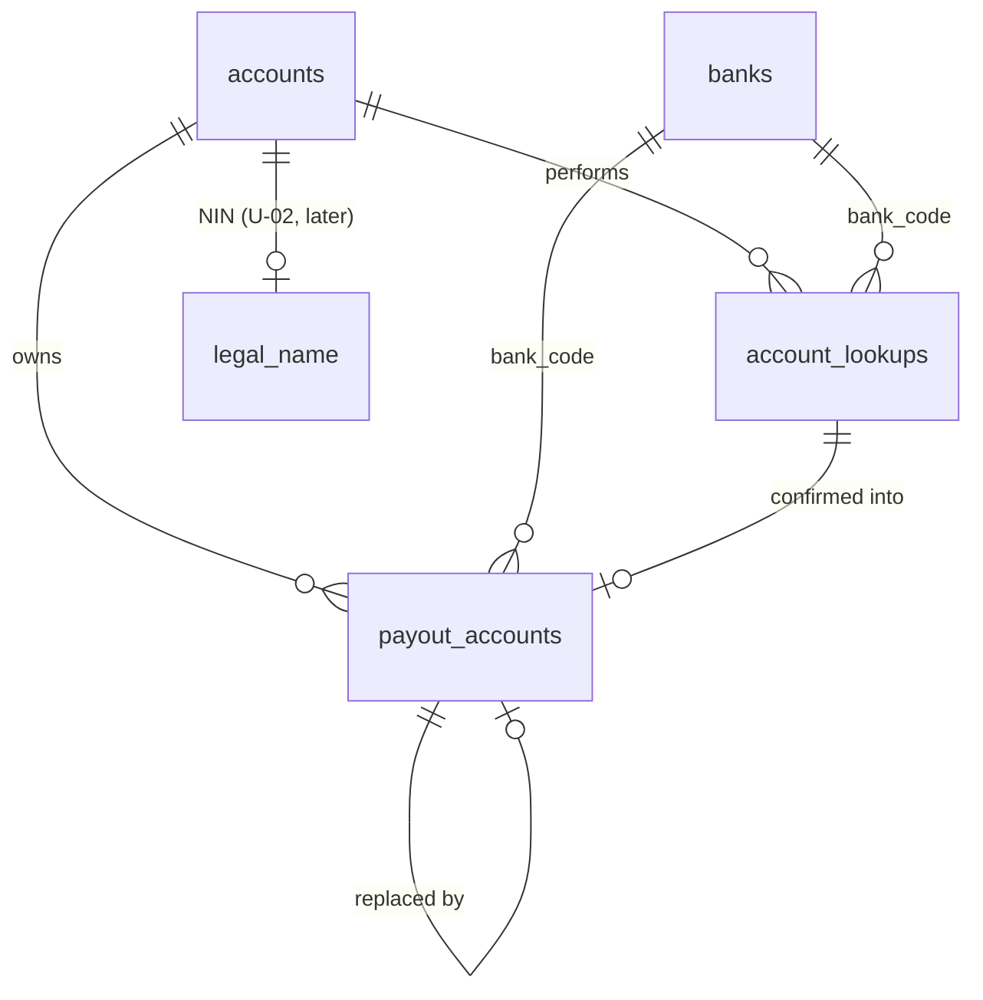
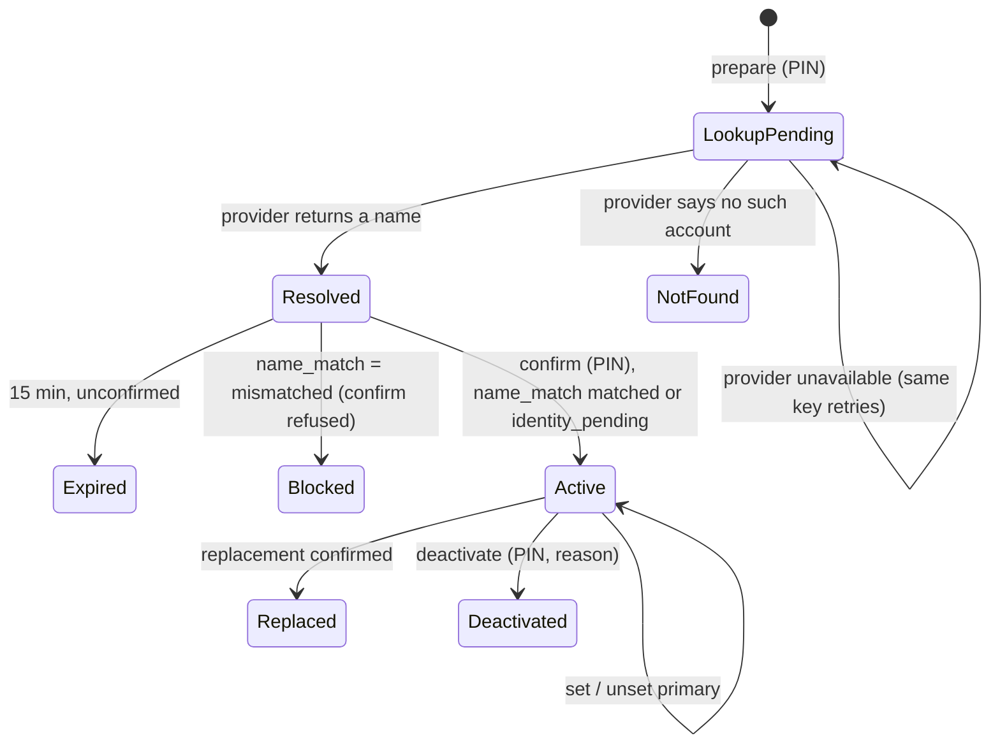

# Blueprint 05 — Payout accounts, bank-name lookup and the NIN name match

Status: **approved by owner 2026-10-08** (decisions Q1–Q11 below; combined-list items 7 and 24–33). Contract: W-17, W-02 step 5, W-09 (input/snapshot only), W-10 step 2 (reveal only), A-01, A-02, A-03 (`manage_own_payout_accounts`), A-05, D-01, F-03, E-03 (boundary only), T-01, T-02, T-03, P-04 (NUBAN adapter), P-06 (email content rule), U-02, W-26 (boundary). Builds on Blueprint 01 (session gate, PIN step-up, idempotency, audit) and Blueprint 02 (workspace, resolver). Track C; migration timestamps `2026100903xxxx`.

Part A is for the owner: what this slice does, in plain language. Part B is the exact build spec that migrations, functions and tests are written from.

---

## Part A — What this slice does

### What's in it
1. **Adding a Nigerian bank account.** A member picks their bank from a list and types their 10-digit account number. After entering their PIN (in onboarding the PIN is set before the bank step, Q7), the app asks the bank network (through Paystack) whose name is on that account and shows it: "This account belongs to ADEBAYO OKAFOR. Is that you?"
2. **Name check against the NIN.** The bank name must match the legal name from the person's NIN check. If it doesn't, saving is blocked with an explanation (W-02). Matching is exact word-for-word, but it allows a different word order, a missing middle name and a middle-name initial (Q1). Leading titles (Mr, Mrs, Dr, Chief, Alhaji…) are ignored. No "close enough" spelling.
3. **Confirming.** The person taps "Yes, save it". The account is saved as verified. A new or replaced account can receive withdrawals 24 hours later; a person's very first account can be used straight away (Q6). Looking up a name is not saving it, and saving it doesn't make it the main (primary) account.
4. **Main account.** A person can keep several accounts and pick one as primary. Withdrawals still ask which account to pay to.
5. **Replacing and removing.** Changing an account number means a new lookup and a new verified account; the old one is kept in history as "replaced". Removing (deactivating) keeps the record too. Both ask for the PIN and a short reason (Q8). Withdrawals already requested keep the account they were requested with.
6. **Hidden numbers.** Account numbers are shown as `•••• 1234` everywhere. Seeing the full number needs the PIN and is recorded. Full numbers never go into emails, logs, analytics or audit entries.
7. **Security email.** Every add, replace, removal or primary change sends the account owner an email ("A payout account was added to your Wallet"). If the email fails, the change still stands.
8. **Bank list.** The list of banks comes from Paystack and is kept for a day, so a Paystack outage doesn't empty the picker.
9. **Limits.** At most 10 name lookups an hour and 30 a day per person, and 5 active accounts (Q9). Two different people may save the same account (Q11).

### Not in it (later slices or still open)
- **NIN verification itself** (provider still undecided, U-02). This slice is built so the NIN check plugs in later; until then accounts are saved as "identity check pending" and can be used (Q4). When the NIN arrives every active account is re-checked automatically; one that fails is blocked and its owner is emailed.
- **Withdrawals** (W-09) and the approver's payout screen (W-10). This slice gives them what they need: "is this account usable?" and the frozen copy of the destination.
- **Foreign or manual accounts** (Q10). Withdrawals are Naira-only, so the pilot needs Nigerian bank accounts only.
- **Automatic payouts** through Paystack stay switched off (W-26). Paystack is used here only to read the account name.

### Owner decisions (2026-10-08)

| # | Question | Owner's answer |
|---|---|---|
| Q1 | How strict is the bank-name vs NIN-name match? | **C.** Same words in any order; a missing middle name or a middle-name initial is accepted; leading titles (Mr, Mrs, Dr, Chief, Alhaji…) are ignored; no spelling tolerance. |
| Q2 | What happens when the names don't match? | **A.** Blocked; the person fixes their bank record or NIN, then tries again. |
| Q3 | Which provider looks up account names? | **A.** Paystack Resolve Account Number plus the Paystack bank list. |
| Q4 | Until NIN verification exists, can people save and use bank accounts? | **B.** Saved as "identity check pending" and usable for withdrawals; re-checked automatically when the NIN lands. |
| Q5 | How is the full account number stored? | **B.** Encrypted by the server with a separate key, plus a one-way fingerprint and the last 4 digits. |
| Q6 | Waiting period after adding or replacing an account? | **B.** 24 hours before a new or replaced account can receive a withdrawal, except a person's very first account. Recorded as a new W-17 rule. |
| Q7 | PIN before the name lookup during onboarding? | **A.** Yes. W-02 onboarding becomes: verify email → accept invitation → set PIN → bank account. |
| Q8 | Reason to replace or remove an account? | **A.** Required, 3–500 characters. |
| Q9 | Limits per person? | **A.** 10 lookups per hour, 30 per day, 5 active accounts. |
| Q10 | Foreign or manually checked accounts? | **A.** Deferred; Nigerian NUBAN accounts only. |
| Q11 | Can two people save the same bank account? | **A.** Allowed. |

---

## Part B — Build spec

### B1. Layout
- New private schema `payout` (bank list cache, payout accounts, lookups, name rule). Same rules as slices 01/02: not exposed via the Data API, RLS on every table with no policies, all functions `search_path = ''`, only `api.*` are `SECURITY DEFINER`, revoked from `public/anon/authenticated`, executable by `service_role` only.
- New Edge Function `payout` (one function, several routes; `verify_jwt = true` in `config.toml`). Same envelope, JWT handling (`user_id`/`session_id` from `getClaims` only), `X-Membership` workspace header and log shape as `org`. Shared `_shared/http.ts` and `_shared/validate.ts`; new shared modules `_shared/name_lookup.ts` (provider adapter) and `_shared/account_crypto.ts` (Q5-B). `GET /payout/banks` is the only route without `X-Membership` (the bank list is not personal).
- Ownership is the **account** (`owner_user_id` → `identity.accounts`). A wallet is 1:1 with an eligible account (D-01), and eligibility is exactly the self-service permission `manage_own_payout_accounts`, resolved in the selected workspace by `authz.require(user, 'manage_own_payout_accounts', workspace.tenant_id, null, user, workspace.id)`. That excludes President-only people (P-03). Every command also calls slice 04's `ledger.require_wallet(actor)` after authorization (`no_wallet` for President-only accounts), and `payout.accounts`/`payout.account_lookups` carry `wallet_id` → `ledger.wallets(id)` (W-17: ownership is the stable account/wallet). The wallet column and calls land in `20261009030400_payout_wallet_and_alerts.sql`, written once slice 04 is on `main`.
- Session gate for every write: `org.require_writer(user, session, p_step_up => true)` (restricted accounts blocked; suspended/deactivated already blocked by the gate). Reads: `identity.require_session(user, session)`.
- Audit: payout accounts are account-level, not tenant-level, so events go to `audit.security_events` via `audit.record(...)` (actions `payout_account.*`). `audit.tenant_events` is not used (its `target_type` check doesn't allow it and the tenant President must not see members' bank changes).

### B2. Data



| Table | Key columns | Rules |
|---|---|---|
| `payout.banks` | `provider` (`paystack`), `code`, `name`, `slug`, `active`, `refreshed_at`; PK (`provider`, `code`) | Cache of the provider's Nigerian NUBAN bank list (`type = nuban`, `active`, not `is_deleted`). Replaced wholesale by `api.refresh_banks` under an advisory lock. Banks that disappear are marked `active = false`, never deleted (existing accounts keep their name). |
| `payout.account_lookups` | `id`, `owner_user_id`, `workspace_membership_id`, `lookup_key` (unique per owner), `request` (jsonb fingerprint), `provider`, `bank_code`, `account_ciphertext`, `key_version`, `account_fingerprint`, `account_last4`, `replaces_payout_account_id`, `status` (`pending`/`resolved`/`not_found`), `resolved_name`, `name_match` (`matched`/`mismatched`/`identity_pending`), `name_rule_version`, `resolved_at`, `created_at`, `expires_at` (= `created_at + 15 min`), `confirmed_payout_account_id`, `confirmed_at` | The W-17 proof. Bound to actor, workspace, bank and account. A trigger (ported from legacy `guard_bank_resolution_intent`) makes identity columns immutable, makes the first provider result final (retries can't swap the name), and blocks delete. Expiry is computed, so an expired unconfirmed proof is terminal without a write. |
| `payout.accounts` | `id`, `owner_user_id`, `country_code` (`NG`), `currency` (`NGN`), `rail` (`bank_transfer`), `provider`, `bank_code`, `bank_name` (copied at confirm), `account_ciphertext`, `key_version`, `account_fingerprint`, `account_last4`, `account_name` (provider-resolved), `verification_status` (`verified`/`pending_verification`), `verification_method` (`nuban_lookup`/`manual`), `lookup_id`, `verified_at`, `name_match`, `name_rule_version`, `name_checked_at`, `is_primary`, `status` (`active`/`replaced`/`deactivated`), `replaces_id`, `replaced_by_id`, `usable_from` (Q6), `deactivated_at`, `deactivated_reason`, `created_at` | Unique: one primary per (`owner_user_id`, `currency`, `rail`) where `is_primary` (W-17); one `active` row per (`owner_user_id`, `bank_code`, `account_fingerprint`). `is_primary` only on `active` + `verified` + `name_match <> 'mismatched'`. Identity, ownership and number columns immutable (trigger); lifecycle columns change only inside `api.*` (transaction-local setting, as legacy). No delete. `pending_verification`/`manual` exist in the type for Q10 but no command creates them in this slice. |

**Account number storage (Q5-B).** The Edge Function receives the 10 digits, calls the provider with them in memory, and sends Postgres only: `account_ciphertext` = AES-256-GCM(`PAYOUT_ACCOUNT_ENC_KEY`, digits, random 12-byte IV, AAD = `owner_user_id`), `key_version`, `account_fingerprint` = hex HMAC-SHA256(`PAYOUT_ACCOUNT_HMAC_KEY`, `bank_code:digits`), `account_last4`. Leading zeros are preserved because the value is a string end to end. Decryption happens only in Edge, only for the owner reveal (B4) and later for the approver reveal / receipt comparison (withdrawals slice). The ciphertext is `base64(iv ‖ ciphertext ‖ tag)`; the AAD is `payout-account:v<key_version>:<owner_user_id>`, so a ciphertext copied to another person's row or relabelled with another key version fails to decrypt.

**Name-match rule (`payout.name_match(legal jsonb, bank_name text) → text`, rule version `nm-1`).** Pure, immutable SQL, so confirm and later re-checks give the same answer.

Normalise each side: Unicode NFKD, drop combining marks, uppercase; delete `.`, `'` and `’`; turn every other non-`A–Z` character (hyphen, comma, slash, digits) into a space; collapse spaces; split into words. On the bank side only (the NIN record is structured), drop leading title words from a fixed list (`MR MRS MS MISS DR CHIEF ALHAJI ALHAJA PASTOR PROF ENGR BARR HRH`).

From the NIN side (shape below): **required** words = every word of the surname + the first word of the given name; **optional** words = every other given/middle-name word.

It matches (Q1-C) when every bank word is used up by a different NIN word, where a bank word equals a NIN word, or is a single letter equal to the first letter of an optional word; all required words are matched in full; and the bank side has at least two words. Counting is by multiset, so a repeated word must appear as often on both sides.

| NIN (given / middle / surname) | Bank name | Q1-C result |
|---|---|---|
| Adebayo / Oluwaseun / Okafor | `OKAFOR ADEBAYO OLUWASEUN` | matched (order) |
| Adebayo / Oluwaseun / Okafor | `Okafor, Adebayo` | matched (middle missing) |
| Adebayo / Oluwaseun / Okafor | `OKAFOR ADEBAYO O.` | matched (middle initial) |
| Adebayo / Oluwaseun / Okafor | `OKAFOR A. OLUWASEUN` | mismatched (first name as initial) |
| Adebayo / Oluwaseun / Okafor | `ADEBAYO OLUWASEUN` | mismatched (no surname) |
| Adebayo / Oluwaseun / Okafor | `ADEBAYO OKAFFOR` | mismatched (spelling; no fuzzy) |
| Adebayo / Oluwaseun / Okafor | `ADEBAYO OKAFOR CHUKWU` | mismatched (extra word) |
| Ngozi / — / Eze | `MRS NGOZI EZE` | matched (title dropped) |
| Ifeoma / — / Nwachukwu-Okeke | `NWACHUKWU OKEKE IFEOMA` | matched (hyphen = space) |
| Ngozi / Adaeze / Okeke | `NGOZI EZE` (married name) | mismatched: blocked, explain |
| Chidi / — / Obi | `OBI CHIDI ENTERPRISES` (business) | mismatched |

This rule is only for bank name vs NIN name. It is **not** the receipt rule: E-03 payout receipts compare recipient name to the snapshot's provider-resolved name with case/whitespace normalisation only.

**NIN plug-in point (U-02).** This slice creates `identity.legal_name(p_user_id uuid) returns jsonb` returning `null` (no verified identity yet). The NIN slice replaces it (`create or replace`, same signature) to return `{ "given": "…", "middle": ["…"], "surname": "…", "verifiedAt": "…" }` from the NIN record, and calls `payout.recheck_name_match(p_user_id)` in the same transaction that locks the legal name. With `legal_name = null`, lookups record `name_match = 'identity_pending'`. Confirmation recomputes the match (the NIN may have landed during the 15-minute proof).

`payout.recheck_name_match(user)`: under the owner lock, recompute `name_match` for every `active` account. Any change to `mismatched` drops `is_primary`, writes `payout_account.name_mismatch` audit and enqueues the owner alert. Nothing is deleted. Returns the number of accounts whose result changed.

### B3. States and eligibility



| What the person sees | Stored as |
|---|---|
| Pending verification | `verification_status = pending_verification` (manual accounts, Q10; not produced in this slice) |
| Verified | `active`, `verified`, `name_match = matched` |
| Verified, identity check pending (usable) | `active`, `verified`, `name_match = identity_pending` (Q4) |
| Name mismatch | lookup result only (save blocked); or an existing account that failed `recheck_name_match` |
| Removed / replaced | `status = deactivated` / `replaced` |

**Withdrawal eligibility**, `payout.eligible_destination(p_owner_user_id, p_payout_account_id) returns payout.accounts` (raises `payout_account_unusable` with `details.reason`): row exists and is owned (else `not_found`), `active` (`inactive`), `verified` (`unverified`), `name_match in ('matched','identity_pending')` (`name_mismatch`, Q4-B), and `now() >= usable_from` (`cooling_off`, with `details.usableFrom`; Q6). Takes the account row `FOR SHARE`. `usable_from` is `created_at` for the owner's very first payout account and `created_at + 24 h` for every later one, including replacements.

**Authority.** Every payout command: session gate (B1) → workspace (`authz.require_workspace`, active tenant via `org.change_workspace`) → `authz.require(actor, 'manage_own_payout_accounts', tenant, null, actor, workspace)` → `ledger.require_wallet(actor)` → for writes, `identity.replay` → state checks → effects. Replays therefore re-check current session, step-up and authority (A-01, F-03). No leader or platform-admin command edits another person's payout accounts (W-17).

**Lock order** (payout): owner advisory lock `payout.owner:<user_id>` → lookup row `FOR UPDATE` → payout account rows `FOR UPDATE`, ordered by `id`. The bank cache uses its own advisory lock `payout.banks` and is never held with the others.

### B4. Commands (`api.*`) and routes (`payout` function)

All writes take `idempotencyKey`. `S` = step-up (PIN within 5 min). `R` = reason (`identity.require_reason`, 3–500). All routes need `X-Membership`.

| Route | Command | Rules |
|---|---|---|
| `GET /payout/banks` | `api.list_banks` · `api.refresh_banks(p_provider, p_banks jsonb)` | Read gate; no workspace. If the newest `refreshed_at` is older than 24 h, Edge fetches the provider list and calls `refresh_banks` (validated rows only), then reads. Provider failure → serve the cache with `stale: true`; empty cache plus failure → `provider_unavailable`. |
| `POST /payout/lookups` | `api.prepare_account_lookup` then `api.record_account_lookup` | S. Body `bankCode`, `accountNumber` (`^[0-9]{10}$`), optional `replacesPayoutAccountId`, `idempotencyKey` (= lookup key). Prepare: bank is active in cache (`bank_unknown`), Q9 limits (10/hour, 30/day) counted from `account_lookups` under the owner lock (`rate_limited` + `retryAfterSeconds`), active-account cap of 5 when not replacing (`conflict`, `details.reason = 'account_limit'`), replacement target owned and `active`, duplicate active account (`payout_account_exists`), same key + different data (`idempotency_conflict`); returns the existing lookup on replay. If it is still `pending` and unexpired, Edge calls the provider, then `record_account_lookup` stores the first result (name bound to the requested number) and computes `name_match` from `identity.legal_name`. Provider down → nothing recorded, `provider_unavailable`; the client retries with the same key. Result: `lookupId`, `bankName`, `accountLast4`, `accountName`, `nameMatch`, `expiresAt`. Never the full number. |
| `POST /payout/accounts` | `api.confirm_payout_account` | S. Body `lookupId`, `confirmed: true`, `reason` (only and always for a replacement), `idempotencyKey`. Locks: lookup must be the actor's, `resolved`, unexpired (`payout_lookup_expired`), not `mismatched` (`payout_name_mismatch`, `details.explanation = 'bank_name_does_not_match_nin'`), not already confirmed under another key (`conflict`). Creates the `verified` account (`usable_from` per Q6). With `replaces_payout_account_id`: old → `replaced` (requires `reason`, Q8), `replaced_by_id` set, primary carried over to the new verified account. Never sets primary otherwise. Audit + outbox. Same-key replay after expiry returns the stored result (after re-authorization). |
| `GET /payout/accounts` | `api.list_payout_accounts` | Read gate. Own accounts, masked (`•••• 1234`), with `bankName`, `accountName`, `status`, `verificationStatus`, `nameMatch`, `isPrimary`, `usableFrom`, `replacedById`, `createdAt`. Ordered primary first, then `created_at desc, id`. |
| `POST /payout/accounts/{id}/primary` | `api.set_primary_payout_account` | S. Account `active`, `verified`, not `mismatched`. Clears the old primary in the same transaction. |
| `POST /payout/accounts/{id}/deactivate` | `api.deactivate_payout_account` | S · R (Q8). `active` → `deactivated`, `is_primary = false`. No automatic new primary. Open withdrawals keep their snapshot. |
| `POST /payout/accounts/{id}/reveal` | `api.reveal_payout_account` | S. Owner only. Writes `payout_account.revealed` audit **before** returning `{ ciphertext, keyVersion }`; Edge decrypts and returns the 10 digits with `cache-control: no-store`. POST so the number is never in a URL or cache. Not idempotent (a read). |

Replacement is two calls: `POST /payout/lookups` with `replacesPayoutAccountId`, then `POST /payout/accounts` with `reason`.

**Audit** (`audit.record`, `safe_after` only ever holds `payoutAccountId`, `bankCode`, `last4`, `status`, `nameMatch`, `isPrimary`): `payout_account.lookup` (outcome only, no name), `.added`, `.replaced`, `.deactivated`, `.primary_changed`, `.revealed`, `.name_mismatch`.

**Notifications** (T-03): `.added`, `.replaced`, `.deactivated`, `.primary_changed`, `.name_mismatch` enqueue an owner email in the same transaction through slice 03's `outbox.enqueue_email` (interface below), template `payout_account.alert` v1 (`duplicate_safe`: a second copy of an alert is harmless), params `action`, `bankName`, `at`, and **no account digits, not even the last 4** (P-06: bank/account numbers stay in Wallet). Delivery failure never rolls back the change. All enqueues go through one internal helper, `payout.alert_owner(account, action)`.

#### Provider adapter (`_shared/name_lookup.ts`)

```ts
export interface Bank { readonly code: string; readonly name: string; readonly slug: string }
export type LookupOutcome =
  | { readonly kind: "resolved"; readonly accountName: string }
  | { readonly kind: "not_found" }
  | { readonly kind: "unavailable"; readonly retryAfterSeconds?: number };
export interface NameLookupProvider {
  readonly id: "paystack" | "fake";
  listBanks(signal: AbortSignal): Promise<readonly Bank[]>;
  resolve(bankCode: string, accountNumber: string, signal: AbortSignal): Promise<LookupOutcome>;
}
export function paystackProvider(secretKey: string, fetcher?: typeof fetch): NameLookupProvider;
export function fakeProvider(fixtures: FakeFixtures): NameLookupProvider; // tests only
```

- **Paystack (real).** Fixed origin `https://api.paystack.co`; `GET /bank/resolve?account_number=…&bank_code=…` and `GET /bank?country=nigeria&currency=NGN&type=nuban&perPage=100&use_cursor=true` (follow `meta.next`, at most 10 pages). Secret only in `Authorization: Bearer`. This fixes the legacy bug of putting the key in the URL path. Each call: 10 s timeout, `redirect: "error"`, 256 KB body cap, strict parse. Resolve is accepted only if `status === true` and `data.account_number` equals the requested number (legacy "bound to requested identifiers" rule, ported). `account_name`: 1–160 characters, no control characters. HTTP 400/422 with `status:false` → `not_found`. 429 → `unavailable` with `x-ratelimit-reset`. 5xx, timeout or malformed → `unavailable`. Bodies, keys and numbers never reach errors or logs.
- **Fake (tests).** Injected through `Deps` the same way `pinHmac` is injected in `security`. Fixtures map `bankCode:accountNumber` to a name or to `not_found`, `unavailable`, `rate_limited` or `malformed`. `index.ts` always constructs the real provider; there is no env switch that could enable the fake in production.
- **Comparison** (checked 2026-10-08; recheck prices and terms at provisioning):

| Provider | Lookup | Cost / limits | Notes |
|---|---|---|---|
| Paystack | `GET /bank/resolve` + `GET /bank` | Documented as free; live 1,500 req/60 s for resolve, test mode 100 req/60 s standard limit | Already selected (P-04 billing). Same name for the same bank+number, so caching is safe. Test-mode resolve behaviour is not documented; plan synthetic fixtures + the fake. |
| Flutterwave | `POST /v3/accounts/resolve` + bank list | Not verified | Second supplier and secret. |
| Monnify | account validation + bank list | Not verified | Second supplier and secret. |
| nuban.com.ng (legacy) | key in URL path | Not verified | Rejected: puts the secret in the URL, less established. |

- **Caching.** Bank list: DB cache, 24 h freshness, stale-on-failure. Name lookups are not cached across people; a same-key retry reuses its own stored result, and the Q9 limits cap provider use.

**Secrets** (Supabase Edge Function secrets, set by the owner; `.env.example` lists empty placeholders; never in Git, the database, responses or logs):
```
PAYSTACK_SECRET_KEY=
PAYOUT_ACCOUNT_ENC_KEY=
PAYOUT_ACCOUNT_HMAC_KEY=
```
`PAYSTACK_SECRET_KEY` is supplied by the owner and is the same key the billing slice will use (Paystack issues one secret per integration). When it is missing, `index.ts` builds no provider and lookups and bank refreshes return `provider_unavailable` (503); cached banks and every other route keep working. The two account keys are generated by the orchestrator: each is 32 random bytes as 64 hex characters (`openssl rand -hex 32`), validated at start-up like `PIN_HMAC_SECRET` (the function refuses to start without them). Never reuse one key for both purposes, and never reuse `PIN_HMAC_SECRET`.

**Rotation.** `PAYOUT_ACCOUNT_ENC_KEY` is key version 1. To rotate later, add the new key as version 2 (the adapter accepts a version → key map), write new rows with version 2, re-encrypt old rows in a one-off job, then drop version 1. `PAYOUT_ACCOUNT_HMAC_KEY` cannot rotate without recomputing every fingerprint from decrypted numbers; treat it as long-lived and rotate only through that job.

### B5. Wire contract
Same envelope and codes as Blueprints 01/02. New codes (added to `_shared/http.ts`):

| Code | HTTP | When |
|---|---|---|
| `bank_unknown` | 422 | Bank code not in the active cached list |
| `account_not_found` | 422 | Provider says there is no such account at that bank |
| `provider_unavailable` | 503 | Provider down, rate-limited or malformed; **retryable** (extend the `retryable` rule in `failure()`) |
| `payout_lookup_expired` | 409 | Proof older than 15 minutes and unconfirmed |
| `payout_name_mismatch` | 422 | Bank name doesn't match the NIN legal name; `details.explanation` |
| `payout_account_exists` | 409 | Same bank + number already active for this person |
| `payout_account_unusable` | 409 | Withdrawal eligibility failed; `details.reason` in `inactive`/`unverified`/`name_mismatch`/`cooling_off` (used by the withdrawals slice) |

Reused: `validation_error`, `step_up_required`, `authorization_denied`, `workspace_invalid`, `not_found`, `idempotency_conflict`, `conflict`, `rate_limited` (Q9), and slice 04's `no_wallet`. Logs keep the slice 01 shape: no account numbers, last 4, names, bank codes, ciphertext or fingerprints.

### B6. Tests (written first; all must pass in CI)
pgTAP (files `050_`–`059_`, reserved for Track C so test file names never collide):
1. `050_payout_name_match.sql`: every example row in B2 plus Unicode (`Ọlá` = `OLA`), punctuation, empty/one-word bank names, a `null` legal name giving `identity_pending`; deterministic for repeated calls.
2. `051_payout_lookups.sql`: no step-up → `step_up_required`; President-only workspace → `authorization_denied`; unknown bank → `bank_unknown`; same key + same data returns the same lookup without new rows; same key + different number → `idempotency_conflict`; first recorded name is final; Q9 limits → `rate_limited`; account cap.
3. `052_payout_confirm.sql`: confirm creates a `verified` account, not primary; expired proof (15:01) → `payout_lookup_expired`; `mismatched` → `payout_name_mismatch`; another person's lookup → `not_found`; two concurrent confirms of one lookup create one account; same-key replay after expiry returns the stored result; replay after losing the permission (membership ended) → `authorization_denied`; duplicate active account → `payout_account_exists`.
4. `053_payout_lifecycle.sql`: one primary per currency/rail; primary on unverified/mismatched refused; replace keeps the old row as `replaced`, carries primary, needs a reason; deactivate needs a reason, keeps the row, clears primary; no command edits another owner's account; account rows can't be deleted; identity columns can't be updated.
5. `054_payout_eligibility.sql`: `eligible_destination` for each state (Q4-B: `identity_pending` usable; Q6: first account immediate, later ones after 24 h); `recheck_name_match` with a stub `identity.legal_name` turns a non-matching account `mismatched`, drops primary, writes audit and an outbox row; a snapshot copied before deactivation is unchanged afterwards (fixture stands in for the withdrawals table).
6a. `056_payout_wallet_and_alerts.sql`: wallet link set and immutable; one alert per change (none for lookups), owner recipient, params exactly `action`/`bankName`/`at`, no digits in any payload.
6. `055_payout_privileges.sql`: `anon`/`authenticated` can't use `payout` or execute `api.*` payout functions; RLS on every `payout` table; only `api.*` are definer; empty `search_path` everywhere; no audit row or outbox payload contains a 10-digit run.

Deno (`backend/tests/`):
7. `payout_handler_test.ts`: route validation, unknown fields rejected, `X-Membership` required, actor only from the JWT, envelope and code mapping, `provider_unavailable` is retryable, lookup flow with the fake (resolved / not_found / unavailable then same-key retry), the full number never appears in any response except `reveal` or in any log entry.
8. `name_lookup_test.ts` (Paystack is never called in tests): Paystack adapter against a fake `fetch`: key only in the header (never in the URL), mismatched `account_number` rejected, 422 → `not_found`, 429 → `unavailable` with `retryAfterSeconds`, timeout, oversize body, malformed JSON, bank-list paging and filtering (`active`, not `is_deleted`).
9. `account_crypto_test.ts`: AES-GCM round trip, AAD binds the owner, wrong key fails, leading zeros preserved, fingerprint stable per key and different across keys.

### B7. Planned files

Migrations (reserved range `2026100903xxxx`):
- `20261009030100_payout_schema.sql`: schema `payout`, enums, `banks`, `account_lookups`, `accounts`, guard triggers, RLS, indexes.
- `20261009030200_payout_name_match.sql`: normaliser, `payout.name_match`, `identity.legal_name` stub, `payout.recheck_name_match`, `payout.eligible_destination`.
- `20261009030300_payout_commands.sql`: all `api.*` in B4, grants to `service_role` only.
- `20261009030400_payout_wallet_and_alerts.sql`: `wallet_id` on proofs and accounts (set by a trigger from `ledger.require_wallet`, must equal the owner's wallet, never changes), `ledger.require_wallet` in the shared command gate, the `payout_account.alert` template row and `payout.alert_owner` through `outbox.enqueue_email`; the renderer in `_shared/email/templates.ts` (the worker passes `APP_ORIGIN` for the "Open Wallet" button; no reference row).

Functions: `backend/supabase/functions/payout/{deno.json,index.ts,handler.ts}`, `_shared/name_lookup.ts`, `_shared/account_crypto.ts`; edits to `_shared/http.ts` (new codes, retryable rule) and `config.toml` (`[functions.payout] verify_jwt = true`); `.env.example` placeholders; CI deno check list if it enumerates functions.

### Cross-track interfaces

**From slice 03 (invitations and email, `2026100901xxxx`). What this slice calls:**
```sql
outbox.enqueue_email(
  p_template text,            -- 'payout_account.alert'
  p_dedupe_key text,          -- 'payout_account:<account id>:<action>:<transaction id>'
  p_aggregate_type text,      -- 'payout_account'
  p_aggregate_id uuid,        -- the payout account
  p_tenant_id uuid,           -- null (payout accounts are account-level)
  p_recipient_user_id uuid,   -- the owner; the worker resolves the email at send time
  p_recipient_email text,     -- null
  p_params jsonb              -- { action, bankName, at } and no account digits
) returns uuid
```
Called inside the business transaction. This slice adds the template row (key `payout_account.alert`, version 1, `duplicate_safe = true`, params `action`, `bankName`, `at`) in its own migration and its renderer in `_shared/email/templates.ts`. Subject per action, e.g. "A payout account was added to your Wallet"; body: bank name, what changed, when, and "If this wasn't you, reset your PIN and contact support"; P-06 layout, no digits.

**From slice 04 (wallets and ledger, `2026100902xxxx`):** `ledger.require_wallet(p_user_id uuid) returns uuid` (raises `no_wallet`) on every command; `ledger.wallet_for(p_user_id)` where a null is acceptable. Payout accounts post no money; the ledger never reads `payout.accounts`.

**To the withdrawals slice (W-09/W-10):**
- `payout.eligible_destination(owner, accountId)`, called under the withdrawal's lock order **before** ledger/reservation locks (agreed with slice 04: `payout account FOR SHARE → ledger segments`).
- The snapshot copies `bank_code`, `bank_name`, `account_ciphertext`, `key_version`, `account_fingerprint`, `account_last4`, `account_name`, `verification_method`, `name_match`, `country_code`, `currency`, `rail`, plus `source_payout_account_id`. Later account changes never touch it (W-17).
- Approver reveal (W-10 step 2) and E-03 "full destination account" comparison decrypt the snapshot in Edge with `PAYOUT_ACCOUNT_ENC_KEY` (AAD = owner). E-03 compares the receipt recipient name to the snapshot's `account_name` with **case/whitespace normalisation only**, never `payout.name_match`.
- Admin search by bank account (W-23) uses `account_fingerprint`.

**From the NIN slice (U-02):** replace `identity.legal_name(uuid)` and call `payout.recheck_name_match(uuid)` when a legal name is locked.

### Legacy reference: ported and fixed
Ported from `legacy-backend` (`20261003161759_nuban_bank_resolution.sql`, `src/integrations/nuban.ts`): the 15-minute proof bound to actor/context/bank/account; the first provider result is final; the provider answer must echo the requested bank+number; bounded fetch (timeout, size cap, no redirects); keep replaced/deactivated rows; `replaced_by` links.

Legacy bugs fixed:
1. **Secret in the URL.** `resolveNubanAccount` put `NUBAN_API_KEY` in the URL path (`app.nuban.com.ng/api/<key>`), which leaks through proxy/CDN/access logs. Here the secret goes only in the `Authorization` header.
2. **Replay before re-authorization.** `deactivate_payout_account`, `replace_payout_account` and `set_primary_payout_account` returned stored results before checking authority (A-01/F-03). Here every replay runs after gate, workspace and `authz.require`.
3. **Unverified replacement became primary.** `replace_payout_account` created a `pending` account from a **client-typed holder name** and moved primary onto it. Here replacement is only through a provider lookup, and primary moves only to a verified account.
4. **Workspace ignored.** Legacy picked "the first non-President membership" (`order by is_primary desc, id limit 1`) instead of the selected workspace. Here the `X-Membership` workspace goes through `authz.require_workspace`.
5. **Full number returned from SQL.** `prepare_bank_resolution` returned `accountNumber` and relied on Edge to strip it. Here SQL never returns it outside `reveal`.
6. **No reason on deactivate/replace**, and plaintext storage. Here reasons are per Q8 and storage per Q5.

### Contract conflicts and gaps found
1. **W-02 step order vs W-17/Blueprint 01 (Q7).** W-02 puts the bank account (step 5) before the PIN (step 6), but W-17 requires step-up before the lookup, and the Blueprint 01 gate already makes everyone set a PIN at first sign-in. Resolved by the owner (Q7, combined item 7): W-02 becomes verify email → accept invitation → set PIN → bank account. The W-02 text itself is updated by the contract track, not this slice.
2. **W-02 step 5 vs W-17 "do not enforce legacy profile-name matching".** These are compatible only if "verified NIN name" ≠ "profile name". This blueprint matches against the locked NIN legal name only, never `identity.profiles`. Please confirm, and W-17 could say so explicitly.
3. **The name-match rule is unspecified** (W-02 says "must match"; E-03's case/whitespace-only rule is for receipts). Q1 sets it.
4. **NIN dependency (U-02).** W-02 step 5 can't be enforced until a NIN provider exists. Resolved (Q4-B): saved as identity check pending and usable, re-checked when the NIN lands.
5. **W-17 manual destinations:** "pending until approved verification", but no approving actor is defined. Deferred (Q10-A).
6. **No cooling-off in the contract.** A-05 requires step-up and W-17 requires alerts. Adopted (Q6-B); the contract track records it as a new W-17 rule.
7. **P-06 email rule vs W-17 alerts.** Alerts must not include account digits. Resolved here by sending the bank name only.
